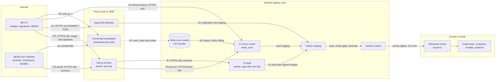

# Compare the supply paths
{: .no_toc }

One diagram shows all paths and the trust boundaries they cross. The table
below compares them. The ranking at the end assumes a site that already runs
Nexus proxies.

1. TOC
{:toc}

---

## All paths in one diagram

Solid arrows are online transfers. The dotted arrow is the physical transfer of
path A3. Path B starts from the release archives, not from images.

Where checks happen:

- **Signature verification** runs in the mirror script (`mirror-images.sh`) at
  the source and again at the destination, in `unpack.sh` and
  `fetch-release.sh` for archives (Path B), and in the cluster (Kyverno, or the
  Ansible role at the mirror).
- **Vulnerability scanning** runs in the CI scan stage (Trivy) on staging, and
  in Harbor on push.

## Comparison table

The ratings are our assessment of the tested tooling, not a measurement.

| Path | Automation | Security | Egress needed | Keeps upstream signatures | Ops effort | Best for |
|---|---|---|---|---|---|---|
| P0 Nexus proxies | High: scheduled job, merge request | High: identity-pinned verification at source and destination; Nexus is a cache, not a trust anchor | none new | yes | Low to medium | Sites with Nexus proxies |
| A1 Harbor egress exception | Medium to high: replication or proxy cache, then a promote step | Medium: opens one egress path; needs the allowlist proxy and firewall | Harbor to `ghcr.io` and `pkg-containers.githubusercontent.com` | through the promotion step only | Medium | Harbor-only sites |
| A2 CI mirror job | High: scheduled, idempotent | High | runner to image source and release files | yes | Medium | GitLab sites without Nexus |
| A3 Fully offline | Low: manual per release | Highest: no inbound path; verified offline on both sides | none | yes, verified offline | High per release | Zero-egress sites |
| B Build from archives | High after setup | High if you trust your build and key; changes what you verify | release files only | no: new digests, your signature | Highest | In-house build policies |
| Mixed | as the parts | as the parts | as the parts | as the parts | Medium | Images and archives on different routes |

## Ranking for a site with Nexus proxies

1. **P0.** No new egress, the most automated path with the CI mirror job, our
   signatures stay intact.
2. **A2** for sites without a Nexus proxy: the same job, reading `ghcr.io`
   through a narrow egress on the runner.
3. **A3** when the site must have zero egress.
4. **A1** only when a Harbor egress exception is acceptable.
5. **B** only when policy requires in-house builds.

## Related

- [Path P0](path-nexus-proxy.md), [A1](path-harbor-egress.md),
  [A2](path-ci-mirror.md), [A3](path-offline.md),
  [B](path-build-from-archives.md), [Mixed](path-mixed.md)
- [Overview and decision guide](index.md)
