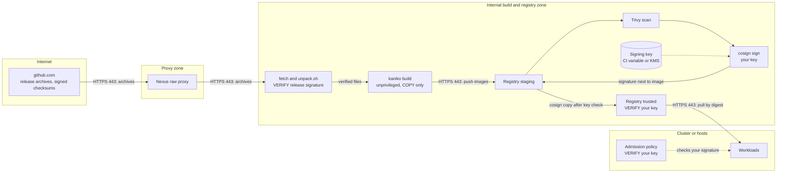
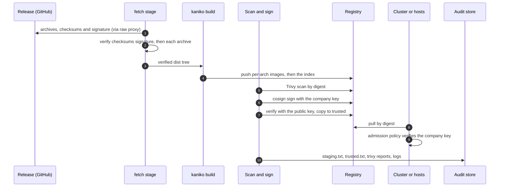

# Path B: build the images from the released archives
{: .no_toc }

Use this path when your policy requires images built in-house, but you do not
build from source. The kit's Dockerfiles only **copy** the released, signed
archives onto a pinned base image. A GitLab pipeline verifies the archives,
builds the images with kaniko, scans them, signs them with **your** key and
promotes them.

{: .important }
Rebuilt images get **new digests** and do **not** carry our signatures. What you
can verify is that they were built from archives the release signed (the fetch
stage), and afterwards your own signature (the sign stage). Enforce your key in
the cluster.

**Verdict:** automation high after setup, security high if you trust your build
and your key (it changes what you verify), operations effort highest.

1. TOC
{:toc}

---

## Prerequisites

- GitLab with an **unprivileged** runner (no privileged mode, no Docker
  socket).
- The tools image
  ([`Dockerfile.ci-tools`](https://github.com/openctemio/openctem/blob/main/deploy/airgap/gitlab/Dockerfile.ci-tools),
  see [Path A2](path-ci-mirror.md#prerequisites)).
- A kaniko executor image (the `:debug` variant, it has a shell) in your
  registry, pinned by digest.
- Base images in your registry, pinned by digest (see the table below).
- Release files through a Nexus raw proxy of `github.com` (or the release
  page).
- A cosign key pair, or a KMS key (`hashivault://`, `awskms://`, `gcpkms://`).

## The image kit

The release's `openctem-image-kit-<version>.tar.gz` unpacks to
`openctem-image-kit-<version>/`. Under it, `image-kit/` holds:

| Path | Purpose |
|---|---|
| `unpack.sh` | Verifies the release archives and unpacks them under `dist/<arch>/<component>/` |
| `Dockerfile.api`, `.migrations`, `.seed`, `.gateway`, `.web`, `.console` | One Dockerfile per image. COPY only, no `RUN` step |
| `rootfs/` | `etc/passwd` and `etc/group` files for the users, and an empty directory used to create writable paths with the right owner |
| `links/` | The links of the API image's operator commands |

`unpack.sh <assets-dir> <version> [--arches "amd64 arm64"] [--trusted-root FILE]`
does two checks and unpacks nothing unless both pass:

1. `checksums-sha256.txt` carries a valid Sigstore signature from the Release
   workflow at the tag (`release.yml@refs/tags/<version>`);
2. every archive it uses matches its line in `checksums-sha256.txt`.

It refuses an existing `dist/` directory, so remove it before a second run.
The archives it needs per architecture are the server, gateway, web and console
archives (`openctem-<component>-<version>-linux-<arch>.tar.gz`).

Because the Dockerfiles have no `RUN` step, they build unprivileged and for
`arm64` on `amd64` runners without emulation.

## The Dockerfiles

All files declare `ARG BASE_IMAGE`; point it at your registry's copy, pinned by
digest. The label `org.opencontainers.image.title` says "rebuilt from release
`<version>`" so a rebuilt image is never mistaken for an official one.

| Image | Base | User | Ports | Entrypoint and notes |
|---|---|---|---|---|
| `openctem-api` | distroless static (Debian 13), nonroot | 1000:1000 (signer 1001 exists in `/etc/passwd`) | 8080, 9443 | `/app/server`; healthcheck `/app/server -healthcheck`; copies the server binaries, links, OpenAPI file, `migrations/` and `configs/`; creates the writable paths `/app/data/attachments`, `/var/lib/openctem-signer/{keys,state}` (0700), `/run/openctem-signer` (0770) and `/var/lib/openctem-signer-pub` |
| `migrations` | alpine 3.24 | 65532 | none | `/usr/local/bin/openctem-migrate`; copies `openctem-migrate` and `migrations/` |
| `seed` | postgres 18 alpine | 65532 | none | the seed SQL files at `/seed`; empty entrypoint; default command lists the files |
| `openctem-gateway` | alpine 3.24 | 1000:1000 | 80, 443, 443/udp, 2019 | Caddy with the layer4 module at `/usr/bin/caddy`; Compose mounts the gateway configuration at `/etc/caddy`; healthcheck on the admin endpoint `http://127.0.0.1:2019/config/` |
| `openctem-web` | distroless Node.js (glibc), nonroot | 1001:1001 | 3000 | `/nodejs/bin/node server-with-ws.mjs`; the Next.js cache is the only writable path; healthcheck on `/api/health` |
| `openctem-console` | distroless Node.js (glibc), nonroot | 1001:1001 | 3000 | `/nodejs/bin/node console/server.js`; same pattern as web |

The web and console images use a **glibc** Node.js base, because the archives'
native modules (sharp) are built for glibc. The Node.js major of the base must
match the archive's `NODE_VERSION` file.

## CI variables

Set these in the pipeline project (protected, masked where secret). The
template is
[`gitlab/.gitlab-ci.build.yml`](https://github.com/openctemio/openctem/blob/main/deploy/airgap/gitlab/.gitlab-ci.build.yml).

| Variable | Meaning |
|---|---|
| `OPENCTEM_VERSION` | Release to build, for example `vX.Y.Z`. The pipeline starts only when it is set |
| `TOOLS_IMAGE` | `bash`, `curl`, `jq`, `tar`, `cosign`, `crane`, `trivy` |
| `KANIKO_IMAGE` | A kaniko executor image (`:debug`), from your registry, pinned by digest |
| `RELEASES_BASE_URL` | Release assets, your Nexus raw proxy of `github.com` |
| `BASE_REGISTRY_PREFIX` | Where your registry serves the base images, for example `harbor.example.internal/dockerhub-proxy` (the `gcr.io/distroless/...` and `docker.io/library/...` paths below it) |
| `DEST_STAGING`, `DEST_TRUSTED`, `REGISTRY_HOST`, `REGISTRY_USER`, `REGISTRY_PASSWORD` | Your registry and robot account |
| `COSIGN_PRIVATE_KEY` (masked file), `COSIGN_PASSWORD` (masked) | Your signing key, or `COSIGN_KEY_REF=hashivault://...`, `awskms://...`, `gcpkms://...` |
| `COSIGN_PUBLIC_KEY` (file) | The matching public key, checked before promotion |
| `TRIVY_DB_REPOSITORY`, `TRIVY_JAVA_DB_REPOSITORY`, `TRIVY_SEVERITY` | Trivy settings |

## Stages

```text
fetch -> build -> index -> scan -> sign -> promote
```

| Stage | What it does |
|---|---|
| `fetch` | Downloads the kit and the five archives for `amd64` and `arm64` with `fetch-release.sh`, which verifies the signed checksums first. Unpacks the kit and runs `unpack.sh` |
| `build` | kaniko, one job per image and architecture (7 images, 2 architectures). `--custom-platform linux/<arch>`, `--reproducible`, `--single-snapshot`. Pushes `<name>:<version>-<arch>` to staging and records its digest |
| `index` | `crane index append`: one multi-arch index per image at `<name>:<version>` in staging. Output `staging.txt` (`name ref digest`) |
| `scan` | `scan-images.sh`: Trivy by digest, reports `trivy-<name>.json` |
| `sign` | `cosign sign --yes --tlog-upload=false --key ... -a openctem.release=<version>` on every digest. `--tlog-upload=false` is for sites with no access to the transparency log |
| `promote` | Verifies each image against `COSIGN_PUBLIC_KEY` (`--insecure-ignore-tlog=true`), then `cosign copy --force` into trusted. Output `trusted.txt` |

## Enforce your key in the cluster

Use the [Kyverno template](reference.md#kyverno-policy) with a `keys:`
attestor holding your public key instead of the `keyless:` attestor. The
template's `keyless` identity matches only our release workflow, so rebuilt
images fail it by design. Test the policy against a built image with the
Kyverno CLI before you enforce it.

## Trust boundaries



## Rollback

Keep the previous release's digests in the trusted project. Re-point the
deployment at them. A rebuild of the same release produces new digests (the
base images and your tooling may differ), so rollback uses the digests you
already hold, not a rebuild.

## Sequence



## Security recommendations

**Must**

- Verify the archives before building. Never build from files that did not pass
  `unpack.sh`.
- Sign with a key only the pipeline can use, and enforce **that** key in the
  cluster.
- Pin base images and the kaniko image by digest, from your registry.
- Keep the runner unprivileged.
- Pin deployments by digest.

**Should**

- Keep the signing key in a KMS or Vault instead of a CI variable.
- Rotate the key on a schedule and keep the old public key for rollback.
- Compare the built image's content with the archive (the Dockerfiles only
  copy, so the layers are small and reviewable).

**Could**

- Build twice on separate runners and compare the digests (`--reproducible` is
  on).
- Add a second approval before the promote stage.

**Residual risks**

- Rebuilt images lose our SLSA provenance and SBOM attestations. Keep the
  archives' `*.spdx.json` SBOMs and the signed checksum file as evidence.
- The base images are your supply chain now. Scan and update them.
- The signing key becomes a high-value secret.

## Related

[Path A2](path-ci-mirror.md), [Reference: images](reference.md#images),
[Troubleshooting](troubleshooting.md)
