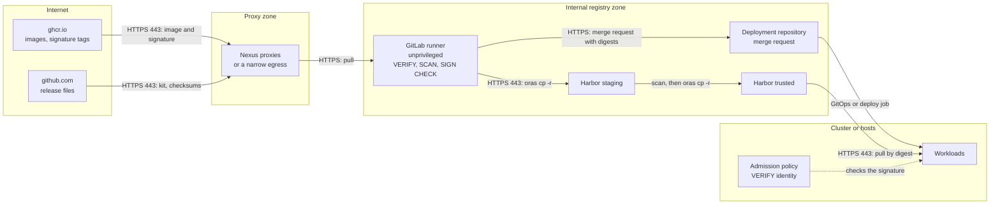
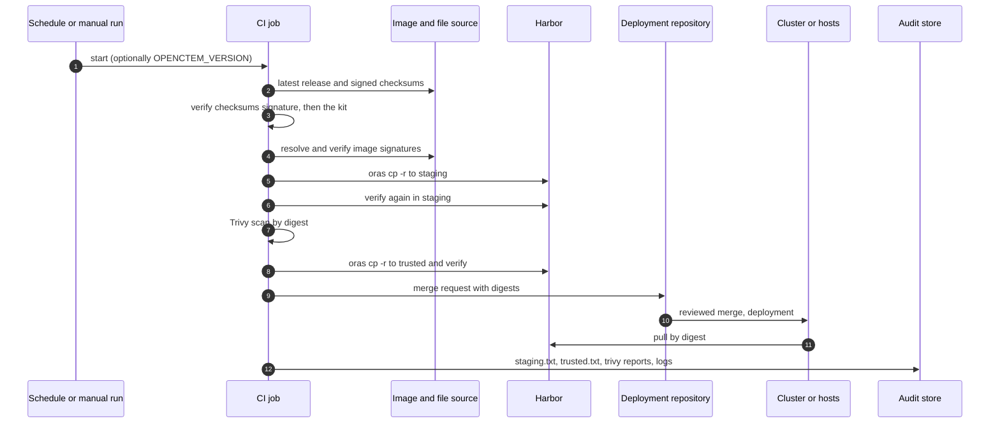

# Path A2: CI mirror job
{: .no_toc }

A scheduled GitLab CI pipeline discovers each new release, mirrors it into
Harbor staging with its signatures, scans it, promotes it into the trusted
project and opens a merge request that pins the new digests in your deployment
repository. It runs on an unprivileged runner and needs only narrow egress.

The same job is the promotion step of [Path P0](path-nexus-proxy.md) and
[Path A1](path-harbor-egress.md). Path A2 on its own means the runner reads
`ghcr.io` and the release files itself, through the narrow egress it has.

**Verdict:** automation high (scheduled, idempotent, merge request), security
high, operations effort medium.

1. TOC
{:toc}

---

## Prerequisites

- A GitLab project for the pipeline (for example `platform/openctem-intake`).
- An **unprivileged** runner: Kubernetes or Docker executor, no privileged
  mode, no Docker socket.
- Runner egress, nothing else: the image source (your Nexus Docker proxy of
  `ghcr.io`, or `ghcr.io` and `pkg-containers.githubusercontent.com`), the
  release assets (your Nexus raw proxy of `github.com`, or `github.com` and
  `release-assets.githubusercontent.com`), and your registry.
- The tools image from
  [`gitlab/Dockerfile.ci-tools`](https://github.com/openctemio/openctem/blob/main/deploy/airgap/gitlab/Dockerfile.ci-tools):
  `bash`, `curl`, `jq`, `git`, `oras`, `cosign`, `crane`, `trivy`. Every
  download in it is checked against a sha256. Build it once per tool upgrade
  and push it to your registry:

  ```bash
  docker build -f Dockerfile.ci-tools \
    --build-arg GITHUB=https://nexus.example.internal/repository/github-all \
    -t harbor.example.internal/ci/openctem-tools:1 .
  ```

  Inside an air gap, `apk add` needs your Alpine package proxy: add
  `--build-arg ALPINE_MIRROR=https://nexus.example.internal/repository/alpine`.
  Bump a tool version only together with its checksum from the tool's release
  page.
- Harbor projects and a robot account as in
  [Path A1](path-harbor-egress.md#harbor-projects-and-policies).

## Set up

1. Create the project. Copy
   [`gitlab/.gitlab-ci.mirror.yml`](https://github.com/openctemio/openctem/blob/main/deploy/airgap/gitlab/.gitlab-ci.mirror.yml)
   to `.gitlab-ci.yml`, and the four helper scripts of
   [`gitlab/scripts/`](https://github.com/openctemio/openctem/tree/main/deploy/airgap/gitlab/scripts)
   (`discover-release.sh`, `fetch-release.sh`, `scan-images.sh`,
   `bump-deployment.sh`) to `scripts/` in the same project. The pipeline takes
   its other scripts (`mirror-images.sh`) from the release's own image kit,
   after checking it against the release's signed checksums.
2. Set the variables below (Settings, CI/CD, Variables). Make them protected,
   and masked where they are secrets.
3. Add a schedule (CI/CD, Schedules), for example daily.

## CI/CD variables

| Variable | Meaning |
|---|---|
| `TOOLS_IMAGE` | The tools image, from your registry |
| `OPENCTEM_SOURCE_PREFIX` | Where release images are read: `nexus.example.internal:8443/openctemio` (Nexus proxy of ghcr.io) or `ghcr.io/openctemio` |
| `RELEASES_BASE_URL` | Release assets, for example `https://nexus.example.internal/repository/github-openctemio/openctem/releases/download` |
| `RELEASE_API_URL` | "Latest release" JSON with `tag_name`, for example `https://nexus.example.internal/repository/github-api/repos/openctemio/openctem/releases/latest` |
| `DEST_STAGING` | For example `harbor.example.internal/openctem-staging` |
| `DEST_TRUSTED` | For example `harbor.example.internal/openctem-trusted` |
| `REGISTRY_HOST` | For example `harbor.example.internal` |
| `REGISTRY_USER`, `REGISTRY_PASSWORD` (masked) | Robot account: push to staging and trusted, pull from them, nothing else |
| `SOURCE_REGISTRY_HOST`, `SOURCE_REGISTRY_USER`, `SOURCE_REGISTRY_PASSWORD` (masked, optional) | Read-only account of the image source, when it needs one |
| `COSIGN_TRUSTED_ROOT` (optional file variable) | The Sigstore `trusted_root.json`, to verify without reaching Sigstore |
| `TRIVY_DB_REPOSITORY`, `TRIVY_JAVA_DB_REPOSITORY` | Your copies of the Trivy databases |
| `TRIVY_SEVERITY` | Default `CRITICAL` |
| `DEPLOY_PROJECT_ID`, `DEPLOY_REPO_URL`, `DEPLOY_TOKEN` (masked), `BUMP_DIR`, `DEPLOY_TARGET_BRANCH` | Optional: the bump job (see below) |
| `OPENCTEM_VERSION` | Optional: mirror this release instead of the latest (manual runs) |
| `OPENCTEM_FORCE` | Optional: also run when the release is already in the trusted project |

## Stages

```text
discover -> mirror -> scan -> promote -> bump
```

| Stage | What it does |
|---|---|
| `discover` | Finds the version (`OPENCTEM_VERSION`, or `tag_name` from `RELEASE_API_URL`). Skips it when `openctem-api:<version>` already resolves in `DEST_TRUSTED`, so a scheduled pipeline is idempotent. Fetches the release's image kit with `fetch-release.sh`, which verifies the signed `checksums-sha256.txt` first |
| `mirror` | `mirror-images.sh online` to staging. Signatures are checked at the source and again in staging. Output `staging.txt` |
| `scan` | `scan-images.sh`: Trivy by digest. Fails on a finding at `TRIVY_SEVERITY` with a fix available. Reports `trivy-<name>.json` are kept |
| `promote` | `mirror-images.sh online` from staging to trusted, verified again. Output `trusted.txt` and `openctem-images.env` |
| `bump` | Only when `DEPLOY_PROJECT_ID` is set. Opens a merge request in your deployment repository |

Pipelines start only from a schedule, the web UI or the API. Artifacts
(`staging.txt`, `trusted.txt`, scan reports) are kept for a year: they are your
audit evidence ([Lifecycle](lifecycle.md#audit-evidence)).

## Schedules and the urgent manual run

- **Schedule.** A daily schedule is enough: a release already in trusted is
  skipped.
- **Urgent run.** Run the pipeline from the web UI with the variable
  `OPENCTEM_VERSION=vX.Y.Z`. It runs the same stages and the same checks.
  Nothing is skipped. See the
  [emergency patch](lifecycle.md#emergency-security-patch).

## The bump merge request

`bump-deployment.sh` clones your deployment repository over HTTPS (the token
goes in an HTTP header, never in the URL), creates the branch
`openctem-<version>` and writes two files under `BUMP_DIR` (default
`openctem`):

- `openctem-images.yaml`: Helm values with repository, tag and digest for
  `api.image`, `api.migrations.image`, `ui.image`, `console.image` and
  `gateway.caddy.image`;
- `openctem-images.env`: a Docker Compose fragment (`OPENCTEM_VERSION`,
  `API_IMAGE`, `UI_IMAGE`, `CONSOLE_IMAGE`, `GATEWAY_IMAGE`, `MIGRATIONS_IMAGE`).

It then opens a merge request titled "OpenCTEM <version>" against
`DEPLOY_TARGET_BRANCH` (default `main`). The `DEPLOY_TOKEN` is a project access
token with role Developer and scopes `write_repository` and `api`, on the
deployment project **only**. A person reviews and merges the request: the
pipeline never deploys by itself.

## Trust boundaries



## Rollback

Merge the previous release's request again, or revert the bump commit. The
previous release is still in the trusted project. See
[Lifecycle](lifecycle.md#rollback).

## Sequence



## Security recommendations

**Must**

- Run the runner unprivileged. No privileged mode, no Docker socket.
- Protect and mask the variables. Rotate the robot account before its 90 days
  end.
- Scope `DEPLOY_TOKEN` to the deployment project only.
- Keep a human in the loop for the merge request.
- Keep the artifacts (digest lists, scan reports, job logs).

**Should**

- Restrict the runner's network to the sources and the registry listed under
  Prerequisites.
- Set `COSIGN_TRUSTED_ROOT` and verify offline, so Sigstore need not be
  reachable.
- Use your own copies of the Trivy databases.
- Build the tools image yourself from the Dockerfile and pin it by digest.

**Could**

- Run a second scheduled pipeline that re-verifies what is in the trusted
  project.
- Send a notification when a pipeline fails the scan stage.

**Residual risks**

- The pipeline trusts the release workflow's identity. A compromise of that
  workflow is not detected by signature checks.
- The kit's scripts come from the same release they mirror; the signed
  checksums protect their integrity, not their intent. Read the release notes.

## Related

[Path P0](path-nexus-proxy.md), [Path A1](path-harbor-egress.md),
[Path B](path-build-from-archives.md), [Troubleshooting](troubleshooting.md)
