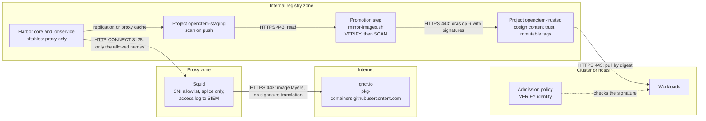
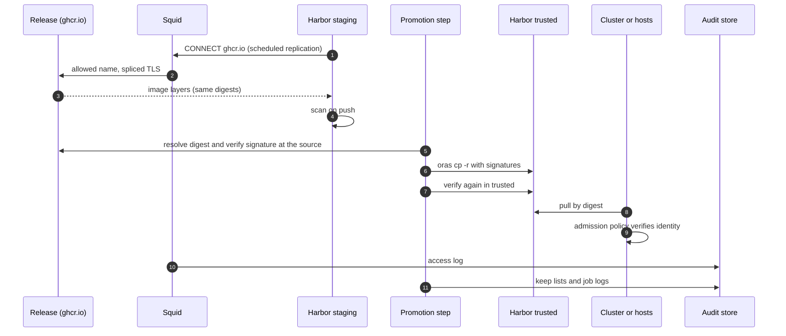

# Path A1: Harbor egress exception
{: .no_toc }

Use this path when Harbor itself may reach `ghcr.io` through one controlled
exception. Harbor replication, or a proxy cache project, fills a **staging**
project. A promotion step then copies the images into a **trusted** project
with their signatures, after verifying them.

**Verdict:** automation medium to high, security medium (one egress path is
opened and must be defended), operations effort medium.

1. TOC
{:toc}

---

## Prerequisites

- Harbor 2.8 or later. Signatures are stored through Harbor's OCI referrers
  support from 2.8. The API bodies in the kit are for Harbor 2.x (`/api/v2.0`).
- A forward proxy host (the Squid template below) and a firewall on the Harbor
  host (the nftables template below).
- A host for the promotion step with `oras` 1.2 or later and `cosign` 2.4 or
  later: the [CI mirror job](path-ci-mirror.md) or a shell on a trusted
  workstation.
- An administrator account for the one-time setup. Keep it out of CI.

## Trust boundaries



## Threats of the egress exception

Opening Harbor to the internet adds risk. These are the threats we considered
and what reduces each of them.

| Threat | Mitigation |
|---|---|
| Malicious or compromised upstream image | Identity-pinned cosign verification before promotion; Trivy gate; admission policy in the cluster; exact repository names in the replication filter |
| Harbor used as an exfiltration path | Egress only through the SNI-allowlist proxy, firewall drop by default, proxy access log sent to the SIEM |
| Information leakage (what you run) | Anonymous pulls of public images; nothing about your inventory leaves |
| Upstream outage | Staging keeps the last good release; releases are pinned by digest |
| Vulnerability in Harbor itself | Harbor on its own host and patched; no cluster credentials on it; robot accounts scoped and expiring |
| MITM or DNS spoofing | TLS to `ghcr.io`; signatures and digests are verified independently of the transport |

## Harbor projects and policies

The checklist is in
[`harbor/harbor-robot-account.md`](https://github.com/openctemio/openctem/blob/main/deploy/airgap/harbor/harbor-robot-account.md).

| Project | Purpose | Who writes | Who reads |
|---|---|---|---|
| `openctem-staging` | Landing zone: images as they arrive (mirror job, replication) | `robot$openctem-mirror` | `robot$openctem-mirror`, the scanner |
| `openctem-trusted` | Images that passed the signature and vulnerability checks | `robot$openctem-mirror` (promotion only) | cluster and host pull robots |

Both projects are private. Create `openctem-trusted` with
[`trusted-project.json`](https://github.com/openctemio/openctem/blob/main/deploy/airgap/harbor/trusted-project.json)
(`POST /api/v2.0/projects`). In `openctem-staging`, turn scan on push on. No
cluster pulls from staging.

In `openctem-trusted`:

- Turn on **cosign content trust** (`enable_content_trust_cosign`). Harbor then
  refuses to serve an image without a cosign signature. It checks that a
  signature **exists**, not who made it. The identity check belongs in the
  promotion step (`mirror-images.sh`) and in the cluster (Kyverno).
- Turn on **prevent vulnerable images from running** with severity `critical`
  (or your policy), with a CVE allowlist only for reviewed exceptions.
- Add a **tag immutability** rule: repositories `**`, tags `v*`. Docker Compose
  pins by tag, and an immutable tag cannot be re-pointed.
- Add a **tag retention** rule: keep the last 5 `v*` tags per repository (the
  rollback window), and run garbage collection on a schedule.

### Robot accounts

| Account | Scope | Permissions | Notes |
|---|---|---|---|
| `robot$openctem-mirror` | `openctem-staging` and `openctem-trusted` | repository pull and push, artifact read, tag create | No delete, no project or member administration. Expiry 90 days. Store as a masked, protected CI variable and rotate before expiry |
| `robot$openctem-pull-<cluster>` | `openctem-trusted` only | repository pull | One per cluster or host group. Expiry 90 days. Kubernetes: `kubectl create secret docker-registry openctem-registry ...` and `imagePullSecrets` in the Helm values |
| Replication endpoint credential | the Nexus proxy | read-only | Nothing else |

Forward the Harbor audit log to your SIEM (System Settings, audit log
forwarding): pushes, pulls, robot creation and policy changes.

## Getting images into staging

Two Harbor features fill staging. Both bring images with the **same digests**
but do not turn our tag-schema signatures into Harbor signatures.

- **Replication.** Use
  [`replication-rule-openctem.json`](https://github.com/openctemio/openctem/blob/main/deploy/airgap/harbor/replication-rule-openctem.json)
  with a registry endpoint: `registry-endpoint-ghcr.json` (type `github-ghcr`,
  `https://ghcr.io`) or `registry-endpoint-nexus.json` (the Nexus Docker
  proxy). The rule names the exact repositories (`openctemio/{openctem-api,openctem-web,openctem-console,openctem-gateway,migrations,seed,admin-cli}`),
  tag filter `v[0-9]*`, a schedule (`0 0 */6 * * *`) and `override: false`.
- **Proxy cache.** Use
  [`proxy-cache-project.json`](https://github.com/openctemio/openctem/blob/main/deploy/airgap/harbor/proxy-cache-project.json).

Keep both as the feed of `openctem-staging` only.

## Promote into trusted

Promotion is the supported step. `mirror-images.sh` verifies the identity,
copies the image with its signatures, and verifies again in the destination:

```bash
oras login harbor.example.internal
./mirror-images.sh online $V harbor.example.internal/openctem-trusted \
  --source-prefix ghcr.io/openctemio
# or from a Nexus Docker proxy of ghcr.io:
#   --source-prefix nexus.example.internal:8443/openctemio
```

`--source-prefix` also accepts a staging project, which makes a promotion
inside Harbor:
`--source-prefix harbor.example.internal/openctem-staging`.

Check in your Harbor version before you rely on anything else:

```bash
cosign tree harbor.example.internal/openctem-trusted/openctem-api:$V
```

It must list the signature.

## Squid and nftables templates

Harbor's core and jobservice reach the internet only through the proxy. In
`harbor.yml`, set the `proxy:` section with components `core,jobservice,trivy`.
Allowed names: `ghcr.io` and `pkg-containers.githubusercontent.com`. For
Trivy's database use your own mirror of it (preferred) or `ghcr.io` again. The
replication filters name the exact repositories (never `openctemio/**`).

The Squid template does not decrypt HTTPS. It allows CONNECT to the listed
names only, checked against the TLS SNI with `ssl_bump peek` and `splice`, so a
client cannot claim one name and connect to another.

[`squid-egress-allowlist.conf`](https://github.com/openctemio/openctem/blob/main/deploy/airgap/templates/squid-egress-allowlist.conf):

```text
# Squid forward proxy: the only egress the registry host (Harbor) or the CI
# mirror runner gets. HTTPS is not decrypted: the proxy allows CONNECT to the
# listed host names only (checked against the TLS SNI with ssl_bump peek +
# splice, so a client cannot claim one name and connect to another).
# Guide: api/docs/deployment/air-gapped.md, "Security of the egress exception".
#
# Hosts:
#   ghcr.io                                image manifests and tokens
#   pkg-containers.githubusercontent.com   image layers (ghcr.io redirects here)
#   github.com, api.github.com             release assets and the release API
#                                          (CI mirror job only)
#   release-assets.githubusercontent.com,
#   objects.githubusercontent.com          release asset downloads (redirects)
#   tuf-repo-cdn.sigstore.dev              Sigstore trusted root (optional:
#                                          verify offline with a copied
#                                          trusted_root.json instead)
#   rekor.sigstore.dev                     transparency log (optional: cosign
#                                          verifies the entry embedded in the
#                                          signature offline)

http_port 3128 ssl-bump tls-cert=/etc/squid/bump.pem generate-host-certificates=off
# Only the registry host / mirror runner may use this proxy.
acl mirror_clients src 10.20.30.40/32
acl SSL_ports port 443
acl CONNECT method CONNECT

acl openctem_upstream ssl::server_name ghcr.io pkg-containers.githubusercontent.com
acl openctem_releases ssl::server_name github.com api.github.com release-assets.githubusercontent.com objects.githubusercontent.com
acl sigstore ssl::server_name tuf-repo-cdn.sigstore.dev rekor.sigstore.dev

acl step1 at_step SslBump1
ssl_bump peek step1
ssl_bump splice openctem_upstream
ssl_bump splice openctem_releases
ssl_bump splice sigstore
ssl_bump terminate all

http_access deny !SSL_ports CONNECT
http_access allow mirror_clients CONNECT SSL_ports
http_access deny all

# Keep a record of every connection for the audit trail.
access_log daemon:/var/log/squid/access.log squid
```

The firewall template drops everything except DNS to internal resolvers, the
proxy and internal services. Name-based rules belong in the proxy: the IP
addresses behind `ghcr.io` and the GitHub CDN change.

[`nftables-egress-allowlist.nft`](https://github.com/openctemio/openctem/blob/main/deploy/airgap/templates/nftables-egress-allowlist.nft):

```text
#!/usr/sbin/nft -f
# nftables on the registry host (Harbor) or CI mirror runner: no direct
# internet; HTTPS only to the egress proxy (squid-egress-allowlist.conf),
# which enforces the host-name allowlist. Name-based rules belong in the
# proxy: the IP addresses behind ghcr.io and the GitHub CDN change.
# Guide: api/docs/deployment/air-gapped.md, "Security of the egress exception".
define proxy = 10.20.30.1
define proxy_port = 3128
define internal = { 10.0.0.0/8, 172.16.0.0/12, 192.168.0.0/16 }

table inet openctem_egress {
	chain output {
		type filter hook output priority 0; policy drop;
		oifname "lo" accept
		ct state established,related accept
		# DNS to the internal resolvers only.
		ip daddr $internal udp dport 53 accept
		ip daddr $internal tcp dport 53 accept
		# The egress proxy.
		ip daddr $proxy tcp dport $proxy_port accept
		# Internal services (registry clients, storage, LDAP, ...).
		ip daddr $internal accept
		counter log prefix "openctem-egress-drop " drop
	}
}
```

Edit the proxy address, the client address and the internal ranges. Test the
firewall from the Harbor host: a direct `curl https://ghcr.io` must fail, and
the same request through the proxy must succeed.

## Rollback

The previous release stays in `openctem-trusted` (tag retention keeps the last
5). See [Lifecycle](lifecycle.md#rollback).

## Sequence



## Security recommendations

**Must**

- Put Harbor behind the nftables policy and the Squid allowlist before enabling
  replication. Keep the proxy log.
- Promote with `mirror-images.sh` (identity check), never by copying staging to
  trusted by hand.
- Name exact repositories in the replication filter.
- Use scoped, expiring robot accounts. No cluster credentials on the Harbor
  host.
- Pin deployments by digest and enforce the identity in the cluster.

**Should**

- Run Harbor on its own host and patch it promptly.
- Forward Harbor and proxy logs to the SIEM and alert on a denied CONNECT.
- Mirror Trivy's databases instead of letting Trivy reach `ghcr.io`.

**Could**

- Use the offline bundle ([Path A3](path-offline.md)) for the most sensitive
  releases.
- Move the promotion step to a runner outside the Harbor host.

**Residual risks**

- Harbor's content trust proves only that a signature exists. A malicious
  signature from another identity passes it, so the identity check in the
  promotion step and the cluster is essential.
- The allowlisted names are shared by many GitHub tenants. The firewall and the
  proxy limit where Harbor connects, not what it fetches.

## Related

[CI mirror job](path-ci-mirror.md), [Path P0](path-nexus-proxy.md),
[Troubleshooting](troubleshooting.md)
