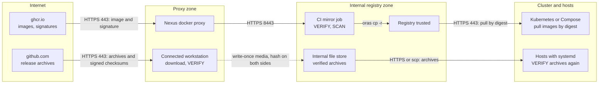
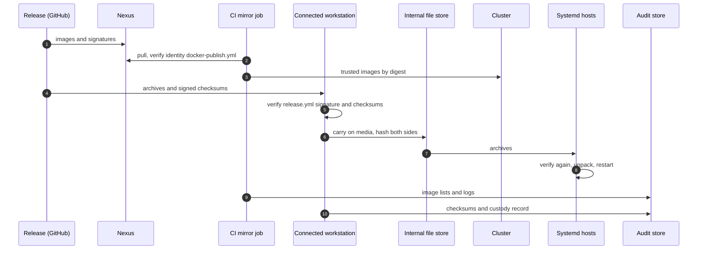

# Mixed paths: images through Nexus, archives by offline transfer
{: .no_toc }

Images and release files do not have to take the same route. The common mix is
this: container images come through the Nexus proxies
([Path P0](path-nexus-proxy.md)), while the release archives for hosts without
containers (see [Install from binaries](../install/binaries.md)) arrive by an
[offline transfer](path-offline.md). Use it when a few hosts are in a stricter
zone than the registry, or when Nexus proxies the Docker side only.

The rule that makes mixing safe: **every route verifies the same signatures**.
Images are checked against `docker-publish.yml@refs/tags/<version>`, archives
against `release.yml@refs/tags/<version>`, whichever route they took.

**Verdict:** automation as the parts (images high, archives low), security as
the weakest verification, operations effort medium.

1. TOC
{:toc}

---

## Prerequisites

The prerequisites of the two paths you combine. In addition:

- Decide which route owns which artifact, and write it down. The images route
  and the archive route must take in **the same version**.
- The archive route needs the `checksums-sha256.txt` and its
  `.sigstore.json` with the archives.

## Trust boundaries

## Steps

1. Run the image route as in [Path P0](path-nexus-proxy.md) for the release.
2. Run the archive route: download the archives, `checksums-sha256.txt` and its
   `.sigstore.json` on the connected workstation, verify them as in
   [Install from binaries](../install/binaries.md#1-verify-the-download), carry
   them as in the [offline checklist](path-offline.md#physical-media-checklist).
3. On each host, verify again before unpacking
   (`cosign verify-blob ... --offline --trusted-root trusted_root.json`, then
   `sha256sum --ignore-missing -c checksums-sha256.txt`). A host should not
   trust the store that holds the files.
4. Record both routes under one release record: the image digest lists and the
   archive checksums.

## Rollback

Each route rolls back on its own. Images: previous digests in the trusted
project. Archives: switch the symlinks back
([Install from binaries](../install/binaries.md#rollback)). Keep both at the
same release, and never run an older server on a newer schema.

## Sequence

## Security recommendations

**Must**

- Verify both routes against their own workflow identity and the exact tag.
- Take in the same version on both routes.
- Verify archives again on every host.

**Should**

- Keep a single release record that lists images and archives together.
- Give the file store read-only access for hosts.

**Could**

- Serve the archives from a Nexus raw proxy inside the stricter zone, fed by
  the same transfer.

**Residual risks**

- The weakest route sets your assurance. A route that skips verification
  undoes the other.
- Version skew between images and archives is a support problem: both come
  from one release, never mix releases.

## Related

[Path P0](path-nexus-proxy.md), [Path A3](path-offline.md),
[Install from binaries](../install/binaries.md)
