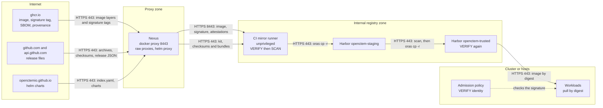
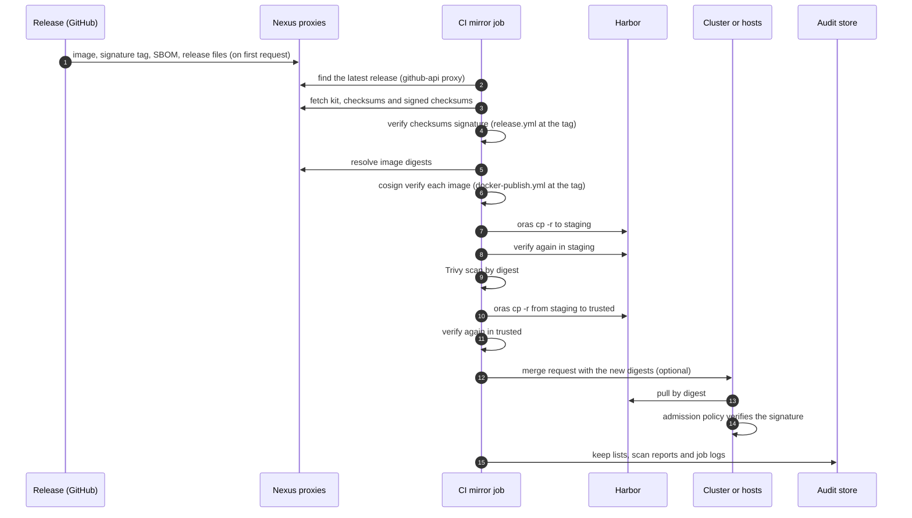

# Path P0: existing Nexus Docker and raw proxies
{: .no_toc }

Use this path when your site already proxies packages through Nexus Repository
and Nexus already reaches the internet. Nexus proxies `ghcr.io` (images and
signatures) and the GitHub release files. A scheduled CI job then verifies the
images through the proxy and promotes them into Harbor. Harbor is the promotion
target; Nexus is a cache.

**Verdict:** automation high, security high, operations effort low to medium.
No new egress.

1. TOC
{:toc}

---

## Prerequisites

- Nexus Repository 3. The path was tested with 3.70.4.
- Nexus can reach `ghcr.io`, `pkg-containers.githubusercontent.com`,
  `github.com`, `release-assets.githubusercontent.com`, `api.github.com` and
  `openctemio.github.io`.
- The "Docker Bearer Token Realm" (`DockerToken`) is active in Nexus. The
  `create-repositories.sh` script adds it and keeps the realms you have.
- Each Docker repository has its own HTTPS connector port, or a reverse proxy in
  front of Nexus.
- A runner with `oras` 1.2 or later and `cosign` 2.4 or later, and (for the
  promotion) Harbor with the projects from [Path A1](path-harbor-egress.md#harbor-projects-and-policies).
- Admin access to Nexus for the one-time setup.

## Trust boundaries



## Steps

### 1. Fetch and verify the image kit (once)

The kit holds the scripts and templates. Fetch it through the raw proxy once
(step 2 creates the proxy; use the release page first if you have no proxy
yet), and verify it with the signed checksums:

```bash
V=vX.Y.Z
base=https://nexus.example.internal/repository/github-openctemio/openctem/releases/download/$V
for f in checksums-sha256.txt checksums-sha256.txt.sigstore.json openctem-image-kit-$V.tar.gz; do
  curl -fsSLO "$base/$f"
done
cosign verify-blob checksums-sha256.txt --bundle checksums-sha256.txt.sigstore.json \
  --certificate-identity "https://github.com/openctemio/openctem/.github/workflows/release.yml@refs/tags/$V" \
  --certificate-oidc-issuer https://token.actions.githubusercontent.com
sha256sum --ignore-missing -c checksums-sha256.txt
tar -xzf openctem-image-kit-$V.tar.gz
```

### 2. Create the Nexus repositories

The kit's
[`nexus/`](https://github.com/openctemio/openctem/tree/main/deploy/airgap/nexus)
folder holds one JSON body per repository and a script that posts them to the
Nexus REST API.

| Repository | Type | Remote | Settings that matter |
|---|---|---|---|
| `ghcr-proxy` | Docker proxy | `https://ghcr.io` | Docker v2 only, anonymous upstream (the images are public), HTTPS connector port 8443, metadata max age 60 minutes, negative cache 1 minute |
| `openctem-hosted` (optional) | Docker hosted | none | write policy `ALLOW`, HTTPS connector port 8444 |
| `github-openctemio` | Raw proxy | `https://github.com/openctemio/` | content max age 1440, negative cache 1 minute; Nexus follows the redirect to `release-assets.githubusercontent.com` |
| `github-api` | Raw proxy | `https://api.github.com/` | content max age 30 minutes, no negative cache; for the mirror job's "latest release" lookup |
| `helm-openctem` | Helm proxy | `https://openctemio.github.io/helm-charts` | serves `index.yaml` |

```bash
NEXUS_USER=admin NEXUS_PASSWORD_FILE=/run/secrets/nexus \
  ./create-repositories.sh https://nexus.example.internal
```

The script reads the password from a file, never from an argument. Review each
JSON first: blob store, the Docker connector ports and the cleanup policy.
Existing repositories are left alone (HTTP 400 is reported).

{: .important }
The negative cache must stay short (1 minute). A release's signatures are
attached minutes after its images. A longer negative cache would hide them
behind a cached 404 and `cosign verify` would say "no signatures found".

{: .important }
The hosted repository needs write policy `ALLOW`. With `ALLOW_ONCE`, a second
mirror run fails, and so do two images that share a signature tag.

### 3. Check a release through the proxy

```bash
cosign verify \
  --certificate-identity "https://github.com/openctemio/openctem/.github/workflows/docker-publish.yml@refs/tags/$V" \
  --certificate-oidc-issuer https://token.actions.githubusercontent.com \
  nexus.example.internal:8443/openctemio/openctem-api:$V
```

Nexus answers 404 on the OCI referrers API. Clients fall back to the tag schema
and find the signature. This was tested with `cosign verify` and
`cosign verify-attestation --type slsaprovenance1` and `--type spdxjson`, both
through the Docker proxy and in a hosted repository filled by `oras cp -r`.

### 4. Promote into Harbor with the CI mirror job

Use the [CI mirror job](path-ci-mirror.md) with the Nexus proxies as sources:

| CI variable | Value |
|---|---|
| `OPENCTEM_SOURCE_PREFIX` | `nexus.example.internal:8443/openctemio` |
| `RELEASES_BASE_URL` | `https://nexus.example.internal/repository/github-openctemio/openctem/releases/download` |
| `RELEASE_API_URL` | `https://nexus.example.internal/repository/github-api/repos/openctemio/openctem/releases/latest` |
| `DEST_STAGING` | `harbor.example.internal/openctem-staging` |
| `DEST_TRUSTED` | `harbor.example.internal/openctem-trusted` |

The job runs staging, Trivy, trusted and the optional merge request. Without
Harbor, mirror straight into the Nexus hosted repository:

```bash
oras login nexus.example.internal:8444
./mirror-images.sh online $V nexus.example.internal:8444/openctem \
  --source-prefix nexus.example.internal:8443/openctemio
```

### 5. Helm charts

Add the Nexus Helm proxy as the chart repository:

```bash
helm repo add openctem https://nexus.example.internal/repository/helm-openctem
helm repo update
```

## Rollback

The previous release stays in `openctem-trusted` (retention keeps the last
releases). Point the deployment back at its digests. See
[Lifecycle](lifecycle.md#rollback).

## Sequence



## Security recommendations

**Must**

- Verify with the exact identity of the tag you take in. Never use a wildcard
  for the workflow or the tag in the promotion step.
- Verify at the source **and** again in the destination (the script does both).
- Keep the negative cache at 1 minute and the DockerToken realm active.
- Give the mirror job a Harbor robot account with push to staging and trusted
  only, and a read-only account for the Nexus proxy.
- Pin deployments by digest, not by tag.

**Should**

- Enforce signatures in the cluster with an admission policy
  ([Kyverno template](reference.md#kyverno-policy)).
- Run Nexus on a hardened host with its own backup and patching. It is a cache:
  a compromised Nexus cannot forge a signature, but it can withhold or delay
  data.
- Forward the Nexus, Harbor and CI logs to your SIEM.
- Scan with Trivy databases you mirror yourself.

**Could**

- Limit Nexus egress to the hosts listed under Prerequisites with an allowlist
  proxy ([Squid template](path-harbor-egress.md#squid-and-nftables-templates)).
- Verify offline with a trusted root carried in separately.

**Residual risks**

- A compromise of the upstream release workflow itself would sign a malicious
  image with a valid identity. Trivy and your own review are the remaining
  defences.
- Nexus can serve stale data for up to the metadata max age (60 minutes).
- Nexus is a single point of failure for new releases. Releases already in
  `openctem-trusted` keep working.

## Related

[CI mirror job](path-ci-mirror.md), [Install targets](install-targets.md),
[Troubleshooting](troubleshooting.md), [Comparison](comparison.md)
