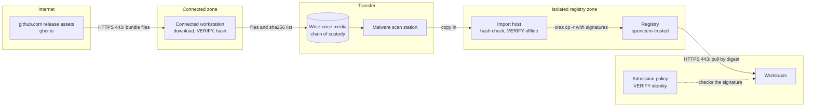
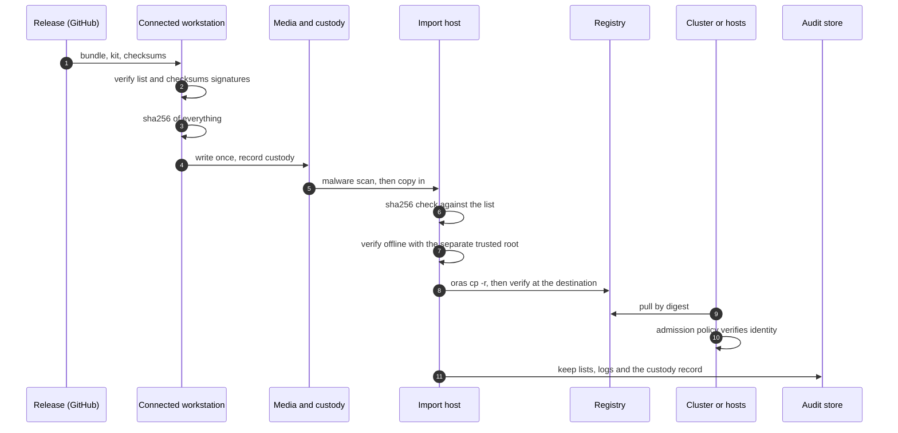

# Path A3: fully offline transfer
{: .no_toc }

Use this path when the inside has no connection to the outside at all. A
connected workstation downloads the release's offline bundle and verifies it.
You carry the files across on controlled media. Inside, a script verifies them
again offline and loads the images into your registry with their signatures.

**Verdict:** automation low (manual per release), security highest (no inbound
path, verified on both sides), operations effort high per release.

1. TOC
{:toc}

---

## What a release gives you

Each production release attaches these files:

| File | Content |
|---|---|
| `openctem-image-<name>-<version>.oci.tar` | The multi-arch image index with its signature, provenance and SBOM attestation, as an OCI layout. One per image: `openctem-api`, `openctem-web`, `openctem-console`, `openctem`, `openctem-gateway`, `migrations`, `seed`, `admin-cli` |
| `openctem-images-<version>.txt` | One line per image: `name source-ref index-digest archive archive-sha256` |
| `openctem-images-<version>.txt.sigstore.json` | The keyless signature of that list, by `docker-publish.yml` at the tag |
| `openctem-image-kit-<version>.tar.gz` | `mirror-images.sh` and the templates |
| `checksums-sha256.txt`, `checksums-sha256.txt.sigstore.json` | Checksums of the release archives and SBOMs, signed by `release.yml` at the tag |

For a non-container install, also download the archives you need (see
[Install from binaries](../install/binaries.md)).

## Prerequisites

- A connected workstation with `gh` (or `curl`), `cosign` and `sha256sum`.
- Inside: `oras` 1.2 or later, `cosign` 2.4 or later, `sha256sum`, `tar`, and a
  registry you can `oras login` to.
- Write-once media, or a controlled transfer system (see the checklist below).
- A separate way to deliver the Sigstore **trusted root**.

## Trust boundaries



## Outside: download and verify

```bash
V=vX.Y.Z
mkdir bundle && cd bundle
gh release download $V -R openctemio/openctem \
  -p 'openctem-image-*' -p 'openctem-images-*' -p 'checksums-sha256.txt*'
# 1. The image list is signed by the release workflow
cosign verify-blob openctem-images-$V.txt --bundle openctem-images-$V.txt.sigstore.json \
  --certificate-identity https://github.com/openctemio/openctem/.github/workflows/docker-publish.yml@refs/tags/$V \
  --certificate-oidc-issuer https://token.actions.githubusercontent.com
# 2. The checksum file is signed too, and covers the kit and the archives
cosign verify-blob checksums-sha256.txt --bundle checksums-sha256.txt.sigstore.json \
  --certificate-identity https://github.com/openctemio/openctem/.github/workflows/release.yml@refs/tags/$V \
  --certificate-oidc-issuer https://token.actions.githubusercontent.com
sha256sum --ignore-missing -c checksums-sha256.txt
```

The pattern `openctem-image-*` also matches the image kit
`openctem-image-kit-<version>.tar.gz`. Keep it in the bundle: it holds
`mirror-images.sh`.

Fetch the Sigstore trusted root **separately**, on a connected machine. Any
online `cosign verify` leaves it at
`~/.sigstore/root/tuf-repo-cdn.sigstore.dev/targets/trusted_root.json`,
verified through Sigstore's TUF repository. Never take it from the same medium
as the artifacts it verifies.

Write the hashes of everything you carry:

```bash
sha256sum * > ../transfer-$V.sha256
```

## Physical media checklist

- [ ] Use **write-once media** (for example a write-once disc), or a transfer
      system that is one-way. Label it with the release and a serial number.
- [ ] Write the `sha256` list (`transfer-<version>.sha256`) on a second,
      separate carrier or print it, and record who produced it.
- [ ] Keep a **chain of custody** record: who wrote it, who carried it, who
      received it, with dates.
- [ ] Run the **malware scan policy** of your site on the media at the
      crossing. The scan does not replace the signature checks.
- [ ] Hash **on both sides**: `sha256sum -c transfer-<version>.sha256` inside.
      A mismatch stops the import.
- [ ] Deliver the **trusted root** on a different carrier or channel from the
      artifacts.
- [ ] Keep the media or its image as audit evidence until the release is
      retired.

## Inside: verify and load

```bash
sha256sum -c transfer-$V.sha256
oras login registry.example.internal
tar -xzf bundle/openctem-image-kit-$V.tar.gz
./openctem-image-kit-$V/mirror-images.sh bundle ./bundle \
  registry.example.internal/openctem-trusted \
  --trusted-root trusted_root.json \
  --env-out openctem-images.env
```

In bundle mode, `mirror-images.sh`:

1. finds `openctem-images-<version>.txt` and requires its `.sigstore.json`;
2. verifies the list's signature (offline when `--trusted-root` is given);
3. for each image checks the archive's sha256 against the list;
4. unpacks the OCI layout and copies it with `oras cp -r`, keeping the digest;
5. checks that the destination has the digest the list names, and verifies the
   signature again at the destination;
6. writes `openctem-mirrored-<version>.txt` (`name ref digest`) and, with
   `--env-out`, a Compose `.env` fragment.

Nothing unverified is copied. Any failure stops the run with exit code 1.

### Verify without internet access

Keyless verification needs the Sigstore trusted root. With it, add
`--offline --trusted-root trusted_root.json` to any `cosign verify` or
`cosign verify-blob`:

```bash
cosign verify --offline --trusted-root trusted_root.json \
  --certificate-identity https://github.com/openctemio/openctem/.github/workflows/docker-publish.yml@refs/tags/$V \
  --certificate-oidc-issuer https://token.actions.githubusercontent.com \
  registry.example.internal/openctem-trusted/openctem-api:$V
```

The signature bundles carry their transparency-log inclusion proofs, so nothing
is looked up online. `mirror-images.sh` and `unpack.sh` take `--trusted-root`
for the same purpose.

## Rollback

Keep the previous release's digests in the registry (tag retention). If it was
removed, import the previous bundle again: the digests are identical. See
[Lifecycle](lifecycle.md#rollback).

## Sequence



## Security recommendations

**Must**

- Verify on **both** sides. The outside check proves what you downloaded; the
  inside check proves what arrived.
- Deliver the trusted root separately from the artifacts.
- Keep write-once media and a chain of custody.
- Pin the exact tag in every identity.
- Pin deployments by digest.

**Should**

- Apply your malware scan policy at the crossing.
- Verify the image list and the checksum file offline again inside.
- Refresh the trusted root on a schedule: it is rotated by Sigstore.
- Keep the media (or an image of it) with the release record.

**Could**

- Use a one-way transfer device instead of media.
- Run the same bundle through a second import host and compare
  `openctem-mirrored-<version>.txt`.

**Residual risks**

- A stale trusted root eventually fails verification. Plan its refresh with
  each transfer.
- The bundle is as fresh as your last transfer. An emergency patch waits for
  one.
- Content feeds are separate ([feeds](feeds.md)).

## Related

[Lifecycle: multi-site](lifecycle.md#multi-site),
[Reference: verification commands](reference.md#verification-commands),
[Troubleshooting](troubleshooting.md)
