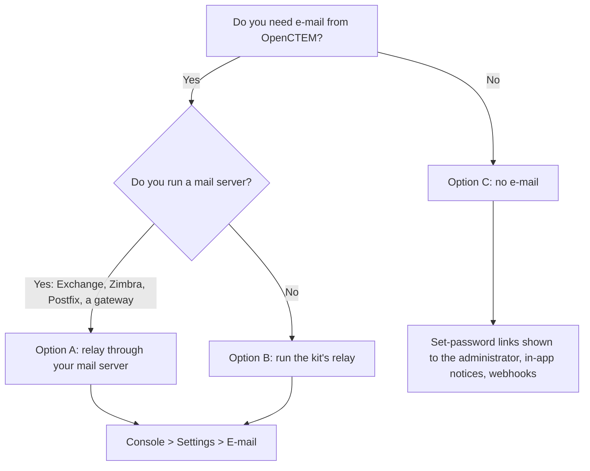
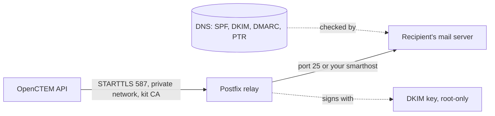

# Send mail without an online provider
{: .no_toc }

OpenCTEM needs one SMTP server to send sign-in, invitation, verification and
password e-mails. That server does not have to be an online mail service. This
page shows three ways to run without one, from least to most work.

1. TOC
{:toc}

---

## Choose a way



| | Option A: your mail server | Option B: the kit's relay | Option C: no e-mail |
|---|---|---|---|
| What sends | Your Exchange, Zimbra, Postfix or mail gateway | A send-only Postfix container installed beside OpenCTEM | Nothing |
| You need | A send-only account or an allowed address, and its TLS certificate | A sender domain, DNS access, outbound port 25 (or a smarthost) | Nothing |
| Delivery to outside people | As good as your mail server | Needs SPF, DKIM, DMARC and a PTR record (below) | Not applicable |
| Effort | 10 minutes | 1 hour plus DNS | None |

## Option A: relay through your company mail server

OpenCTEM connects to your server like any mail client would, and your server
delivers the message.

1. **Create a send-only account** (for example `openctem@corp.example`) with no
   mailbox access to anyone else's mail. Allow it to send as the address OpenCTEM
   will use as sender (for example `noreply@corp.example`): on Exchange, grant
   *Send As* on that address; on Postfix, add the login to the sender login maps.
2. **Pick how OpenCTEM is allowed in.**
   - *Authenticated submission* (recommended): port 587 with STARTTLS and the
     account from step 1.
   - *By address*: a receive connector (Exchange) or `mynetworks` entry (Postfix)
     that relays for OpenCTEM's address only, never for a whole network. Leave the
     user name and password empty in OpenCTEM.
3. **Trust the server's certificate.** If its certificate is signed by a public
   authority, nothing to do. If it is signed by your own certificate authority,
   paste that CA certificate in **Internal CA certificate** (below). Do not look
   for a "skip verification" switch: there is none, on purpose.
4. **Let the API reach the server.** A server on a private address is refused
   unless its range is listed in `OPENCTEM_HTTPSEC_ALLOW_PRIVATE_CIDRS` (see
   [Email](email.md#relays-on-a-private-network)).
5. Enter the server, port 587, user, password and sender in the console and use
   **Send a test e-mail**.

### Internal CA certificate

If your mail server's certificate comes from your own certificate authority,
paste the CA certificate (PEM, the `-----BEGIN CERTIFICATE-----` text) into
**Settings > E-mail > Internal CA certificate** and save. Rules:

- Certificates only. A private key is refused and never stored.
- The certificate is used only to check this mail server. It replaces the public
  authorities for this connection, so the relay is trusted only if your CA signed it.
- It is write-only: the console shows that one is stored and its SHA-256
  fingerprint, never the text. Compare the fingerprint with the CA you hold.
- Setting, replacing or removing it is a relay change: it needs a fresh
  authenticator code and a second super administrator's approval, like a new
  host, because whoever controls the certificate authority can read every
  set-password link.
- It is audited without the certificate text (fingerprints only).
- A stored bundle that cannot be read turns platform e-mail off; it never falls back to the public authorities.
- At first install, `bootstrap-admin` reads the file named by `BOOTSTRAP_SMTP_CA_FILE` (certificates only).

## Option B: run the relay that ships with the kit

The Ansible kit can install a send-only Postfix container next to OpenCTEM
(role `mail_relay`, off by default). It is not an open relay: it listens only on
a private Docker network that has no route out and no published port, whose only
other member is the OpenCTEM API; it accepts mail only from that network; it
sends only for the domains you list; and it requires TLS.



In the kit inventory:

```yaml
openctem_mail_relay: true
openctem_mail_relay_from: noreply@example.com
mail_relay_hostname: mail.example.com        # its public name, also the PTR name
mail_relay_sender_domains: [example.com]
mail_relay_dkim: true
# mail_relay_smarthost: smtp.corp.example:587   # hand all mail to your own server instead of delivering directly
```

Apply the relay stage before the OpenCTEM stage, because OpenCTEM joins its
network:

```bash
ansible-playbook -i $INV playbooks/52-mail-relay.yml -K -e apply_mail_relay=true
ansible-playbook -i $INV playbooks/50-openctem.yml -K -e apply_openctem=true
```

The stage creates the relay's own certificate authority and certificate, creates
the DKIM key (in the kit's root-only secrets directory), starts the relay, waits
for its health check, and writes `/opt/openctem-mail-relay/dns-records.txt` with
the DNS records to publish. The first administrator tool
(`openctem-bootstrap-admin`) stores the platform e-mail setting for the relay and
the relay's CA certificate. On an installation where e-mail is already
configured, enter the same values in the console: server `mail-relay`, port 587,
STARTTLS on, no user name, and paste the CA certificate
(`/opt/openctem/secrets/mail_relay_ca/ca.crt`; compare its fingerprint with the
one the stage printed).

### Make the mail arrive

Mail from a server that is not set up this way is usually discarded or sent to
spam. Publish all of these before you rely on it:

| Record | Where | Why |
|---|---|---|
| SPF | `TXT` on the sender domain: `v=spf1 ip4:<server address> ~all` | Says which address may send for the domain. With a smarthost, use the include your mail team gives you. |
| DKIM | `TXT` on `<selector>._domainkey.<domain>` (value in `dns-records.txt`) | Receivers verify each message was signed by you. |
| DMARC | `TXT` on `_dmarc.<domain>`: start with `p=none`, move to `quarantine`, then `reject` | Tells receivers what to do when SPF and DKIM fail and sends you reports. |
| PTR (reverse DNS) | Set at whoever owns the server's address (the hosting provider) to `mail_relay_hostname`, and make that name resolve back to the address | Many receivers refuse mail from an address with no matching reverse name. |
| Outbound port 25 | Open from the server to the internet | Many hosting providers close it by default; ask them to open it, or use a smarthost. |

Check the result by sending a test e-mail to a mailbox you read and viewing the
original message headers: `spf=pass`, `dkim=pass`, `dmarc=pass`.

If your network restricts the stack's outbound traffic
(`openctem_egress_policy: restricted`), the relay's outbound network is under
the same policy: add your smarthost's address to `openctem_egress_allow`.

## Option C: no e-mail

Turn **Send e-mail** off in **Settings > E-mail**. OpenCTEM still works:

- An administrator creating a user or an invitation gets the one-time
  set-password link on screen once and passes it on. In the platform console, a
  new organization owner who lost that link gets a new one from **New setup
  link** on the organization's **Members** tab.
- An organization created for someone who already has an account is marked
  "Not sent". The console shows the address where they accept, and the person
  sees a **Review invitation** banner after signing in.
- Password resets are done by an administrator, who issues a new one-time link.
- Findings and alerts go to people through in-app notices, webhooks and the
  chat channels (Slack, Teams, Telegram) of **Notification channels**, none of
  which need SMTP.

Self-service sign-up and email verification need e-mail: keep the sign-up mode
on `disabled` (the default).

## Send a test e-mail, and read the result

In the console: **Settings > E-mail**, save the settings, then **Send a test
e-mail**. It goes to the signed-in administrator's own address, never to another.
A failure says what to fix:

| The console says | Cause | Fix |
|---|---|---|
| The mail server's certificate is not trusted | Signed by an authority OpenCTEM does not know | Paste your CA certificate in **Internal CA certificate**. |
| The certificate is not issued for the server name | You entered a name that is not on the certificate | Use the name on the certificate (for the kit's relay: `mail-relay`). |
| The certificate is expired or not valid yet | Certificate expired, or the server clock is wrong | Renew it; check the clock. |
| The secure connection failed | Wrong port, or STARTTLS is on for a port that expects implicit TLS (465), or the server only speaks old TLS | Use 587 with STARTTLS; TLS 1.2 or later is required. |
| The mail server refused the user name or password | Authentication failed | Check the account; some servers want the full address as the user name. |
| The mail server wants you to sign in | The relay requires authentication | Enter a user name and password, or allow OpenCTEM's address on the server. |
| The mail server refused to relay | Relay denied: the server does not relay for this client or domain | Authenticate, or add OpenCTEM's address to the server's relay rules. |
| The mail server refused the sender address | The account may not send as this address | Grant send-as rights, or change the sender address. |
| The address is blocked by the platform's network rules | The server is on a private address | List its range in `OPENCTEM_HTTPSEC_ALLOW_PRIVATE_CIDRS`. |
| Could not connect | Wrong name or port, or a firewall | Check the name, the port and the route. |

The API log has the technical detail of every failure.

Failures that only show up on delivery, after the relay accepted the message,
are in the relay's own log:

| In the mail log | Cause |
|---|---|
| `spf=fail` or `SPF` in a bounce | The sending address is not in the domain's SPF record. |
| `550 5.7.1 ... DKIM` or `DMARC policy` | DKIM is missing or the DMARC policy rejects an unsigned message. |
| `Connection timed out` to port 25 | Outbound port 25 is blocked at the provider. |
| `Relay access denied` from your smarthost | The smarthost does not allow the relay's address or login. |
| `Client host rejected` on the relay | Something other than the API tried to send; the relay refuses it by design. |
