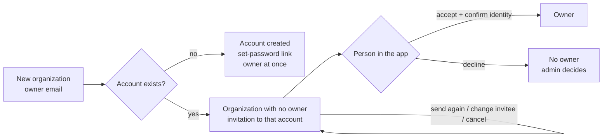

# Organizations and users
{: .no_toc }

The **Customers** group of the [platform console](index.md): the organizations on
the installation, the people who sign in, the requests for an organization and the
sign-up activity.

1. TOC
{:toc}

---

## Organizations

**Organizations** lists every organization with its status, owners, limits,
members, single sign-on setup, the latest sign-in of any member and creation date. The list does not carry owners'
email addresses: operations admins and above see the owners' domains, a read-only
administrator sees the owner count. Search by name or slug and filter
by owner (**With an owner**, **Without an owner**) or by **Status**. The Status column
shows **Active**, **Suspended** or **Deletion scheduled**. **Last member sign-in** is the
latest sign-in of any active member; sign-in times are kept per account, so a member's
sign-in to another organization counts.

*Figure: Platform console, Organizations.*

### Create an organization

Operations admin or above, with a confirmation:

1. Click **New organization**.
2. Enter the **Name**, the **Slug** (used in URLs, including the SAML sign-in
   addresses), the **Owner email** and, optionally, the owner name and a
   description.
3. Click **Create organization**.
   - **A new person** (no account yet): an account is created and becomes the
     owner. The owner receives a one-time link to set a password by email, or
     shown to you when the platform [e-mail](settings.md#e-mail) is off.
   - **Someone who already has an account**: the dialog says "This person already
     has an account. They'll get an invitation to become the owner." The
     organization is created with no owner, and that person gets an
     [ownership invitation](#ownership-invitations). Use this to give one person
     several organizations.

An organization created here is stamped with the deployment region (if one is
set) and has no limits until you set some.

### Ownership invitations

Nobody becomes the owner of an organization without accepting. When you create
an organization for an existing account (or change who is invited, below):

- The organization waits with **no owner and no member**: nobody can open it
  until the invitation is accepted. Its limits and settings apply as for any new
  organization, and you manage it from the console as usual.
- The person is emailed and sees **Organizations waiting for you** on **My
  account** in the app (the email links to the same list). **Accept and become
  owner** asks them to confirm their identity (password, and their authenticator
  code when they use two-factor authentication) and needs a verified email
  address; then they own the organization. **Decline** leaves it to you.
- Only that account can accept: the invitation is tied to the account, not to the
  address, and it cannot be passed to someone else.
- It expires after 7 days. The organization list and Overview show **Waiting for
  owner to accept** (or expired, declined, canceled).

On the organization's **Members** tab, operations admins and above can:

- **Send again**: emails the invitation again and renews the 7 days (at most 5
  sends per invitation, 10 minutes apart).
- **Change invitee**: invites another existing account (the current invitation is
  canceled and that person told), or creates the owner's account for a new person.
- **Cancel invitation**: the person is told by email; the organization stays
  without an owner.

Each step needs a confirmation and is written to the admin activity log and to
the organization's audit log. Once someone has accepted, or anyone is in the
organization, the console can no longer invite an existing account into it.

### One organization

Open an organization for its tabs:

- **Overview**: owners and active members, limits and usage, sign-in (single
  sign-on and verified domains), slug, ID, creation date and recent administrator
  actions on it. Operations admins and above see the owners' addresses here; each
  view is written to the admin activity log (`organization.view`). A read-only
  administrator does not see the free-text suspension reason.
- **Members**: the organization's members (a read-only admin sees only the
  count). While an organization has no owner, **Create first owner** adds one
  (or, for an organization waiting for an ownership invitation, the invitation
  with **Send again**, **Change invitee** and **Cancel invitation**).
  When no owner can act (every owner's membership is suspended, or their account
  is blocked or erased), the Overview raises "without owner" and a super admin can
  use **Recover ownership**: it creates a new owner account and the set-password
  link goes to that person by email only. Other members are added by the organization's owners and
  administrators, not from the console.
- **Limits**: caps for this organization, such as seats, assets, findings,
  sensors, API keys, platform scans a day and storage (`storage_mb`, which
  overrides the default storage quota). No limit applies unless one is set. A
  lower limit never removes anything: additions over it are refused. Changing a
  limit needs an operations admin and a confirmation, and is audited. Features
  can also be denied to an organization: besides modules, the sign-in features
  `sso.connections` (adding or changing SAML and OIDC connections),
  `sso.enforcement` (requiring SSO), `scim` (the SCIM API) and
  `sso.group_links` (SCIM group to role mappings). A denied feature refuses new
  configuration with `403 FEATURE_NOT_INCLUDED`. Nothing is taken away at once:
  sign-in through configured connections keeps working, SCIM keeps working for
  the 30-day grace, and SSO enforcement is switched off after that grace (the
  owners are told), so members are never locked out. Two-factor, session and
  audit controls are never features.
- **Single sign-on** (changes need a super admin): SAML 2.0 and OIDC identity
  providers, **Verified domains** (proved by a DNS TXT record; automatic joining
  through SSO admits only addresses on them) and **Require single sign-on**
  (available once a provider is set up, a domain is verified for SSO, an owner or
  admin has signed in through the provider once and an owner has two-factor on;
  turning it on revokes the existing user API keys and AI connections unless you
  keep them; an owner can still sign in with a password and their second factor,
  audited). The identity provider form shows what to register at the provider
  (redirect URI, and for Entra ID the front-channel logout URL and the ID token
  claims), built from `APP_URL`. SSO changes made here apply only after the organization's owner
  approves them under **Settings › Access & security › SSO approvals**. See
  [Identity and access](../identity/index.md).
- **Scope**: the organization's scan approval policy and its modules. Modules are
  available unless denied here; the organization then switches on or off what is
  available. Core modules are always on.
- **Activity**: administrator actions on this organization. It opens on **Changes** (writes, sign-ins, elevations and refused attempts); page views and the record written before each change are under **All events**.
- **Audit chain**: checks the integrity of the organization's audit log.
  **Re-check** verifies the chain and lists entries that do not verify. A super
  admin can re-sign (rebaseline) the chain when every break is explained; this is
  irreversible, asks you to type the organization's name and needs a second super
  admin's approval ([Approvals](security.md#approvals)).

### Suspend an organization

In the **Danger zone** at the end of the **Overview** tab, **Suspend organization**
(operations admin or above, a fresh confirmation and a reason) closes the organization to every credential from the next request on:
sign-in and session refresh, API keys, MCP tokens, sensor keys, SCIM tokens, CI
run tokens and inbound Jira and GitHub webhooks answer
`403 ORGANIZATION_SUSPENDED` ("This organization is suspended — contact
support"). Its live connections close and its scheduled work (scheduled scans,
reports, retests, syncs, sweeps, sensor commands) is skipped. Nothing is deleted.

**Lift suspension** makes every credential work again; schedules that came due run
on their next tick. Both actions write a critical row in the admin activity log.
Use suspension for abuse, an unpaid invoice or a security incident; use deletion
when the data must go.

### Delete an organization

There are two ways to delete an organization, and both delete everything in it:
assets, findings, scans, members, roles, settings and its audit log. Member
accounts are kept (people may belong to other organizations).

- **The owner deletes it, with a 14-day grace period.** In the organization app,
  an owner uses **Settings › Organization › General**, **Delete organization**.
  The organization is closed to everyone at once (the same gate as a suspension)
  and the console shows **Deletion scheduled** with the date. Until that date any
  active owner can open the sign-in page, sign in and choose **Cancel deletion**;
  everything works again as before. When the 14 days end, the
  `organization-delete` background job deletes it.
- **A super admin deletes it now.** **Delete now** in the **Danger zone** of the organization's Overview tab (any
  status) needs a super admin, a reason and a fresh code. It cannot be undone.
  When a second super admin exists, the console first asks for their approval
  (action `organization.purge`, the exact organization as target): the request
  appears under [Approvals](security.md#approvals), and you repeat **Delete now**
  within 24 hours once it is approved. The critical `organization.purge_requested`
  row (with the reason) is written before anything is deleted: when it cannot be
  written the request answers 503, nothing is deleted and the approval is handed
  back. `organization.purged` follows the deletion.

*Figure: Delete now asks for a second super admin's approval.*

Data handling and erasure: [Data handling](../security/data-handling.md).

## Users

**Users** (roles that hold `platform.users.read`: platform owner, platform admin
and support) lists every account of the installation,
newest first, with state tabs and their counts: **All**, **Active**, **Not
verified**, **Locked**, **Blocked**, **No MFA** and **Platform admins**. Search by
email, name or user ID (at least three characters). The list shows account facts
only, never what an organization holds, and every list view is recorded in the
admin activity log. Reads are limited to 120 a minute per administrator. Accounts
linked to a platform administrator are listed (and readable) only for a platform
owner; for other roles they are left out of the rows and the counts.

*Figure: Platform console, Users.*

Open an account for its organizations, linked identities, active sessions and the
administrator actions on it. The actions, each with a reason that goes to the
admin activity log. **Sign out everywhere**, **Reset two-factor** and **Block account** are in a
**Danger zone** at the end of the page; the everyday actions stay under the name:

| Action | Effect |
|---|---|
| **Send password reset** | Emails the person a reset link, as "Forgot password" does. You never see the link. |
| **Resend verification** | Emails a new verification link; the previous one stops working. |
| **Unlock** | Clears the lockout after failed sign-ins. |
| **Sign out everywhere** | Ends every session of the account, in every organization and on every device. |
| **Block account** / **Unblock account** | Blocks the account platform-wide: it cannot sign in, its sessions end now, and its API keys and MCP tokens stop working. Nothing it made is removed. Needs a fresh confirmation; a profile save cannot lift a block. Unblocking lets the person sign in again; old sessions stay ended. |
| **Copy reset link** (platform owner, only while the server cannot send email) | Creates a one-hour password reset link and shows it once, for you to hand over on a channel you trust. Any earlier link stops working. It is stored only as a hash and never logged or written to the audit row. The person still needs their second factor. |
| **Mark email verified** (platform owner, only while the server cannot send email) | Marks the address verified. Do it only once you have confirmed the address is theirs. |
| **Reset two-factor** (platform owner) | Turns off two-factor authentication and ends every session, for someone who lost their device and recovery codes and has no organization administrator above them. Another super admin must approve first ([Approvals](security.md#approvals)). |

**Send password reset** and **Resend verification** are offered while the server can
send email; the two link actions replace them while it cannot. The three platform
owner actions need the `platform.users.credentials` permission.

Platform administrator accounts are managed under
[Administrators](security.md#administrators), not here.

## Access requests

When sign-up is closed and **Let people request access** is on
([Sign-up](settings.md#sign-up)), people who cannot sign in may ask for an
organization. **Access requests** lists them with the company, requester, note and
status (**Pending**, **Email not confirmed**, **Approved**, **Rejected**). An
operations admin approves a pending request with a confirmation, which creates the
organization (name and slug editable) with the requester as its owner, or rejects
it. An existing account becomes the owner only when the requester confirmed the
address by email (refused with 409 otherwise), and is emailed that the request
was approved. Nobody decides a request made by their own account or with their
own email (403). A read-only administrator sees the requesters' addresses masked
and no notes. The Overview lists requests waiting.

## Sign-ups

**Sign-ups** shows accounts created, organizations created and access requests
submitted as they arrive, with the counts for today, the last 7 days and the last
30 days, and a list filterable by **Event**. Each event keeps only the email
domain and the client network (`/24` for IPv4, `/48` for IPv6), never the address,
a name or a browser; events are kept 90 days. Any console role can read the feed.

*Figure: Platform console, Sign-ups.*

**Sign-up burst alerts**: when sign-ups of one kind from one network or one email
domain reach a threshold within a window (default 10 per network, 20 per domain,
in 60 minutes), the API raises one alert: an email to every administrator, a
high entry `platform.signup_burst` in the admin activity log, a warning log line
`alert=signup_burst` and the metric `openctem_signup_burst_alerts_total`
(monitoring rule `SignupBurst`). A super admin changes the thresholds, the window
and the **Ignored email domains** with a reason and a fresh code. Burst alerts
need Redis; without it events are still recorded.

## Support access

**Support access** (roles that hold `platform.support.access`: platform owner,
platform admin, support) lists the organizations whose owner granted you read-only
access to help them (an owner grants it under **Settings › Access & security › Support
access**, naming any active platform administrator, for a case and a limited time;
only an administrator whose roles hold support access can use it). **Open support session** reads that organization's assets and
findings read-only: the owners are emailed, every member sees a banner and every
page you open is recorded in the organization's audit log. **End session** ends it.
It also ends when you sign out of the console, when your console session expires or
goes idle, when the owner revokes the access or the grant expires, and after 30
minutes without use (a session unused that long is refused at its next use). A
background sweep (`support-session-sweep`, every minute) closes them. Each ended
session writes `support.session_ended` to both audit logs and emails the owners with
the cause; the members' "support is viewing now" banner drops at once.
