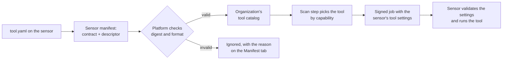



# Writing a tool

A **tool** is a program a sensor runs for a scan step: a port scanner, a web prober, a code
analyzer, a connector to another product. Sensors ship with built-in tools; this page shows how to
add your own. You can wrap an existing command-line scanner without writing code, write an adapter
in any language, or write the tool in Go with the SDK.

The contract is **tool contract v1**, implemented by
[openctemio/sdk-go](https://github.com/openctemio/sdk-go) (v0.37.0 at the time of writing; pin the
version you install). New to it? [Build your first tool](build-your-first-tool.md) walks through
one tool end to end, from an empty directory to findings. The platform side is described in
[tool-contract.md](https://github.com/openctemio/openctem/blob/develop/api/docs/architecture/tool-contract.md).

Once a sensor runs your tool, the tool joins your organization's tool catalog by itself (platform
v0.9.6 and later): the
platform reads what the tool declares, shows it, offers its settings form and can schedule scans
with it, without a platform change ([How the tool reaches your organization](#how-the-tool-reaches-your-organization)).

## Concepts

| Term | Meaning |
|---|---|
| **Capability** | An act, such as `scan.ports@1` or `secrets.code@1`, from a closed taxonomy. It fixes the phase, the minimum tier, the input and output types, the standard parameters and the output every report must carry. You implement capabilities; you do not invent them. |
| **Descriptor** | `tool.yaml` (`apiVersion: openctem.io/tool/v1`): what your tool implements, consumes and produces, its settings schema, permissions, resources, self-tests and how to start it. The runtime trusts this file, never the program. Its SHA-256 digest identifies the exact version the platform sees. |
| **Settings schema** | The descriptor's `config`: the options an administrator may set, in a small, closed subset of JSON Schema. The platform and the sensor validate values with the same code. |
| **Tier** | How intrusive the act is: T0 passive, T1 active, T2 intrusive. The platform assigns it; your declared tier is only a request. |
| **Trust** | `builtin` for a tool the platform knows the released sensor compiles in, `unverified` for every other tool, including yours. The platform decides it, never the tool. |
| **Output** | Always CTIS records. The runtime validates them against the descriptor and the capability before anything leaves the sensor. |

The capabilities and their required output are listed in
[docs/capabilities.md of the ctis repository](https://github.com/openctemio/ctis/blob/main/docs/capabilities.md).
Capabilities marked `routed` are the ones the platform places in scan workflows today:

| If your tool... | Implement |
|---|---|
| lists subdomains of a domain | `discover.subdomains@1` |
| resolves names | `resolve.dns@1` |
| finds open ports | `scan.ports@1` |
| probes web services | `probe.http@1` |
| crawls a site | `crawl.web@1` |
| runs vulnerability checks or templates | `vuln.templates@1` |
| tests a web application dynamically | `dast.web@1` (T2) |
| analyzes source code | `sast.code@1` |
| finds secrets in a repository | `secrets.code@1` |
| checks dependencies | `sca.deps@1` |
| checks infrastructure-as-code | `iac.misconfig@1` |
| checks container images | `container.image@1` |
| pulls results from a network vulnerability product | `network_va.connector@1` |
| imports a file | `import.file@1` |

## Choose how to build it

| Your scanner... | Kind | Code to write |
|---|---|---|
| prints SARIF | `exec-sarif` | none |
| prints CTIS, or one CTIS record per line | `exec-ctis` | none |
| prints JSON or JSON Lines | `exec-json` | a mapping file |
| prints a format OpenCTEM already reads (nuclei, semgrep, trivy, grype, betterleaks, gitleaks, zap, vuls, CycloneDX, SPDX, OSV, CSAF, OpenVEX, Nessus, Qualys, DefectDojo) | `exec-json`, then set `run.output.format` to that name | none |
| needs logic (per-target status, credentials, HTTP calls) | `python` (or any language) | an adapter speaking the adapter protocol |
| is written in Go | `go` | a Go program using `pkg/tool` |

## 1. Scaffold

```bash
go install github.com/openctemio/sdk-go/cmd/openctem@v0.37.0
openctem tool init --kind exec-json --capability scan.ports@1 --name acme-ports acme-ports
```

`init` never overwrites a file. It writes:

| File | What it is |
|---|---|
| `tool.yaml` | the descriptor, pre-filled from the capability |
| `mapping.yaml` | a mapping stub (`exec-json` only) |
| `bin/acme-ports` | a stub program that emits nothing (exec kinds) |
| `fixtures/task.json`, `fixtures/expect.ctis.json` | one self-test |
| `Makefile` | `validate`, `test`, `conformance` |
| `.github/workflows/openctem-tool.yml` | CI for your tool |

The full command reference is
[docs/tools/cli.md](https://github.com/openctemio/sdk-go/blob/main/docs/tools/cli.md).

## 2. Edit the descriptor

This is the scaffold for `scan.ports@1` after the usual edits:

```yaml
apiVersion: openctem.io/tool/v1
name: acme-ports
version: "0.1.0"
description: "Fast TCP connect port scanner."
engine:
  name: acme-ports
  version_probe: [./bin/acme-ports, "--version"]
presentation:                         # how the console shows the tool
  display_name: Acme port scanner
  category: network
class: target-scan
tier: T1                              # a request; never below the capability's floor
implements:
  - capability: scan.ports@1
    output_shape: open_port_assets
    params:                           # the capability's standard params -> your config keys
      ports: {}
      rate: {}
      top_n: {}
consumes: [domain, subdomain, ip_address, host]
produces: ["asset:open_port", "asset:service", "asset:ip_address", "asset:host"]
config:                               # the settings schema (next section)
  type: object
  additionalProperties: false
  properties:
    ports:
      type: string
      title: Ports
      maxLength: 2048
      pattern: "^[0-9]{1,5}(-[0-9]{1,5})?(,[0-9]{1,5}(-[0-9]{1,5})?)*$"
      x-octm-scope: scan
    rate:
      type: integer
      title: Packets per second
      minimum: 1
      maximum: 10000
      default: 500
      x-octm-common: rate
      x-octm-flag: "--rate"
      x-octm-scope: scan
    top_n: {type: integer, minimum: 1, maximum: 65535, x-octm-scope: scan}
permissions:
  network: targets
safety:
  rate_param: rate
run:
  profile: exec
  argv: [./bin/acme-ports, "--ports={{config.ports?}}", "--top={{config.top_n?}}", "--rate={{config.rate}}", "{{target.value}}"]
  output: {format: jsonl, from: stdout, mapping: mapping.yaml}
selftest:
  - name: sample
    task: fixtures/task.json
    expect: fixtures/expect.ctis.json
```

Rules that keep a tool safe and portable:

- **`argv` is never a shell.** Placeholders are a closed set: `{{target.value}}`,
  `{{target.host}}`, `{{target.port}}`, `{{target.url}}`, `{{task.targets_file}}`,
  `{{task.targets_json}}`, `{{task.config_file}}`, `{{task.web_scope_file}}`, `{{task.output}}`,
  `{{task.workdir}}`, `{{http.user_agent}}`, `{{http.headers:-flag}}` (the flag, then one
  `Name: value` argument per header), and a config key in one of four forms:

  | Form | Expands to |
  |---|---|
  | `{{config.k}}` | the value (empty when not set) |
  | `{{config.k?}}` | the value; the whole argument is left out when the key is not set, empty or false |
  | `{{config.k...}}` | an array key: one argument per item, or the items joined with commas inside a larger argument |
  | `{{config.k?:--flag}}` | a boolean key: the literal flag when true, nothing otherwise |

  A substituted value that starts with `-` or contains control characters is refused.
- **Job identification.** A job can carry an HTTP identification that the organization requires
  (a User-Agent and headers, for example the header a bug-bounty program asks of its researchers).
  An exec tool that can send HTTP to its targets passes `{{http.user_agent}}` and
  `{{http.headers:-flag}}` on its argv, or declares `features.http_identity: true` and applies the
  identification itself (a Go tool does it through `Context.HTTP`). Otherwise the task is refused
  (`refused_by_policy`). Port scans, host discovery, DNS lookups and tools that reach no target are
  not affected.
- **Unknown keys are errors.** The descriptor is loaded strictly.
- **Secrets are never config.** Declare them under `permissions.credentials`; the sensor operator
  stores them, and the tool receives them only in the run message, never in the environment, argv
  or a file.
- **`params` is the bridge to scan workflows.** A standard param you do not map is one your tool
  does not take; a workflow step that sets it will not pick your tool.
- **Declare side effects** (`safety.side_effects`). A tool that can change the target is T2.
- **Network class.** `permissions.network` says what the tool may reach (`none`, `targets`,
  `resolver`, `egress-proxy`, `vendor`). The sandbox enforces it.
- **`presentation`** (`display_name`, `category`, `icon`, `docs_url`) is how the console shows
  the tool. It is shown as plain text, bounded and stripped of control characters.

## 3. Declare settings

`config` is the tool's **settings schema**: what an administrator may set on a sensor and what a
scan may lower. It is a closed subset of JSON Schema 2020-12, defined and validated by the
[`settings` package of ctis](https://github.com/openctemio/ctis#tool-settings). The platform
validates what an administrator enters with it, and the sensor validates the same values again
before a task uses them.

- Types: `string`, `integer`, `number`, `boolean`, `array`, and `object` for a group. Keywords
  include `title`, `description`, `default`, `enum`, `minimum`, `maximum`, `pattern`,
  `maxLength`, `items`, `maxItems`, `required` and `additionalProperties`. There is no `$ref`,
  `oneOf` or conditional: anything outside the subset makes the schema invalid.
- Limits: 32 KiB per schema, 64 properties (nested ones included), 256 enum values, patterns of
  512 characters.
- `proxy`, `user_agent` and `headers` are reserved top-level names: the platform's egress and HTTP
  policy set them, never a tool option.

Annotations:

| Annotation | Meaning |
|---|---|
| `x-octm-scope` | `sensor` (default): only the sensor's **Tool settings** may set the key. `scan`: a scan or a workflow step may also set it, only lower for a common option. Give every key a standard param maps to `scan`. |
| `x-octm-common` | The key is one of the common tool options below. Its type must match and its bounds may only narrow the common ones. Top-level keys only. |
| `x-octm-tier` | The safety class of a non-default value: `T0` safe, `T1` more load or reach on the target, `T2` dangerous. A dangerous option keeps its default until the organization allows dangerous options. |
| `x-octm-flag` | The tool's native flag (`-rate-limit`), shown next to the value. The argv is still built from typed values. |
| `x-octm-sensitive`, `x-octm-restart`, `x-octm-group`, `x-octm-order`, `x-octm-widget` | Presentation and handling hints. |

The common tool options are the ones the platform's per-job decisions reach (its learned budgets
and limits, and the per-target time budget), and the sensor-local policy's rate cap:

| Option | Unit | Bounds | A later layer may |
|---|---|---|---|
| `timeout` | seconds per request or probe | 1 to 300 | (shortened by the per-target budget) |
| `rate` | requests or packets per second | 1 to 100000 | only lower it |
| `concurrency` | targets or requests at once | 1 to 1000 | only lower it |
| `retries` | repeats of an unanswered request | 0 to 10 | only lower it |

A key you name `rate` without `x-octm-common: rate` is a plain tool option: the platform's job
limits and the sensor's local rate cap do not reach it.

How values are resolved, and who may set what, is described for administrators in
[Tool settings](../sensors/tool-settings.md).

## 4. Map the output (exec-json)

Suppose the scanner prints one line per open port:

```json
{"ip":"192.0.2.10","port":443,"protocol":"TCP"}
```

`mapping.yaml` turns each line into a CTIS record:

```yaml
apiVersion: openctem.io/mapping/v1
source: jsonl
records:
  - when: {path: /port, exists: true}
    kind: asset
    set:
      type: {const: open_port}
      value: {template: "{ip}:{port}", vars: {ip: /ip, port: /port}}
      properties.host: /ip
      properties.port: {path: /port, as: integer}
      properties.protocol: {path: /protocol, lower: true, default: tcp}
```

The mapping language is closed on purpose:

- **values:** a source path (`/a/b`, `/list/0`), `const`, or `template` with named `vars`;
- **transforms:** `first`, `trim`, `lower`, `upper`, `split`, `map` (an enum table), `join`,
  `as` (integer, boolean, string), `max_bytes`, and `default`;
- **predicates** (`when`): `exists`, `equals`, `in`, `matches` (RE2, length-capped).

There is no code, no jq and no template engine. Lines that match no rule are skipped. For a single
JSON document, use `source: json` and point `each:` at the list of results. The mapping file is
part of the contract: its digest is recorded when the descriptor is loaded, and a changed file is
refused.

## 5. Or write an adapter in any language

A tool with logic is a program that speaks **adapter protocol v1** on stdin and stdout:
newline-delimited JSON, one message per line (at most 1 MiB), every message with `"v": 1` and a
`"type"`. **stdout is the protocol channel only**; diagnostics go to stderr. One task per process.

```
runtime -> {"v":1,"type":"hello","protocol":[1],...}
tool    -> {"v":1,"type":"hello","protocol":1,"sdk":{"name":"my-tool","version":"1.0.0"}}
runtime -> {"v":1,"type":"describe"}
tool    -> {"v":1,"type":"manifest","manifest":{ ...tool.yaml as JSON, without run... }}
runtime -> {"v":1,"type":"validate","task":{...}}                       (optional)
tool    -> {"v":1,"type":"validation","ok":true}
runtime -> {"v":1,"type":"run","task":{"id":"...","targets":[{"ref":"t1","type":"http_service","value":"http://app.example.com"}],"config":{},"workdir":"/run/task"}}
tool    -> {"v":1,"type":"record","kind":"finding","target":"t1","data":{ one CTIS finding }}
tool    -> {"v":1,"type":"target_status","target":"t1","status":"done"}
tool    -> {"v":1,"type":"result","status":"ok"}
```

- Messages to the tool: `hello`, `describe`, `validate`, `run`, `cancel`. From the tool:
  `hello`, `manifest`, `validation`, `log`, `progress`, `record`, `report_info`,
  `target_status`, `artifact`, `heartbeat`, `verdict` (retest tasks), `result`. Ignore message
  types and members you do not know (except during the handshake).
- The `manifest` you send must match `tool.yaml` exactly (the `run` section aside), or the tool is
  refused.
- The task's `config` holds the resolved settings: already validated against your schema, with
  defaults applied.
- Report every target once with `target_status` (`done`, `failed` or `skipped`, with an error
  class for a failure). A `result` of `ok` with unreported targets becomes `partial`.
- Error classes: `invalid_input`, `target_unreachable`, `refused_by_policy`, `transient`,
  `rate_limited`, `auth_failed`, `permission_denied`, `not_found`, `tool_error`.
- Send something (a `heartbeat` will do) at least every idle timeout (10 minutes by default). On
  `cancel`, send `result` with `canceled`; after a 10-second grace the runtime sends SIGTERM, then
  SIGKILL.
- The outcome is the `result` message, not the exit code. Exit after it.

`openctem tool init --kind python` writes a working skeleton. A complete example with no
dependencies is
[examples/python-adapter](https://github.com/openctemio/sdk-go/tree/main/examples/python-adapter),
and the full contract is
[docs/adapter-protocol.md](https://github.com/openctemio/sdk-go/blob/main/docs/adapter-protocol.md).

## 6. Or write it in Go

`openctem tool init --kind go` writes a program that embeds its `tool.yaml` and serves it over the
adapter protocol with `pkg/tool` and `pkg/tool/adapter`:

```go
//go:embed tool.yaml
var manifest []byte

func main() {
	m, err := tool.LoadManifest(manifest)
	if err != nil {
		panic(err)
	}
	adapter.Serve(tool.New(m, run))
}

func run(ctx tool.Context, task tool.Task, cfg map[string]any) error {
	for _, t := range task.Targets {
		// probe t, emit records with ctx.Emit(), then:
		ctx.TargetDone(t)
	}
	return nil
}
```

Run `make build` before testing it. The descriptor stays the one place the tool's facts are
written, so the program always describes itself exactly as its `tool.yaml`.

To compile tools into your own sensor instead, declare them with the builder; `Params` becomes the
settings schema (`PerScan` sets `x-octm-scope: scan`, and a param named like a standard param of
the capability is mapped to it):

```go
var Dotenv = tool.Define("dotenv", "1.0.0").
	Describe("Finds .env files a web server serves").
	Implements("vuln.templates@1").
	Targets("http_service").
	Produces("finding:misconfiguration").
	Params(
		tool.StringParam("path").Label("Path").Default("/.env").Pattern("^/").MaxLength(256),
		tool.IntParam("rate").Label("Requests per second").Default(10).Range(1, 100).PerScan(),
	).
	Handle(func(ctx tool.Context, job *tool.Job, emit tool.Emit) error {
		for _, t := range job.Targets() {
			// probe t.URL(job.Param("path").String()) with ctx.HTTP(), then report:
			_ = emit.Misconfiguration(t, tool.Issue{RuleID: "dotenv-exposed", Title: ".env is readable", Severity: "high"})
			ctx.TargetDone(t)
		}
		return nil
	}).
	MustBuild()
```

Add it with `kit.AddTool(Dotenv)` (`pkg/sensorkit`) and call `adapter.Dispatch(Dotenv)` at the top
of the sensor's `main`, so the tool runs out of process like any other.

`ctx.HTTP()` is an HTTP client that reaches only what the descriptor's network permission allows
and never cloud metadata endpoints; `ctx.Secret(name)` returns a declared credential.
`testkit.Run` (`pkg/testkit`) runs a tool in-process with the runtime's rules and compares its
output with golden CTIS.

## 7. Test it

```bash
cd acme-ports
openctem tool validate .                       # strict schema, taxonomy, settings and mapping; JSON-pointer errors
openctem tool run "$PWD" --target 192.0.2.10@ip_address --format table   # one offline run
openctem tool test --update .                  # record fixtures/expect.ctis.json from a real run; review it
openctem tool test --capability --scope --fuzz 30s .
```

Pass the tool directory to `run` as an absolute path (`"$PWD"`): a relative path makes the
runtime look for `bin/...` relative to the task's working directory. `run --config k=v` tries a
setting.

Nothing talks to a platform: every task runs through the sensor runtime's own host and sandbox, so
the tool behaves as it will on a sensor.

| Check | Proves |
|---|---|
| Manifest, Handshake, Validate, StdoutIsProtocol, ExitsOnEOF, Cancel | an adapter speaks protocol v1 and describes itself exactly as its `tool.yaml` (adapters only) |
| Fixtures | each self-test task produces exactly its expected CTIS |
| Lint | warns about missing `implements`, missing fixtures, no engine version probe, a rate param with no rate key, a mapped param no argument uses, deprecated keys |
| FixtureContract | every fixture meets the required output of each implemented capability |
| `--capability` | runs a suite per capability on local fixtures (for example, `scan.ports@1`: two open ports and one closed must produce exactly the open ones; `secrets.code@1`: the raw secret never appears in the report or logs) |
| `--scope` | the tool gets target A while address B listens nearby; any connection to B fails |
| `--fuzz 30s` | fuzzes the output parser; a panic, a non-deterministic result or a size-cap breach fails |

The scaffold's CI workflow runs `validate`, `test --capability --scope --fuzz 30s` and `diff` on
every change. The stub scaffold passes `openctem tool test` as written, and fails
`make conformance` until it finds something real.

Before releasing a new version, compare descriptors:

```bash
openctem tool diff old/tool.yaml tool.yaml
```

`diff` fails when the change needs a larger version bump than you made (narrowing what the tool
takes or emits, raising the tier or adding a required config key needs a new major version).
`openctem tool describe --json .` prints the canonical descriptor and its digest, which is what
the platform sees.

## 8. Install it on a sensor

Copy the tool directory into a directory listed in the sensor's `SENSOR_ADAPTER_DIRS` (a
`:`-separated list), for example `/etc/openctem/tools/acme-ports/`:

```bash
SENSOR_ADAPTER_DIRS=/etc/openctem/tools
```

- The sensor loads `<dir>/tool.yaml` and `<dir>/<name>/tool.yaml`, at most 256 tools.
- The directory and its files must be owned by root or the sensor user, not writable by others,
  and not symbolic links. The descriptor needs a `run` section.
- A descriptor that fails a check is skipped and never runs; the sensor reports it on its
  **Setup & health** checklist (`adapter_refused`).
- A tool whose name a tool of the sensor already has is not loaded.
- The sensor-local policy still applies: its `tools.allow` list, target ranges and rate cap.
- The program must be able to run on the sensor host. The published container image has no
  shell and no interpreter, so in it only static binaries (a Go tool, for example) run as tools;
  a Python or shell tool needs a sensor installed as a binary on a host with the interpreter, or
  your own image built from the sensor binary
  ([Build your first tool](build-your-first-tool.md#a-sensor-in-a-container)).

Restart the sensor to load a new or changed tool.

## How the tool reaches your organization



1. **The sensor reports it.** The sensor's manifest carries each tool's contract: its digest,
   class, tier, network class, consumed and produced types, implemented capabilities, and the
   whole descriptor in canonical JSON (up to 64 KiB). The platform keeps a descriptor only when it
   hashes to the digest, is a tool contract v1 object and holds no control characters.
2. **The sensor shows it.** Open the sensor (**Discovery > Sensors**), tab **Manifest**: each tool
   with its version, capabilities, a **Tool contract** line (class, tier, network class) with the
   descriptor digest to copy, and its options, with the common ones tagged and the risky ones
   marked. Anything the platform ignored is listed with the reason, for example "not a valid tool
   contract".
3. **It joins the catalog.** A tool that an active sensor of your organization reports with a
   valid contract becomes a tool of your organization's catalog (**Settings > Scanning > Tools**),
   enabled, with the display name, description, capabilities, target types, settings schema and
   version from its descriptor. A newer version refreshes the entry; an older one reported by a
   sensor that is not yet upgraded is ignored.
   - It never takes the name of a platform tool and never replaces a tool a member added by hand:
     pick a name no built-in tool uses.
   - It cannot be edited or deleted through the console or the API, since the next manifest would
     bring it back; switching it off works.
   - An organization holds at most 128 such tools. Tools of one organization are never visible to
     another, and a platform-operated sensor adds nothing to any catalog.
4. **Scans use it.** A workflow step pinned to the tool runs it. On platform releases after
   v0.14.0, a step that names one of its capabilities also offers it: after the built-in
   implementations, or first when the step's preferred tools list it; the step's standard params
   reach it under the config keys its `implements[].params` names, and its command names the
   capability, so the sensor checks the output against it. The tool's availability follows the
   sensors that report it, like any catalog tool ([Tools and capabilities](../scanning/tools.md)).
5. **Settings are delivered in the signed job.** Administrators set the tool's options per sensor
   on the sensor's **Tool settings** tab, a form built from the settings schema. The platform
   validates the values when they are saved. When the sensor claims a job, the platform puts the
   values into the job's payload (`settings_layers.sensor`) before it signs the job, so the
   signature covers them. The sensor checks the signature, then resolves the values layer by
   layer against the tool's own schema: the tool's defaults, the sensor's settings, the scan's
   options (keys of scope `scan` only, never raising a common option), the platform's per-job
   limits and the local policy's caps. An invalid value or a forbidden raise fails the job with
   the reason; nothing is silently dropped. Saved values that no longer fit a new version's
   schema fail the sensor's jobs for that tool (`TOOL_SETTINGS_INVALID`) until an administrator
   saves or resets them.

### What an organization administrator does

Nothing is needed to add the tool to the catalog. To run scans with it:

- **Grant.** Every tool that is not one the platform knows the released sensor compiles in is
  **unverified** and runs as **T2** (intrusive), whatever tier its descriptor requests. The
  sensor must be **Trusted** and its grant's highest tier must be T2: **Widen sensor grants**
  (`sensors:grant:widen`) on the sensor ([Grants and trust](../sensors/pairing.md#grants-and-trust)).
- **Scope.** Targets need scope that allows T2 probes ([Scope](../scanning/scope.md)).
- **Settings.** Review the tool's options on the sensor's **Tool settings** tab.
- **Switch off.** To stop using the tool, switch it off under **Settings > Scanning > Tools**.

## What the runtime guarantees

| Concern | Handled by |
|---|---|
| Only admitted, in-scope targets reach the tool | the sensor runtime, checked again by the platform |
| Network class, sandbox, resource limits, timeouts | the sensor runtime |
| Settings validated against your schema; common options capped by the job's limits and the sensor's local policy | the platform when they are saved, and the sensor runtime before every task |
| Standard params mapped to your keys; unsupported values refused before start | the sensor runtime |
| Output validated as CTIS and against `produces` and the capability; size caps; secret masking; provenance stamp (tool, versions, descriptor digest, capability) | the sensor runtime, and again on the platform |
| Tier and trust | the platform, never the tool |

