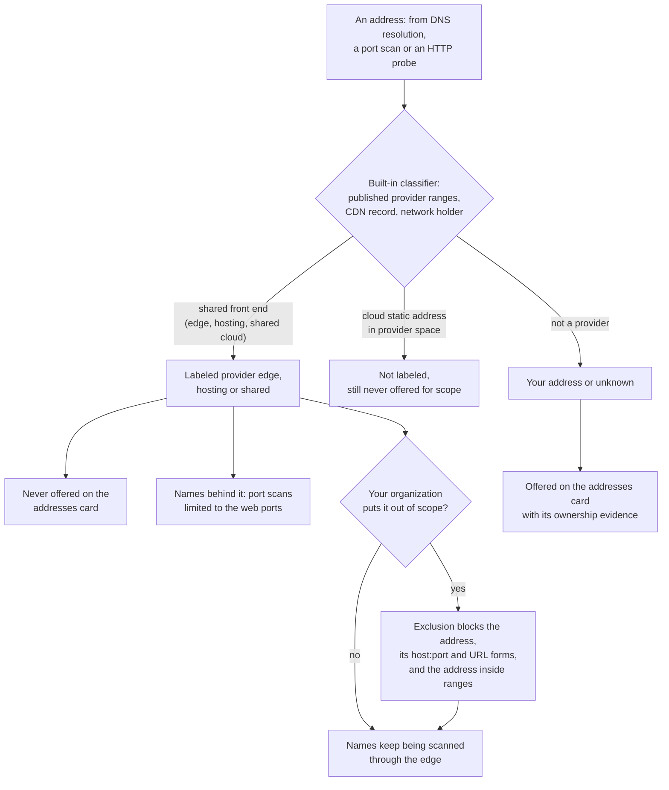

# CDN and shared hosting
{: .no_toc }

Many of your names are served by a CDN, a WAF or a hosting platform. Their
addresses belong to the provider and serve many organizations. The platform
labels them from one built-in classifier and never refuses them by itself:
your organization decides. Putting such an address out of scope stops scans
of the address but keeps scanning the names you serve through it.

1. TOC
{:toc}

## The flow

1. Every address the platform knows about is classified on read, from data
   it already holds: the published ranges providers list for their shared
   front ends, the CDN the probe reported, and the network holder.
2. A shared front end is labeled (**Behind** *provider* on a name,
   *provider* **edge**, **hosting** or **shared** on the address). Its ports
   show as **Provider ports**.
3. Such an address is never offered for scope on the **Decisions** page,
   even when nothing else is known about its network.
4. A port scan of a name served through a shared front end may reach only
   the web ports, whatever your scope entries say: the provider's other
   ports are not yours.
5. The platform never refuses the address on its own. Someone with scope
   write clicks the label and chooses **Add to out of scope**.
6. That exclusion stays on the address. Names that resolve to it keep being
   scanned through the edge. An exclusion of any other address (a dedicated
   or unknown one) also stops every name that resolves to it.

{: .note }
> From v0.20.0: the built-in classifier holds the published edge ranges of
> more providers, so more CDN edge addresses are labeled and kept off the
> addresses card.

## When something fails

| What happens | What you see | What to do |
|---|---|---|
| An address is labeled an edge only by its network holder | The exclusion preview lists the names it would stop too | Read the preview: for such an address the exclusion reaches its names |
| A name behind an edge is challenged or blocked | The coverage gap says **Blocked by edge protection** | Allow the scanner addresses at the provider, or accept the gap |
| A port scan asks for non-web ports on a name behind an edge | The name is left out of that job with the reason web ports only | Scan the web ports, or scan your own origin address directly |

## Security

- **Your organization decides scope.** The platform labels; it does not
  refuse provider addresses for you, and it never adds them for you.
- **No new data leaves the platform.** The label is computed from data the
  platform already holds; the ranges ship with the platform and are never
  downloaded at run time.
- **Fail closed on exclusions.** An address that is not provably a shared
  front end is treated as dedicated, so its exclusion reaches its names.
- **Organization isolation.** Exclusions, labels and previews read only
  your organization's assets within your data scope.

## Related

- [Attack surface monitoring: CDN and edge addresses](../../scanning/easm.md#cdn-and-edge-addresses)
- [Exclusions and the names behind them](../../scanning/scope.md#exclusions-and-the-names-behind-them)
- [Attack surface decisions](decisions.md)
