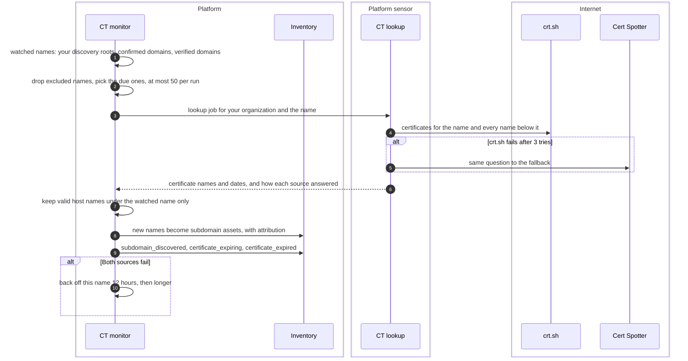
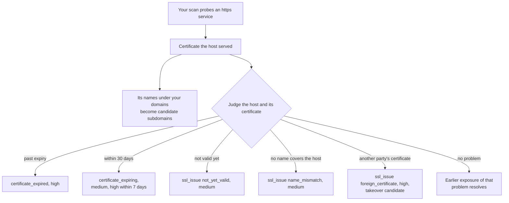

# Certificate exposures
{: .no_toc }

Certificates tell the platform two things: which names exist under your
domains, and whether the certificate a host serves is healthy. The platform
reads public Certificate Transparency logs for your domains, and your scans
read the certificate each https host serves. Both feed the inventory and the
exposures.

1. TOC
{:toc}

## The flow

### Certificate Transparency

1. The monitor watches your domain scope entries with discovery on, your
   confirmed domain assets and your verified domains. Names you excluded are
   not sent.
2. Each run takes at most 50 due names per organization, never-checked first.
3. The platform itself contacts neither source: a platform sensor answers
   each name as a lookup job. It asks crt.sh, retrying up to 3 times, then
   Cert Spotter as a fallback. When both fail, the name backs off for 12
   hours, then 24, 48 and up to 7 days (longer when a source asked to wait).
   Without such a sensor, Certificate Transparency monitoring is off and the
   **Monitoring** card says so.
4. Only syntactically valid host names at or below the watched name are
   kept. A name named exactly on a certificate that lapsed at most 90 days
   ago becomes a `subdomain` asset, with the attribution its evidence gives
   (see [Attack surface decisions](decisions.md)).
5. The monitor raises `subdomain_discovered` for new hosts, and
   `certificate_expiring` or `certificate_expired` from each host's newest
   certificate. Names marked **Not ours**, and names under them, raise
   nothing.

### Certificates your hosts serve

1. When a scan reads the certificate a host serves, its names below your
   domains are proposed as `candidate` subdomains. A certificate never
   confirms or scopes a name by itself.
2. The platform judges each host and its certificate and raises one exposure
   per host and problem.
3. A certificate from another party, typically a hosting platform's default
   certificate, is a takeover candidate. It feeds the
   [dangling DNS](dangling-dns.md) check.
4. A later scan that sees the host serve a healthy certificate resolves the
   exposure; seeing the problem again reopens it. Accepted and
   false-positive exposures are left alone.

## When something fails

| What happens | What you see | What to do |
|---|---|---|
| crt.sh and Cert Spotter both fail | The name's last check shows each source's state; it backs off | Nothing; it retries. Check the platform sensor's outbound access |
| No platform sensor answers CT lookups | The **Monitoring** card says lookups need a platform sensor; nothing is queried | The platform administrator connects a platform sensor with a release that has CT lookups |
| Many watched names | Not every name is queried in one run | Nothing; the rest follow in the next runs |
| Certificate Transparency is off | No new names from logs, no expiry from logs | Turn it on in the **Monitoring** card if you accept sending your names |
| A host resets every request | The certificate is still judged from the TLS handshake | Fix the host, or allow the scanner |

## Security

- **Only your names leave, and only from a platform sensor.** The platform
  sensor sends the watched names to crt.sh and Cert Spotter through its
  guarded client; the platform contacts neither. Turning it off stops this.
- **The sensor's answer is checked again.** Each lookup is signed for your
  organization and one platform sensor, answered once, and the platform keeps
  only names under the name it asked about. A wildcard-only name never
  becomes a host.
- **Untrusted names.** A name from a log is kept only if it is a valid host
  name under the queried name; markup and control characters are dropped.
- **A shared certificate creates nothing for others.** Names outside your
  domains on a CDN or hosting certificate never become your assets.
- **Organization isolation.** The organization comes from the watched name,
  never from the log's answer. Host certificates pair only with your own
  assets of the same report.

## Related

- [Attack surface monitoring: Certificate Transparency](../../scanning/easm.md#certificate-transparency)
- [Attack surface monitoring: Certificates](../../scanning/easm.md#certificates)
- [Dangling DNS](dangling-dns.md)
