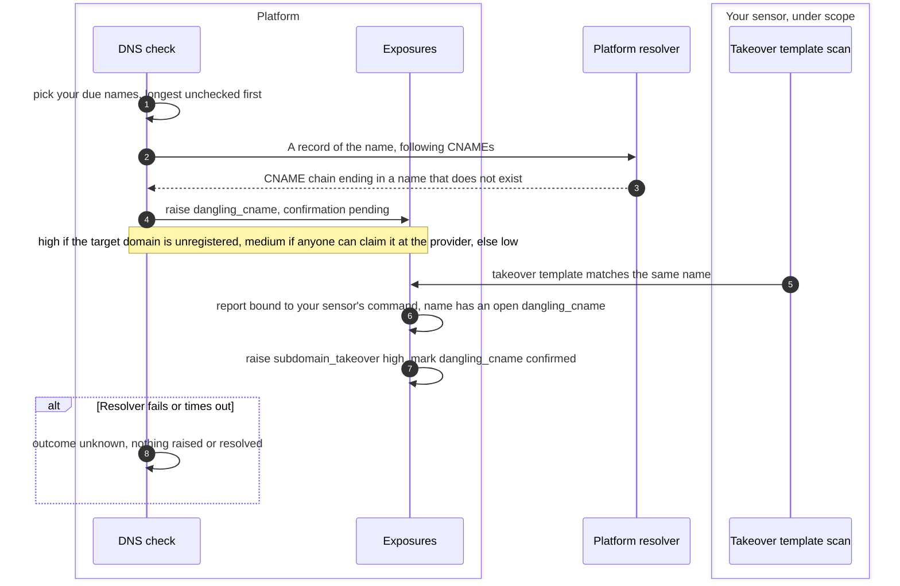
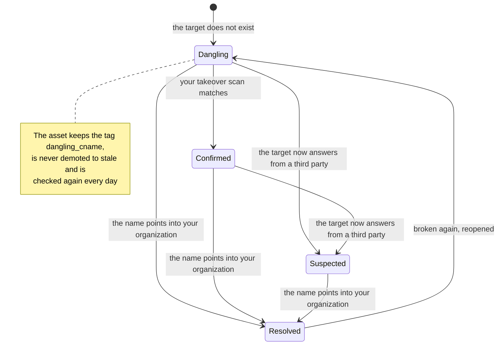

# Dangling DNS
{: .no_toc }

A dangling record is one of your names whose CNAME or delegation points at
something that no longer exists, or at a provider that no longer serves it.
Whoever claims the target answers for your name. The platform finds these
with DNS questions only, your own scans confirm them, and the name stays
your asset and stays tracked until it points somewhere you own.

1. TOC
{:toc}

## The flow

### Finding and confirming

1. Every day the platform asks its own resolver about your names: those in
   your inventory, and names awaiting review only while a scope entry covers
   them. Rejected names are never asked about.
2. A CNAME chain that ends in a name that does not exist raises
   `dangling_cname`. A delegation whose name servers do not exist, or do not
   answer for the zone, raises `dangling_ns`.
3. The severity follows the risk: high when the target's domain is not
   registered, medium when the provider lets anyone claim the name, low for
   any other missing target.
4. A takeover template in a scan your own sensor ran, on the same name,
   confirms it: the platform raises `subdomain_takeover` (high). A template
   match alone, without the dangling record, raises nothing.
5. When the resolver fails, nothing is concluded. The name is checked again
   next time.

### Lifecycle

{: .note }
> From v0.20.0: this lifecycle is how the check works. In v0.19.1 the check
> resolves `dangling_cname`, and a confirmed takeover, as soon as the missing
> target exists again, which is also what a successful takeover looks like.

1. **Into your organization** is the only automatic resolution: the CNAME
   ends under the name's own registrable domain or a root domain you
   confirmed; or, with no CNAME, every address is your confirmed address
   outside provider space; or the name has no record at all.
2. A target that did not exist and now answers from someone else, or a
   chain that moved to a new third party, is what a takeover looks like. The
   check keeps `dangling_cname` open and raises a suspected
   `subdomain_takeover` (high). Check what the name serves; the check
   resolves it only once the name points into your organization.
3. A provider that serves every customer from shared front ends still
   answers for a name it no longer serves. When your scans see certificate
   trouble on the name (expired, another site's certificate, a name
   mismatch) while the CNAME points at that provider, the check raises
   `dangling_cname` with the response class `provider_refuses`. A takeover
   template match on such a name is confirmed from the CNAME chain, without
   an earlier DNS-only record.
4. While a dangling or takeover exposure is open, the asset carries the tag
   `dangling_cname` and is never demoted to stale, so scans keep targeting
   it.
5. A record that breaks again reopens the same exposure, but only one the
   check itself resolved. Your own resolution, acceptance or false-positive
   mark is never reopened.

## When something fails

| What happens | What you see | What to do |
|---|---|---|
| The resolver times out or fails | Nothing changes for that name | Check `EASM_DNS_RESOLVER` on the platform |
| A dangling name is outside every scope entry | It is checked only if it is in your inventory | Confirm it, or add a scope entry |
| No takeover template ran | `dangling_cname` stays medium with confirmation pending | Run the **Subdomains** or **Deep recon** workflow's takeover step |
| A fix takes time to clear | The exposure stays open until the next check after the record's cache time | Wait for the next daily check, or **Run now** |

## Security

- **DNS only from the platform.** The check asks DNS about your own names.
  Nothing is sent to your hosts or to the CNAME targets, and no request ever
  tries to claim a name.
- **Confirmation comes from your own gated scan.** Only a report bound to a
  command your sensor ran, on a name the command covered, confirms a
  takeover. Uploads and imports confirm nothing.
- **Organization isolation.** Ownership comes from your organization's own
  assets and decisions only. The same address or domain in another
  organization proves nothing.
- **Not used as a lookup tool.** A name awaiting review is checked only
  while your scope covers it, so the platform cannot be used to probe other
  organizations' names.

## Related

- [Attack surface monitoring: DNS checks](../../scanning/easm.md#dns-checks)
- [Discovery depth](discovery-depth.md)
- [Certificate exposures](certificates.md)
