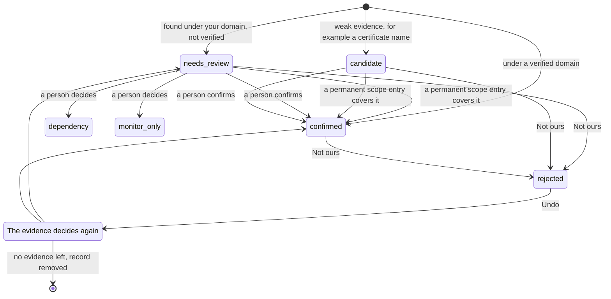
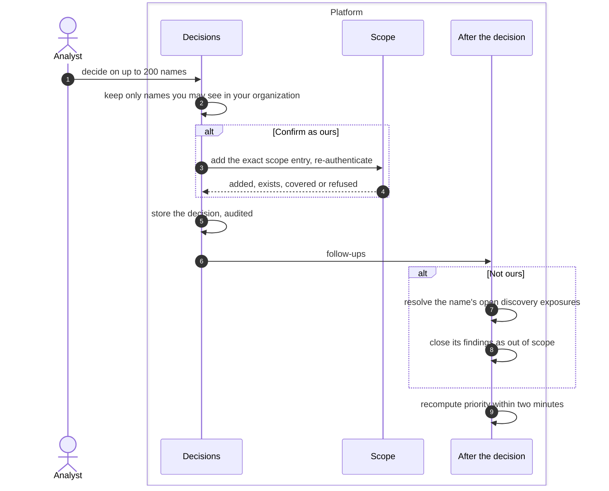
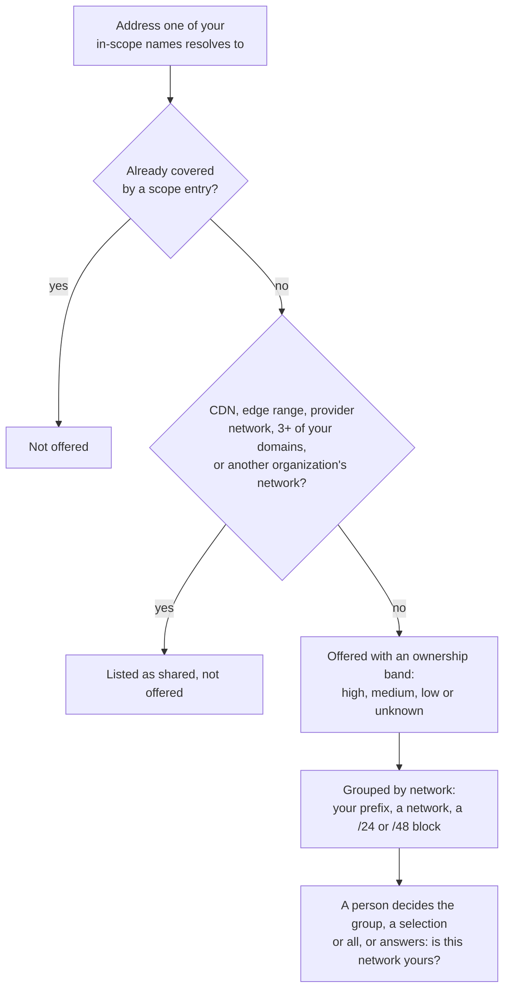

# Attack surface decisions
{: .no_toc }

Discovery finds names and addresses that may or may not be yours. A name a
permanent scope entry covers is confirmed by itself. Everything else waits
for a person in **Discovery > Decisions**. A decision changes what the
platform may scan, which findings stay open and what your inventory counts.

1. TOC
{:toc}

## The flow

### How a name gets its attribution

1. Evidence sets the first state. A name under a verified domain is
   confirmed. A name under one of your domains that you did not verify
   needs review. A name seen only on a certificate is a candidate.
2. A permanent scope entry that covers the name confirms it with no review.
   This runs after every scope change that could confirm names, and every
   6 hours.
3. Otherwise a person decides: **Ours: add to scope**, **Not ours**,
   **Dependency** (your name on a provider's infrastructure) or **Monitor
   only**. A person's decision always wins; automation never changes it.

### What a decision does

1. You decide on one name or up to 200 at once. Names outside your data
   scope or another organization's names are answered as not found.
2. **Ours: add to scope** first adds the exact scope entry for each domain,
   subdomain or public address, with re-authentication, the usual scope
   approvals and one audit event per entry. It adds nothing when your
   organization turned this off, when scan approval is Strict, or when you
   cannot write scope. Services, certificates and web pages follow their
   host and get no entry of their own.
3. The decision is stored and audited.
4. **Not ours** resolves the name's open Certificate Transparency and DNS
   check exposures, and those of the names under it. Its findings are
   closed as out of scope (never counted as fixed). The name is remembered
   for 12 months so discovery does not propose it again.
5. Every decision recomputes the priority of the asset's findings within two
   minutes.
6. **Undo** of Not ours lets the evidence decide again; findings closed as
   out of scope reopen to the status they had.

### Addresses behind your names

An address is never added to scope because a name points at it: dangling
records, shared hosting and released cloud addresses would make a scan
probe a third party. The **Addresses your in-scope names resolve to** card
offers the others with their ownership evidence, strongest first.

### One decision per network

The card groups the addresses so you decide a network once, not each
address:

| Group | What it is | What you can do |
|---|---|---|
| **Your prefix** | inside a prefix your own network seed announces | **Add range** (one entry for the prefix), **Not ours** |
| **Your network** | in one of your network seeds | **Add N addresses**, **Not ours** |
| A network (AS and holder) | a known network you have not declared | **Add N addresses**, **Not ours**, and **Is this network yours?** |
| A /24 or /48 block | no network data yet | **Add N addresses**, **Not ours** (a block is never added as a range) |
| Announced by another organization | shared: not offered | **Is this network yours?**, **Add anyway** for one address |
| A provider, shared hosting | CDN, edge, hosting or cloud provider space | **Add anyway** for one address, **Not ours** |

Each group shows how many addresses it holds, the in-scope names that point
at them and its evidence (for example "In your own prefix", "No network data
yet", "New, first seen less than a day ago"). Select addresses across groups
for **Add selected** or **Not ours**, or use **Add all**. Every action opens
a dialog that lists exactly what is added or marked, and every decision has
an **Undo**.

**Is this network yours?** **Yes** records the network (its AS, or its
holder's name) as one of your network seeds: its addresses, now and later,
are then added automatically when the evidence is strong, through your
approval rules. **No** marks the group's addresses not yours and the
question is not asked again (**Ask me again** undoes it).

The server accepts only addresses and ranges that are on your own card: an
address of another organization, one outside your data scope, one already in
scope or a range that is not your own announced prefix is refused, and
nothing is written. A shared or provider address is never part of a bulk
add. With scope approvals on, every added entry waits for your approvers.

### Why "No network data yet"

An address's network (AS, holder, announced prefix) comes from the network
lookup your sensor runs in discovery runs and every week for each address.
An address that a DNS answer just created has none until that lookup runs.
The weekly lookup also reaches addresses that no scope entry covers, as long
as one of your in-scope names points at them: it reads public routing data
and sends nothing to the address.

## When something fails

| What happens | What you see | What to do |
|---|---|---|
| Re-authentication missing | The confirm asks you to sign in again; nothing is saved | Re-authenticate and confirm again |
| A scope entry is refused | The result lists it as refused with the reason (guardrail, deny list) | Ask a scope approver, or check the guardrails |
| You can confirm but not write scope | The name is confirmed, no entry is added | Ask someone with scope write to add the entry |
| A name you rejected comes back | It came back with a new kind of evidence | Check the evidence, reject again |

## Security

- **Organization isolation.** Every read and write is limited to your
  organization and your data scope. A name you cannot see answers as not
  found.
- **Confirming is not authorizing.** Only a scope entry authorizes active
  scans. A confirmed name outside every entry stays passive until an entry
  covers it.
- **Re-authentication.** Adding scope entries needs a fresh sign-in, and
  every entry and decision is audited.
- **Automation never overrides a person.** The scope join and later
  evidence only raise automatic records.

## Related

- [Attack surface monitoring: Review](../../scanning/easm.md#review)
- [Discovery: Decisions](../../user-guide/04-discovery.md#decisions)
- [Scope and authorization to scan](../../scanning/scope.md)
- [CDN and shared hosting](cdn-edge.md)
- [Finding status lifecycle](../results/finding-lifecycle.md)
