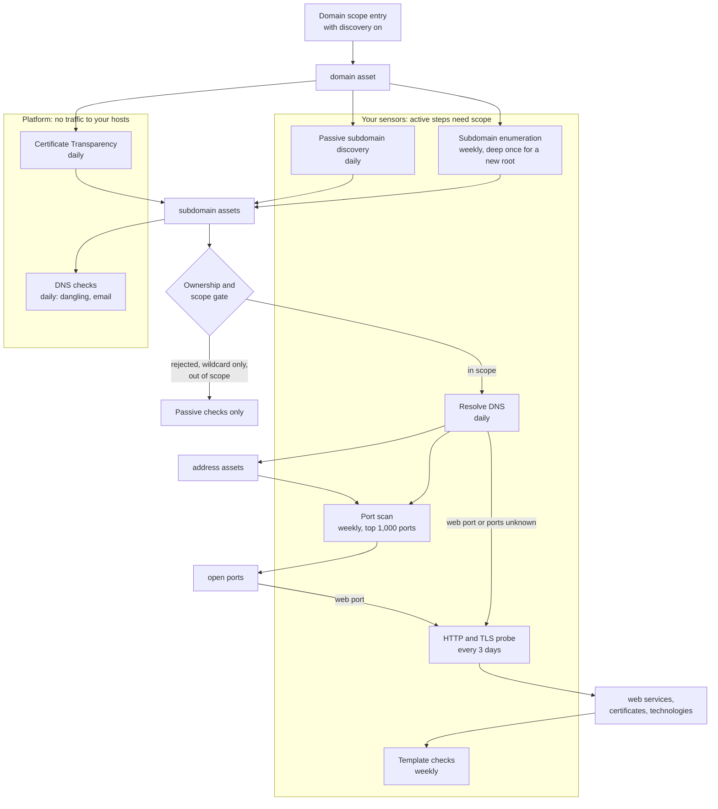

# Discovery depth
{: .no_toc }

Discovery starts from your permanent domain scope entries with discovery on,
for example `*.example.com`. The platform and your sensors then find the
names under them, resolve them, scan their ports and probe their web
services. Each step only runs on what the previous one found and what your
scope allows, so discovery never wanders into another organization's
network.

1. TOC
{:toc}

## The flow

1. A domain scope entry with discovery on makes its domain a discovery root.
   Certificate Transparency also watches your confirmed domain assets and
   verified domains.
2. On each root, automatic coverage runs passive subdomain discovery daily
   and subdomain enumeration weekly. A root enumerated for the first time
   gets one deep pass with the larger wordlist.
3. Every name found becomes a `subdomain` asset with an attribution (see
   [Attack surface decisions](decisions.md)). Before any active step, the
   scope and ownership gate checks it. A name marked **Not ours**, one that
   resolves only through a wildcard DNS record, or one outside every scope
   entry gets passive checks only.
4. A name in scope is resolved daily. Its addresses become address assets.
   A name that resolves gets a weekly port scan of the top 1,000 ports.
5. A name is probed over HTTP and TLS when one of its addresses has a
   possible web port, or when no port scan has run yet. An open web port on
   an address is probed too.
6. The probe records web services, the certificate each host serves and
   its technologies. Template checks then run weekly on each web service.
7. In parallel, the platform's daily DNS checks look at every name for
   dangling records and email posture, with no traffic to your hosts.

### How deep it goes

Automatic coverage does not chain names to names: only a `domain` asset
under a scope entry is searched for subdomains, so a subdomain is never a
new root by itself. Scans of the recon workflows chain their steps, and
there the depth is fixed:

| Limit | Value |
|---|---|
| Discovery hops from the scan's own targets | at most 3 |
| Derived targets per parent in one step | at most 5,000 |
| Targets in one run | at most 10,000 |
| Derived targets for an intrusive (T2) step | never |

A derived target past a limit is recorded as skipped on the run, with the
reason, and is not scanned.

## When something fails

| What happens | What you see | What to do |
|---|---|---|
| A found name is not in any scope entry | It joins the inventory and gets passive checks only | Add a scope entry for it, or confirm it in **Decisions** |
| A name stops resolving | Coverage settles it as checked with no answer and rechecks DNS after 1, 3 and 7 days, then weekly | Nothing, or remove the record if it is gone for good |
| The host does not answer the scanner | The run and the asset show a coverage gap with the reason | Allow the scanner addresses, or lower the rate |
| No sensor can run a step | **Discovery stages** shows the stage paused with the reason | Install the tool or a recent sensor |
| A derived target is past a limit | The run lists it as skipped | Split the scan, or scan the subtree on its own |

## Security

- **Scope decides what is touched.** Only a scope entry authorizes active
  steps. A name found by discovery is never a reason to scan another name.
- **Gate at every hop.** Each derived target passes the same checks as a
  target you type: exclusions, ownership, zones and scan windows.
- **Passive parts stay passive.** Certificate Transparency and the DNS
  checks send only your names to public logs and the platform's resolver.
  Turning Certificate Transparency off stops sending them.
- **Organization isolation.** Names, scope entries and attributions of
  another organization never allow or refuse anything for yours.

## Related

- [Attack surface monitoring](../../scanning/easm.md)
- [Automatic coverage](../../scanning/asset-coverage.md)
- [Scope and authorization to scan](../../scanning/scope.md)
- [From scan to results](../scans/scan-to-results.md)
- [Politeness](../scans/politeness.md)
