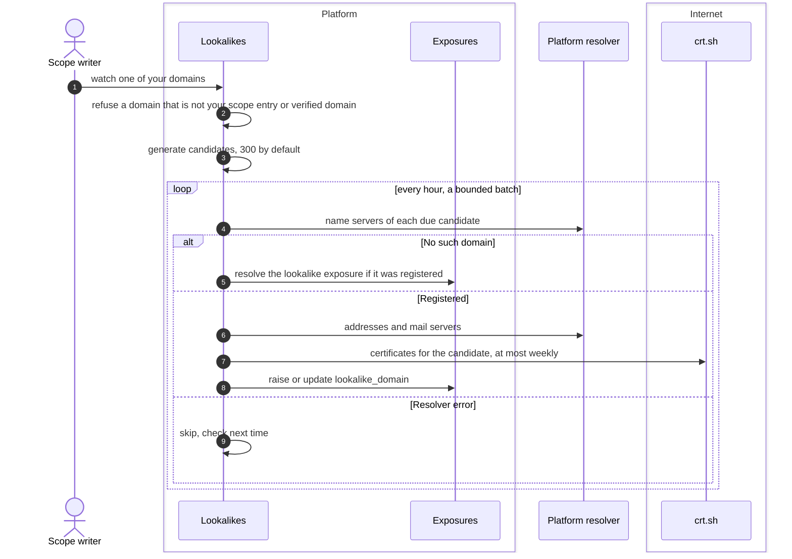

# Lookalike domain monitoring
{: .no_toc }

A lookalike is a domain someone registers to look like yours: a typo, a
swapped letter, another top-level domain. The platform generates the
candidates of each domain you watch and checks them passively, with DNS
questions and Certificate Transparency only. It never contacts a candidate
host.

1. TOC
{:toc}

## The flow

1. Someone with scope write watches a domain under **Attack surface >
   Lookalikes**. Only one of your own root domains (an active permanent
   domain scope entry or a verified domain) can be watched, up to 20.
2. The platform generates the candidates locally: typos, keyboard
   neighbours, hyphens, bit flips, look-alike characters including
   international ones, and other top-level domains. 300 per domain by
   default, at most 1,000.
3. Every hour it checks a bounded batch: up to 100 candidates per domain and
   300 per organization. A registered candidate is checked again daily,
   others weekly.
4. A candidate with name servers is registered. The platform then asks for
   its addresses and mail servers, and Certificate Transparency for its
   certificates (at most 10 such questions per organization per run, each
   candidate at most weekly).
5. A registered candidate raises a `lookalike_domain` exposure: medium when
   it can receive mail, or has addresses and a certificate (ready to phish);
   low otherwise.
6. A candidate that no longer exists is resolved by itself. Removing a watch
   resolves its open lookalikes.
7. You triage each one: accept it (yours or harmless), mark it a false
   positive, or resolve it once it is taken down.

## When something fails

| What happens | What you see | What to do |
|---|---|---|
| The domain is not one of yours | The watch is refused | Add a permanent scope entry or verify the domain first |
| The resolver fails | The candidate is skipped this time | Nothing; it is checked next time |
| Certificate Transparency lookups are off | Severity uses DNS only | Turn the lookups on in the attack surface settings if you accept sending candidate names |
| Many candidates | Not all are checked in one hour | Nothing; the rest follow |

## Security

- **Passive only.** DNS questions go through the platform's resolver and
  certificate questions through the guarded client. No candidate host is
  ever contacted, so the owner of a lookalike learns nothing.
- **Only your domains.** A watch needs an active permanent scope entry or a
  verified domain, so the feature cannot watch another organization.
- **Organization isolation.** Watches, candidates and exposures belong to
  your organization; every read and write carries it.

## Related

- [Discovery: Lookalikes](../../user-guide/04-discovery.md#lookalikes)
- [Attack surface monitoring](../../scanning/easm.md)
