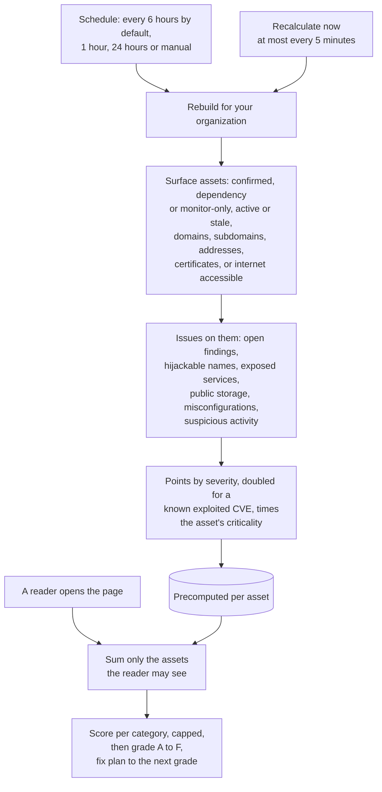

# Posture grade
{: .no_toc }

The posture grade sums up your external attack surface as a score from 0 to
100 and a grade from A to F, for the organization and for each root domain.
It is computed ahead of time on a schedule, and each reader sees the grade of
the assets they may see.

1. TOC
{:toc}

## The flow

1. The posture is rebuilt for your organization on its schedule (every 6
   hours by default) or with **Recalculate now**, at most once every 5
   minutes.
2. Only surface assets count: attributed internet-facing assets of your
   organization. Names awaiting review and names marked **Not ours** never
   count.
3. Each issue gets points by severity: critical 10, high 5, medium 2, low
   0.5. A finding whose CVE is known exploited counts double. The points of
   an asset are multiplied by its criticality: critical 2, high 1.5, medium
   1, low 0.5.
4. The points per asset are stored ahead of time. Nothing is computed from
   scratch when you open the page.
5. When you open the page, the platform sums the points of the assets you
   may see and computes each category's deduction. A category never takes
   more than its share: vulnerabilities 35, hijackable subdomains 15,
   exposed services 15, misconfiguration 15, cloud storage 10, suspicious
   activity 10.
6. The score is 100 minus the deductions: A from 90, B from 80, C from 70, D
   from 60, F below. With no surface asset there is no grade.
7. The page also shows the fix plan to the next grade and the gain from
   fixing assets of each criticality.

## When something fails

| What happens | What you see | What to do |
|---|---|---|
| A rebuild fails | The last grade stays, marked stale | Nothing; it retries in 15 minutes |
| A rebuild is running | **Recalculate now** answers busy | Wait for it to finish |
| Recalculate pressed again within 5 minutes | It is refused with the time to wait | Wait |
| You see only some assets | A grade of those assets only, no organization total | Ask for a wider data scope if you need the whole picture |

## Security

- **Limited to what you may see.** A reader with a limited data scope gets
  a score of their assets only and never learns how many issues exist
  elsewhere.
- **Organization isolation.** The rebuild runs for one organization at a
  time and every statement is limited to it.
- **Bounded load.** One rebuild per organization at a time, a time limit per
  rebuild, and the 5-minute limit on **Recalculate now**.
- **Audited.** **Recalculate now** and schedule changes are audited.

## Related

- [Discovery: Posture](../../user-guide/04-discovery.md#posture)
- [Attack surface monitoring](../../scanning/easm.md)
- [Dangling DNS](dangling-dns.md)
