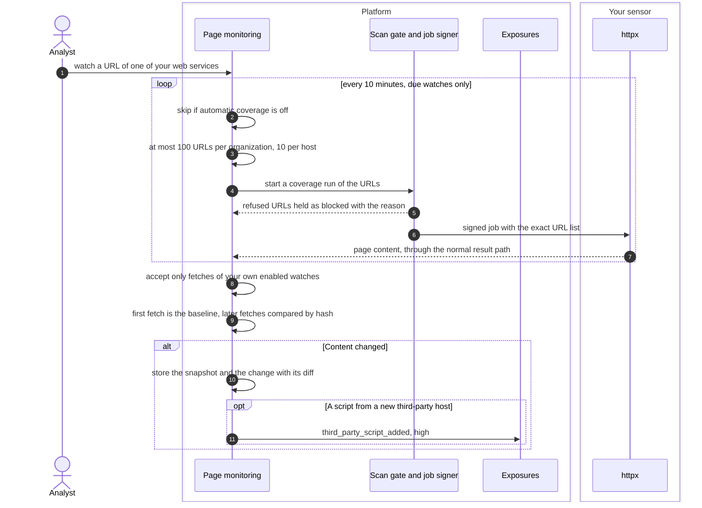
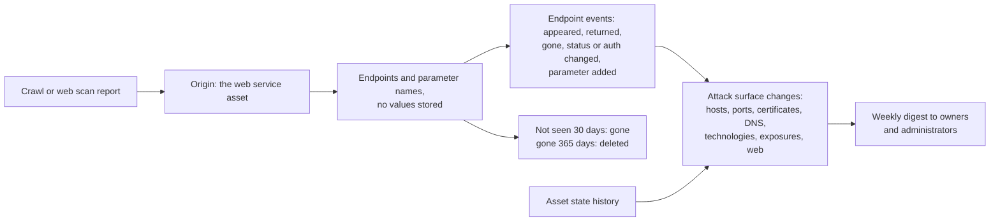

# Web surface and page changes
{: .no_toc }

Your scans record each web service, the endpoints a crawl finds on it and,
for pages you watch, the scripts and text they serve. The platform compares
each new sighting with the last one and turns the difference into changes
you can review, alerts for the risky ones, and a weekly digest.

1. TOC
{:toc}

## The flow

### Watched pages

1. You watch a URL of one of your web services, by hand or from the
   suggestions (home, sign-in and admin pages, scripts from the crawl).
2. Every 10 minutes the due watches are fetched through automatic coverage,
   only when it is on for your organization: at most 100 URLs per
   organization and 10 per host in one pass.
3. The fetch passes the same scope, exclusion and active-scan checks as any
   active scan, and the sensor gets a signed job with the exact URL list.
   A refused URL is held as **Blocked** with the reason; with no sensor able
   to fetch, watches stay **Waiting**.
4. The platform takes a fetch only for an enabled watch of your
   organization, so a sensor cannot plant content for a URL nobody watches.
5. The first fetch is the baseline. A later fetch with a different content
   hash stores a snapshot (the last 5) and a change with its diff (kept 180
   days). A page that changes on every check is muted.
6. A script from a host the page did not use before raises
   `third_party_script_added` (high), which resolves when the page drops the
   host.

### Endpoints and the change feed

1. A crawl or web scan report stores each web service as an asset and its
   endpoints below it: method, path template and parameter names. No value
   is stored.
2. Each change of an endpoint is an event: appeared, returned, gone, status
   or authentication changed, parameter added. An endpoint not seen for 30
   days is gone; gone for 365 days, it is deleted.
3. **Attack surface > Changes** reads the asset history, these events and
   the exposures, and gives each change a kind: host added or removed, port
   opened or closed, certificate changed or expiring, DNS changed or
   dangling, technology changed, new exposure, and the web kinds (a new
   sensitive path, authentication lost, a sensitive parameter added).
4. Once a week (Monday 08:00 UTC by default) each organization's owners and
   administrators get a digest of the past week. A quiet week sends nothing.

## When something fails

| What happens | What you see | What to do |
|---|---|---|
| No sensor can fetch web content | Watches show **Waiting** and are kept | Use a sensor that runs `monitor.web_content` |
| The scan gate refuses a URL | The watch shows **Blocked** with the reason | Check scope and exclusions for that host |
| Automatic coverage is off | Nothing is fetched | Turn automatic coverage on |
| A page changes on every check | The watch is marked **Changes on every check**, changes muted | Add ignore patterns, or edit the watch |

## Security

- **Same gate as every scan.** Fetches go through scope, exclusions, the
  active-scan check and zones, as signed jobs naming the exact URLs.
- **No values kept.** Endpoints keep names, never parameter, cookie or
  header values. Full-page mode masks secrets in the text.
- **Content is untrusted.** Every value from a page is shown as plain text.
- **Organization isolation.** Watches, snapshots, endpoints and changes are
  your organization's; reads follow the data scope of the web service.

## Related

- [Attack surface monitoring: Page changes](../../scanning/easm.md#page-changes)
- [Discovery: Web surface](../../user-guide/04-discovery.md#web-surface)
- [Discovery: Changes](../../user-guide/04-discovery.md#changes)
- [Signed jobs](../scans/signed-jobs.md)
