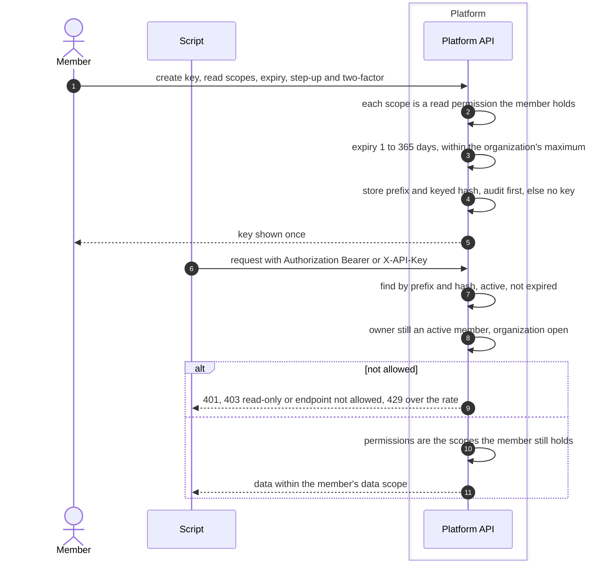

# API key flow
{: .no_toc }

A member creates an API key in **Settings > API keys** to read data from a
script. The key is shown once, belongs to that person in one organization,
and can only read. Every request is checked against what the person may
still do.

1. TOC
{:toc}

## The flow

1. Scopes are read permissions only, and the creator must hold each one.
2. The organization sets the longest allowed expiry (90 days by default, at
   most 365). The person is told a week before a key expires.
3. If the creation cannot be audited, the key is revoked and the request
   fails.
4. Keys are never accepted in the URL. They cannot be used for account,
   sign-in, administration, key or SCIM endpoints, and cannot change data.
5. When the member loses a permission or leaves the organization, the key
   loses it too at the next request.

## When something fails

| What happens | What you see | What to do |
|---|---|---|
| The key is wrong, revoked or expired | 401 Invalid credentials | Create a new key. |
| The request changes data | 403 API keys are read-only | Use the console. |
| The endpoint is not for keys | 403 | Use the console. |
| Too many requests | 429 with Retry-After | Slow down or raise the key's rate. |
| No two-factor on your account | Key creation refused | Turn on two-factor first. |

## Security

- **At rest.** Only a prefix and an HMAC hash are stored.
- **Least privilege.** Read only, never more than the member holds now,
  never administrator.
- **Organization isolation.** The organization comes from the key, never the
  request.
- **Audit.** Requests made with a key are audited with the key's id.

## Related

- [API authentication](../../api/authentication.md)
- [MCP server and OAuth](mcp-oauth.md)
