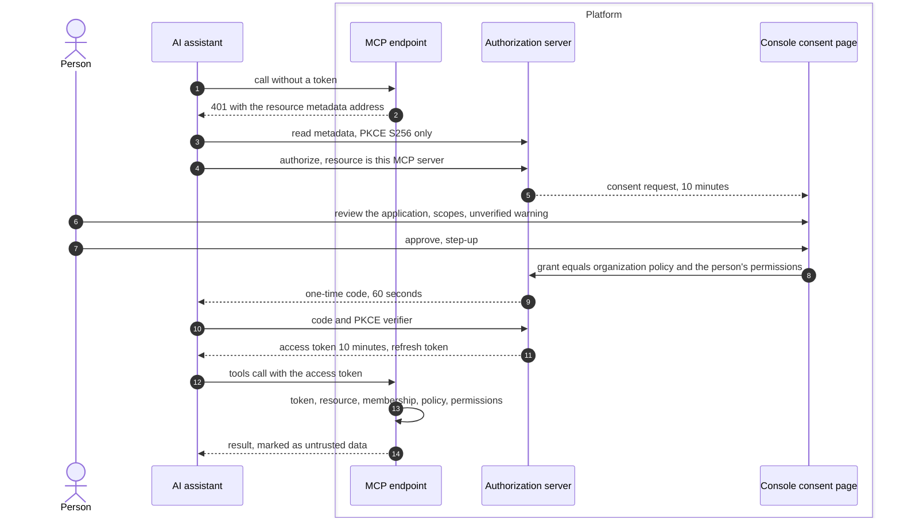

# MCP server and OAuth
{: .no_toc }

An AI assistant connects to the OpenCTEM MCP server on behalf of a person.
The assistant discovers the platform's authorization server, sends the
person to a consent page, and gets short-lived tokens limited to what the
organization allows and the person holds. Every tool call is checked again.

1. TOC
{:toc}

## The flow

1. The assistant is identified by a client metadata address, a client the
   organization registered, or, only when the installation enables it, by
   dynamic registration.
2. The consent page shows who asks, what each scope allows, and which scopes
   the organization or the person's role does not allow.
3. The grant is the intersection of the organization's policy under
   **Settings > AI assistants (MCP)** and the person's own permissions.
4. Access tokens last 10 minutes. Refresh tokens rotate on every use; a
   reused refresh token revokes the grant. A grant lasts at most 90 days.
5. Each tool call checks the token, that it was issued for this server, the
   person's membership, the policy and the permission the tool needs. Reads
   stay inside the person's data scope.
6. Tools that change data ask the person to confirm in the console within 5
   minutes.

API keys also work on the MCP server, when the organization allows it, for
read tools only.

## When something fails

| What happens | What you see | What to do |
|---|---|---|
| The organization has not approved the application | "Your organization has not approved this application" | Ask an administrator. |
| AI assistants are off | "AI assistants are turned off" | An administrator turns them on. |
| A tool needs a scope you did not grant | Insufficient scope | Reconnect and grant it, if allowed. |
| A code or refresh token is reused | The connection is revoked | Connect again. |
| You left the organization | The connection is revoked | Nothing. |
| API keys are not allowed on MCP | 403 | Use an OAuth connection. |

## Security

- **Tokens.** Opaque, stored as keyed hashes, bound to this server. Optional
  proof-of-possession (DPoP) can be required by the organization.
- **Least privilege.** Never more than the person holds now; never
  administrator.
- **Organization isolation.** The organization comes from the grant, never
  from tool arguments.
- **Revocation.** People revoke under **Connected applications**,
  administrators per organization, platform administrators per application.
  A password change or sign-out everywhere revokes every grant.
- **Audit.** Authorizations, tokens, tool calls and revocations are audited.

## Related

- [MCP](../../api/mcp.md)
- [AI assistants and data](../../identity/access/ai-assistants-and-data.md)
- [API key flow](api-keys.md)
