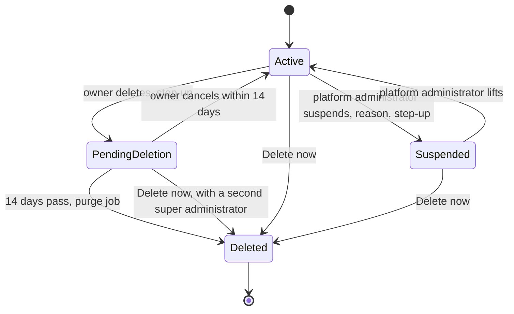

# Organization suspension and deletion
{: .no_toc }

A platform administrator can suspend an organization: nobody and nothing can
use it until it is lifted. An owner can delete their organization: it is
closed at once and removed after 14 days, unless the owner cancels.

1. TOC
{:toc}

## The flow

- **Suspended** and **pending deletion** close the organization the same
  way: sign-in, token refresh, API keys, MCP, sensors, SCIM, CI and webhooks
  are all refused, and scheduled work is skipped.
- A suspension needs a reason of 10 to 500 characters and is audited as
  critical, with WebSocket connections closed at once.
- The owner deletes from **Settings > Organization > Danger zone**. During
  the 14 days, the owner sees **Organization scheduled for deletion** at
  sign-in and can cancel.
- The purge job deletes files first, then the organization's data. People's
  accounts are kept.
- **Delete now** in the platform console works whatever the status. It needs
  a fresh code, a reason and approval by a second super administrator. The request is audited before
  anything is deleted.

## When something fails

| What happens | What you see | What to do |
|---|---|---|
| The organization is suspended | "Organization suspended" | Contact the platform operator. |
| The status cannot be read | Please try again shortly | Retry. Access is refused until the status is known. |
| You try to suspend an organization pending deletion | Already suspended | It is already closed. Purge or cancel instead. |
| You try to delete a suspended organization | Not active | Lift the suspension first. |
| The purge fails | The organization stays pending | The job retries on its next run. |

## Security

- **Fails closed.** When the status cannot be checked, access is refused.
- **Audit.** Suspension, lifting, scheduling, cancelling and deletion are
  audited.

## Related

- [Organizations and users](../../console/organizations-and-users.md)
- [Platform console and break-glass](platform-console.md)
