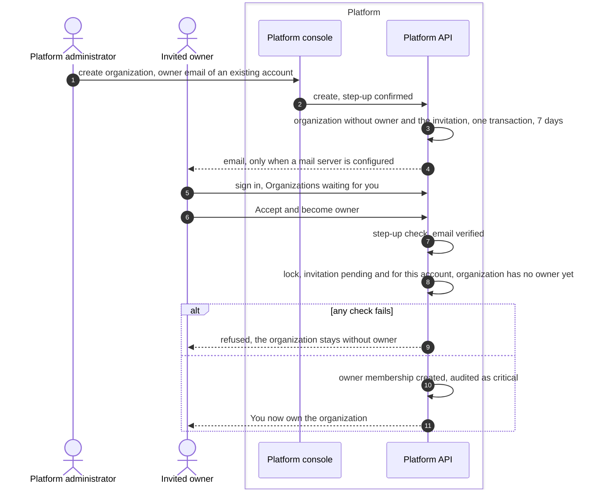
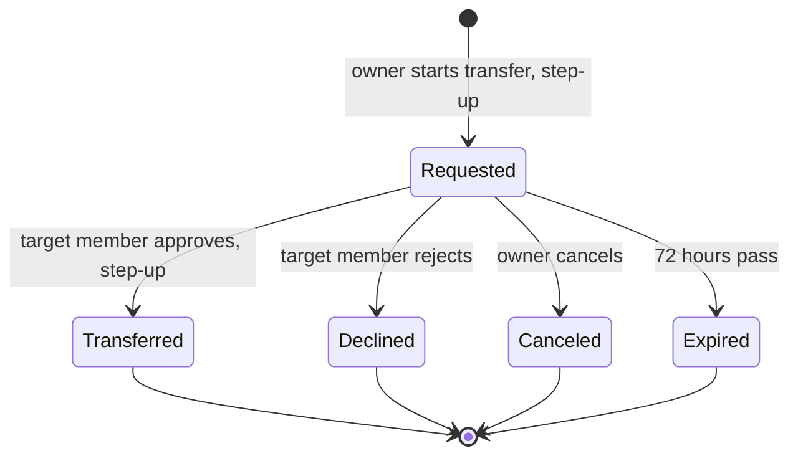

# Ownership invitations
{: .no_toc }

A platform administrator can create an organization for a person who already
has an account. The organization starts without an owner, and the person is
invited to become its owner. Later, an owner can transfer ownership to
another member, who must approve.

1. TOC
{:toc}

## The flow

### Becoming the first owner

1. If the owner email has no account, the platform instead creates the
   account and mails a set-password link.
2. The invitation is bound to that account. Nobody else can see or accept
   it. It lasts 7 days and can be sent again after 10 minutes, at most 5
   times.
3. The invitee confirms with step-up: their authenticator code, or their
   password when two-factor is off. A person who signs in only with single
   sign-on is asked to sign in again at their provider.
4. A lock makes sure only one person can become the first owner.
5. If the mail server is not configured, no email is sent. The invitation
   still appears under **My account** after sign-in.

### Transferring ownership

The target member must have two-factor authentication on. Every step is
audited.

## When something fails

| What happens | What you see | What to do |
|---|---|---|
| No mail server | No email arrives | Sign in. The invitation is under **My account**. |
| The email is not verified | "Verify your email address before accepting." | Verify the email, then accept. |
| You sign in with single sign-on only | Step-up not available | Sign in again at your provider, then accept. |
| The invitation expired | Expired | Ask the platform administrator to send it again. |
| Someone already became owner | Not found | Ask the owner for an invitation. |
| The target of a transfer has no two-factor | Transfer refused | The target enrols first. |

## Security

- **Bound to one account.** Only the invited account can see and accept an
  ownership invitation.
- **Step-up.** Accepting, starting and approving a transfer need a fresh
  proof of identity.
- **Audit.** Sending, accepting, declining and canceling are audited.
  Accepting is critical.

## Related

- [Organizations and users](../../console/organizations-and-users.md)
- [Sign-up and invitations](sign-up-and-invitations.md)
- [Step-up re-authentication](step-up.md)
