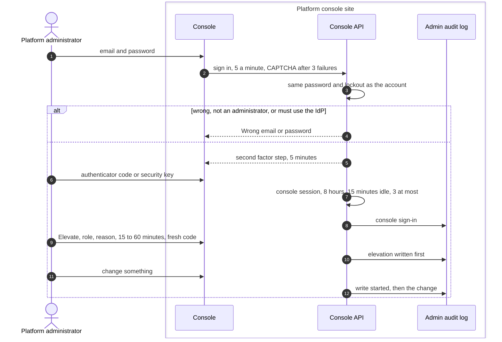
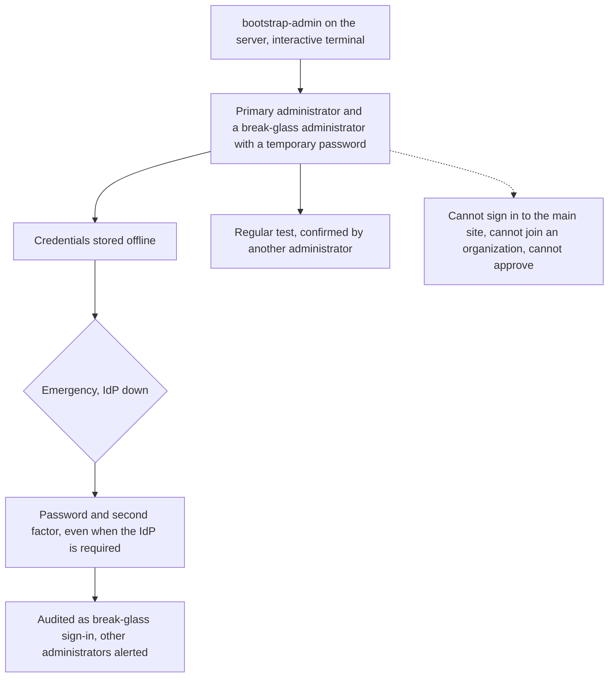

# Platform console and break-glass
{: .no_toc }

The platform console is a separate site for the people who run the
installation. It has its own sessions, always needs a second factor, and is
read-only until the administrator elevates for a short time. A break-glass
account is a spare platform administrator kept for emergencies: it can only
use the console.

1. TOC
{:toc}

## The flow

1. The console runs on its own address. The main site answers 404 for it.
2. Every console sign-in needs a second factor: a code or a security key.
   The installation can require security keys.
3. The session is read-only until the administrator elevates, with a role,
   a reason and a fresh code, for 15 to 60 minutes.
4. A change is not made when it cannot be audited first.
5. Some changes need a second super administrator to approve: adding or
   removing a super administrator, deleting an organization now, sign-in
   provider and two-factor policy changes, and others.

### Break-glass account

- `bootstrap-admin` creates the first administrator and, unless told not
  to, a break-glass administrator on a separate email. It refuses to print
  credentials to anything but a terminal.
- The break-glass account always has a password path, but still needs its
  second factor. Each use is a high-severity audit event and alerts the other
  administrators.
- Other platform administrators may also be members of organizations on the
  main site. Only break-glass accounts are limited to the console.

## When something fails

| What happens | What you see | What to do |
|---|---|---|
| Wrong password, or the IdP is required for this account | "Wrong email or password" | Use the IdP, or the break-glass account in an emergency. |
| Security keys are required | Security key required | Use a registered key. |
| The audit store is down | The change is refused | Restore the audit store first. |
| A second approval is needed | Second approval required | Ask another super administrator to approve. |
| Session idle for 15 minutes | Sign-in page | Sign in again. |

## Security

- **Separate site.** Its own address, optional network allow list, its own
  cookies with SameSite Strict and a session-bound CSRF token. No API keys.
- **Least privilege in time.** Read-only by default, elevation is short and
  audited.
- **Audit.** The admin audit log is hash-chained, and its head can be checked
  with `bootstrap-admin verify-audit` or shipped to an outside sink.

## Related

- [Platform console](../../console/index.md)
- [Console security](../../console/security.md)
- [First administrator](../../install/first-admin.md)
- [Audit log integrity](../operations/audit-chain.md)
