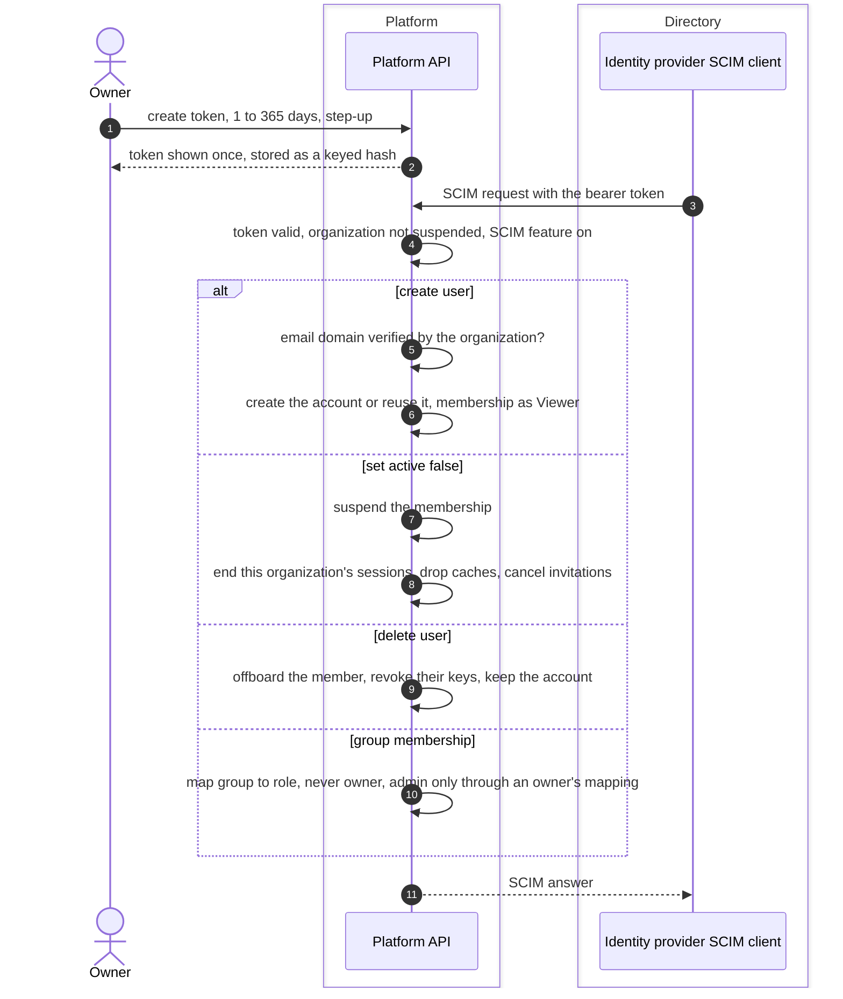

# SCIM provisioning flow
{: .no_toc }

An organization owner creates a SCIM token in **Settings > Directory sync
(SCIM)** and gives it to the identity provider. The provider then creates
members, suspends them and removes them. Every call works only inside the
token's organization.

1. TOC
{:toc}

## The flow

1. A new account is created only for an email on a domain the organization
   has verified. New members join as **Viewer**; groups give them more.
2. `active: false` suspends the membership. The person's sessions issued by
   this organization's provider end, and their API keys stop at the next
   request.
3. Delete offboards the member and revokes their keys. When the member owns
   work that needs a new owner, they are disabled instead until an
   administrator hands that work over. The account itself is kept, because it
   may belong to other organizations.
4. Rotating a token keeps the old one working for at most 24 more hours.

## When something fails

| What happens | What you see in the provider | What to do |
|---|---|---|
| Token wrong, revoked or expired | 401 | Create or rotate a token. |
| Organization suspended or SCIM not allowed | 403 | Contact the platform operator. |
| Email domain not verified | 400 invalid value | Verify the domain in the organization. |
| No free seat | 403 | Free a seat or raise the limit. |
| Unknown user | 404 | Resynchronise from the provider. |

## Security

- **Token.** Shown once, stored as an HMAC hash, always with an expiry.
  Creating and rotating need the owner and step-up.
- **Organization isolation.** The organization comes from the token, never
  from the request.
- **Roles.** SCIM never makes an owner. Administrator only through a mapping
  the owner set.
- **Disabling at the provider alone** does not end a session; SCIM
  deprovisioning or a suspension does.

## Related

- [SCIM](../../identity/scim.md)
- [Single sign-on with OIDC](sso-oidc.md)
