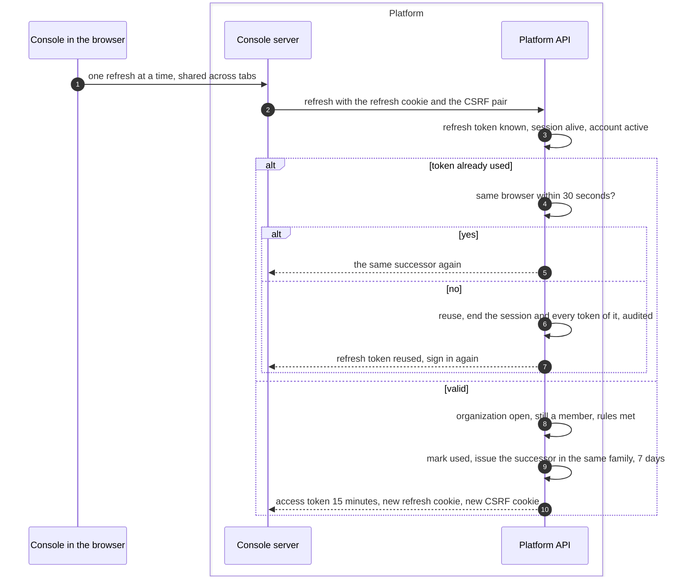
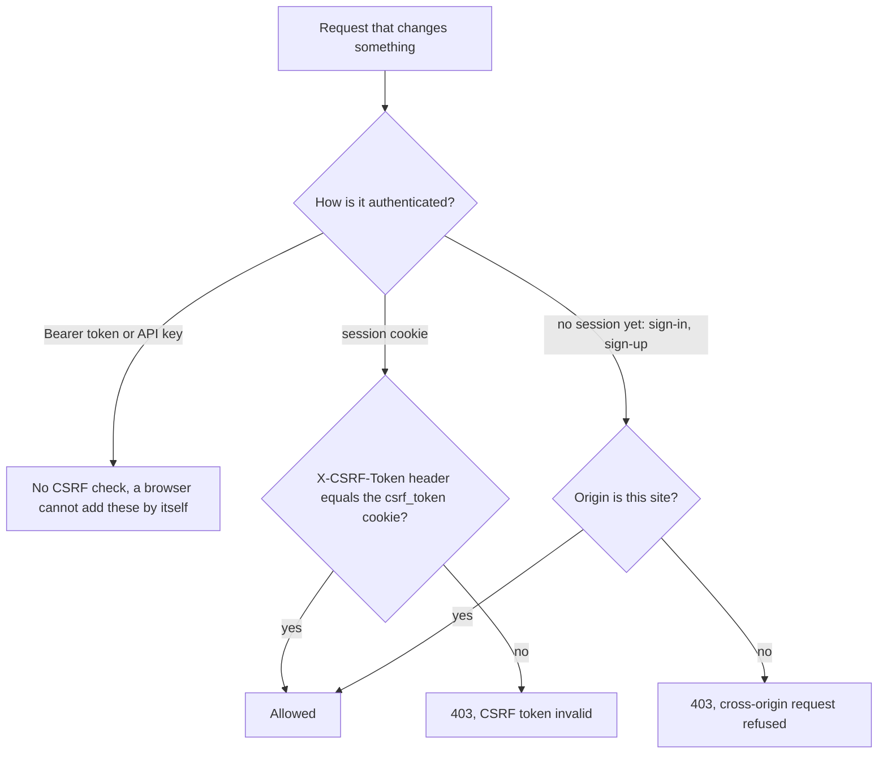

# Sessions and CSRF
{: .no_toc }

The console holds a 15-minute access token and a refresh token. Before the
access token expires, the console trades the refresh token for a new pair.
Each refresh token works once; using one twice ends the whole session. Every
change the browser makes carries a CSRF token that another site cannot read.

1. TOC
{:toc}

## The flow

1. Only one refresh runs at a time across tabs, so the normal case never
   reuses a token.
2. A second use within 30 seconds from the same browser gets the same
   successor, which covers a lost answer.
3. Any other second use is treated as theft: the session and all its tokens
   end.
4. A session lasts at most 30 days.

### CSRF

- Another site cannot read the `csrf_token` cookie, so it cannot copy it
  into the header.
- Sign-in and sign-up requests have no session yet; they are refused when
  they come from another site.
- The SAML response and the back-channel logout are signed by the provider
  and are not checked this way.

## When something fails

| What happens | What you see | What to do |
|---|---|---|
| The refresh token was reused | "Your session ended" and the sign-in page | Sign in again. If you did not cause it, change your password. |
| The session expired | Sign-in page | Sign in again. |
| Two tabs switch organization at the same moment | The session may end | Sign in again. Only refresh has the 30-second allowance. |
| A form is submitted from another site | 403 | Nothing to do. This is the protection working. |

## Security

- **At rest.** Refresh tokens are stored as SHA-256 hashes. Cookies are
  HttpOnly, except `csrf_token`, which the page must read.
- **Revocation.** Signing out, a password change or a reuse ends the session
  at once, including access tokens not yet expired.
- **Organization isolation.** Every refresh checks membership and the
  organization's status again.

## Related

- [Password sign-in](sign-in.md)
- [Sign-in configuration](../../identity/sign-in-configuration.md)
