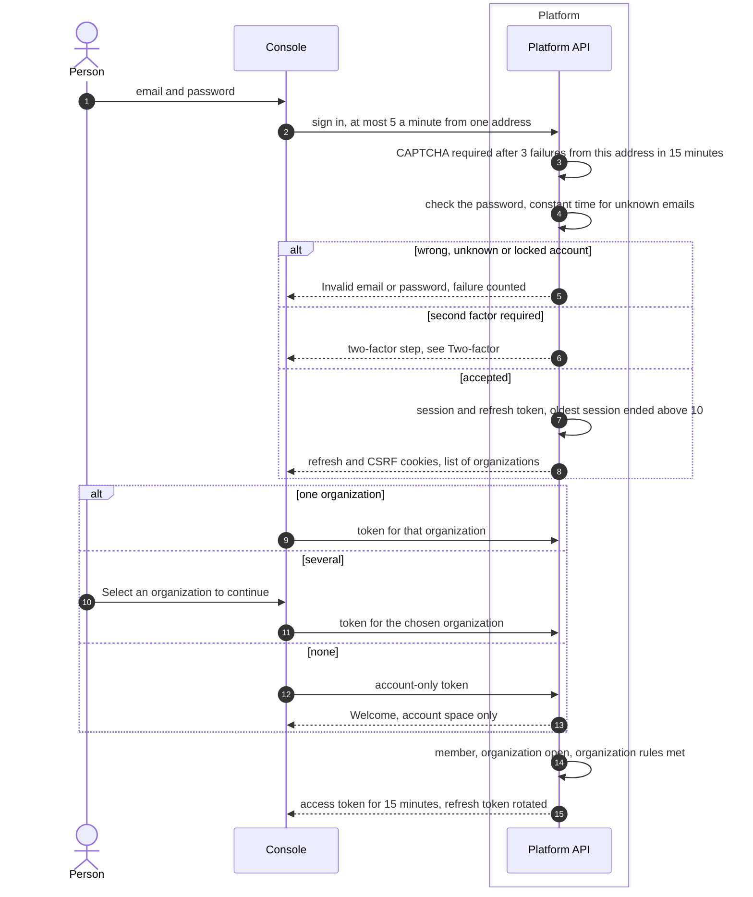

# Password sign-in
{: .no_toc }

A person signs in with email and password. The platform checks the password,
asks for the second factor when one is required, opens a session and then
issues an access token for one organization at a time. A person with no
organization lands in their account space.

1. TOC
{:toc}

## The flow

1. After 3 failed sign-ins from one address within 15 minutes, a CAPTCHA is
   required, when CAPTCHA is configured.
2. A wrong password, an unknown email and a locked account all get the same
   answer: "Invalid email or password."
3. After 5 failures in a row the account is locked for 15 minutes. Each
   further run of 5 failures doubles the lock, up to 24 hours. Wrong
   authenticator codes and wrong step-up attempts count too. The counter
   resets only after a complete sign-in.
4. A person may have at most 10 sessions. A new one ends the oldest.
5. The organization token is issued only when the person is a member, the
   organization is not suspended, and its rules are met: single sign-on,
   two-factor, verified email.
6. With no organization, the person gets an account-only token. It reaches
   the profile, security settings, sessions, invitations and organization
   creation, and nothing else.

### Signing out

Signing out ends the session, revokes its refresh tokens and blocks its
access tokens at once. Resetting the password ends every session.

## When something fails

| What happens | What you see | What to do |
|---|---|---|
| Wrong password or locked account | "Invalid email or password." | Wait and try again, or reset the password. Resetting does not unlock the account early. |
| Too many attempts from one address | CAPTCHA, or too many requests | Solve the CAPTCHA, or wait a minute. |
| The account is blocked | Account suspended | Contact your administrator. |
| The email is not verified | Email not verified | Open the verification link. |
| The organization is suspended | "Organization suspended" | Contact the platform operator. |
| The organization requires single sign-on | Sign in with SSO required | Use **Sign in with SSO**. |
| The organization requires two-factor | Two-factor enrolment | Enrol when asked. |

## Security

- **No enumeration.** Every reason for a refused password gets the same
  answer and takes the same time.
- **Cookies.** The refresh token is in an HttpOnly cookie and never in the
  answer body. The access token lasts 15 minutes.
- **Organization isolation.** Each access token names one organization. Its
  membership is checked again on every request.
- **Audit.** Sign-in, failures and sign-out are audited.

## Related

- [Sign-in methods](../../identity/sign-in-methods.md)
- [Sign-in configuration](../../identity/sign-in-configuration.md)
- [Two-factor and the two-factor floor](two-factor.md)
- [Sessions and CSRF](sessions-csrf.md)
