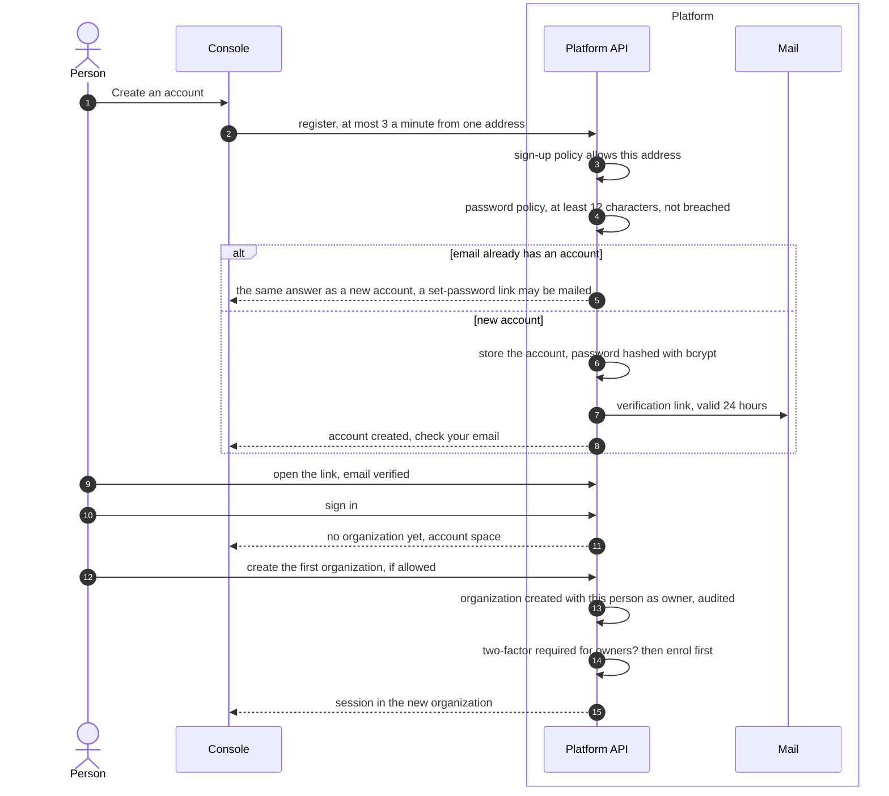
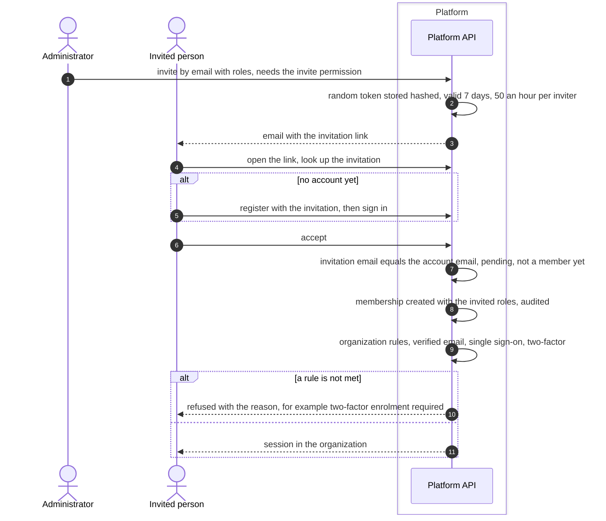

# Sign-up and invitations
{: .no_toc }

A person gets into OpenCTEM in one of three ways: an administrator creates
the account, an organization invites them, or they sign up themselves when the
installation allows it. Self sign-up is off by default. After sign-up the
person either creates their first organization, when that is allowed, or
accepts an invitation.

1. TOC
{:toc}

## The flow

### Self sign-up and the first organization

1. The sign-up policy decides who may register. It is set by a platform
   administrator under **Settings > Sign-in and sign-up > Sign-up** and
   cannot go above the installation's own limit. An address whose domain
   must sign in with its organization's single sign-on is refused.
2. The answer is the same whether the email is new or already has an
   account, so the page does not reveal who is registered.
3. The verification link lasts 24 hours. A person cannot sign in before the
   email is verified, unless the installation has no mail server at all.
4. When creating an organization is allowed, the person becomes its owner.
   If owners must use two-factor authentication, they enrol before they get
   a session.

### Accepting an invitation

1. An invitation can be sent again after 10 minutes, at most 5 times.
   Revoked invitations are kept for 30 days and then removed.
2. A person who already has organizations sees invitations on **Your
   invitations** and can accept or decline them there.
3. The invitation must be accepted by the account whose email it was sent
   to.

## When something fails

| What happens | What you see | What to do |
|---|---|---|
| Sign-up is closed | "Your organization isn't set up yet" | Ask an administrator for an account or an invitation. |
| The domain must use single sign-on | Sign-up refused | Use **Sign in with SSO**. |
| The password is too short or found in a breach list | The rule that failed | Choose another password. |
| The verification link expired | The link is refused | Ask for a new link. One link is sent per address every 2 minutes. |
| You sign in before verifying | Email not verified | Open the link in your mailbox. |
| Creating organizations is off | "Organizations are created by the application administrator." | Ask for an invitation. |
| The invitation was sent to another email | Refused | Sign in with the invited email. |
| The invitation expired | Refused | Ask for a new invitation. |
| The organization requires two-factor | Two-factor enrolment required | Enrol, then sign in again. You are already a member. |

## Security

- **No enumeration.** Registration and resend answers are the same for known
  and unknown emails.
- **Secrets at rest.** Passwords are bcrypt hashes. Verification and
  invitation tokens are stored as SHA-256 hashes.
- **Organization isolation.** An invitation names one organization and one
  email. Roles are checked against what the inviter may grant.
- **Audit.** Registration, organization creation, invitations and
  acceptance are audited.

## Related

- [Sign-up and invitations](../../identity/sign-up-and-invitations.md)
- [First administrator](../../install/first-admin.md)
- [Ownership invitations](ownership-invitations.md)
- [Two-factor and the two-factor floor](two-factor.md)
