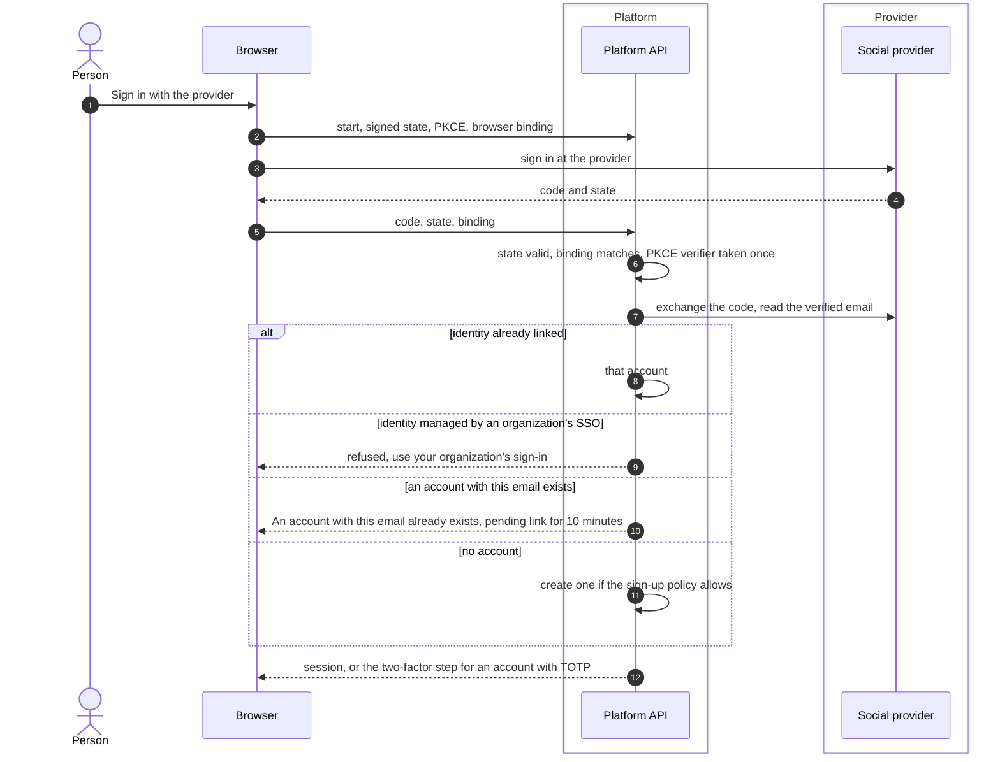
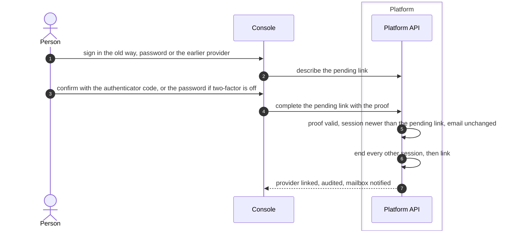

# Social sign-in and account linking
{: .no_toc }

When the platform administrator enables a social provider, people can sign in
with Google, GitHub or Microsoft. A social sign-in is matched by the
provider's own user id. When it meets an existing account with the same
email, the platform does not link them by itself in the normal case: the
person signs in the old way and confirms the link with their authenticator
code or password.

1. TOC
{:toc}

## The flow

### Sign-in

### Confirming a link

1. The pending link lives on the server for 10 minutes. The browser holds
   only its secret, in an HttpOnly cookie.
2. The person must sign in the old way after the pending link was made.
3. The proof is the current authenticator code; a recovery code is not
   accepted. Without two-factor the password is asked. With neither, linking
   is refused until two-factor is turned on.
4. Linking ends every other session first.
5. The same proof is asked to link a provider from **Account > Security >
   Connected sign-in methods**, and to unlink one. The last sign-in method
   cannot be removed.

### Accounts that are bound without the link step

Two kinds of account are bound to a provider on the email:

- an account that has no password yet (created by an invitation or SCIM),
  when the provider is authoritative for the mailbox and every organization
  of the account has verified the email domain;
- an older account created with the same provider that has no provider id
  recorded yet.

## When something fails

| What happens | What you see | What to do |
|---|---|---|
| An account with the email exists | "An account with this email already exists..." | Sign in the way you did before and confirm the link. |
| The provider did not verify the email | Email not verified by the provider | Verify the email at the provider. |
| The identity belongs to your organization's SSO | Use your organization's sign-in | Sign in with SSO. |
| Wrong proof | Refused, counts towards the account lock | Try again. |
| No two-factor and no password | "Turn on two-factor authentication before you change sign-in methods" | Turn on two-factor first. |
| The provider is linked to another account | Linked elsewhere | Unlink it there first. |

## Security

- **Never linked by email alone** in the normal case: a link needs a sign-in
  the old way plus a second proof.
- **At rest.** The provider client secret is encrypted. The pending link
  secret is stored hashed.
- **Audit.** Links, unlinks and their proofs are audited, and the mailbox is
  told.

## Related

- [Social login](../../identity/social-login.md)
- [Sign-in methods](../../identity/sign-in-methods.md)
- [Single sign-on with OIDC](sso-oidc.md)
