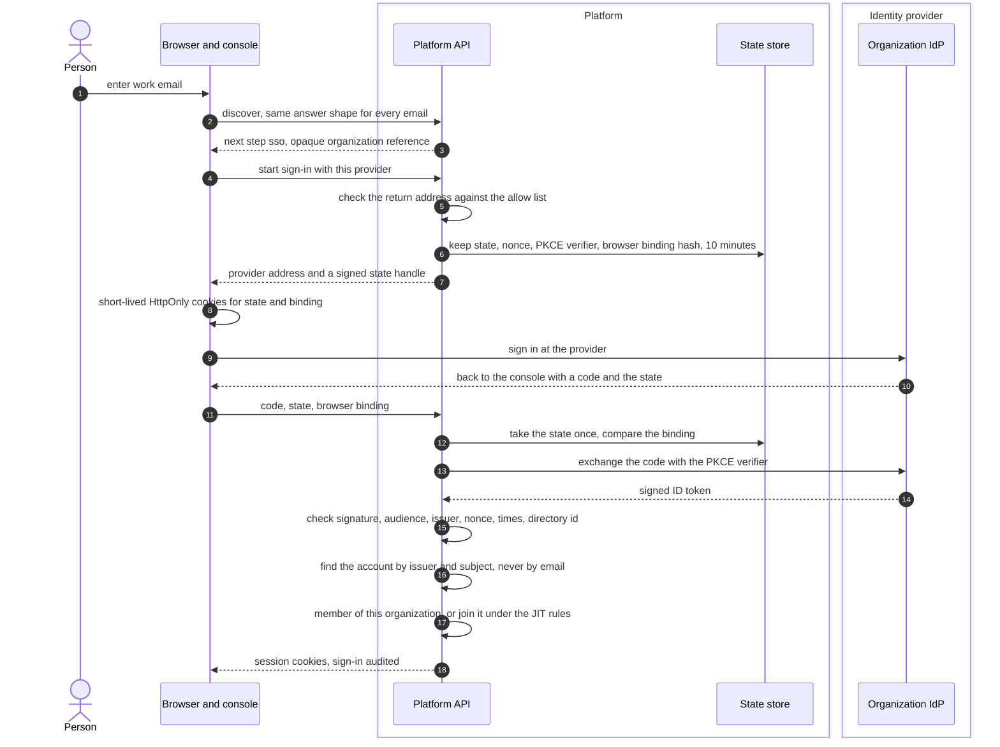
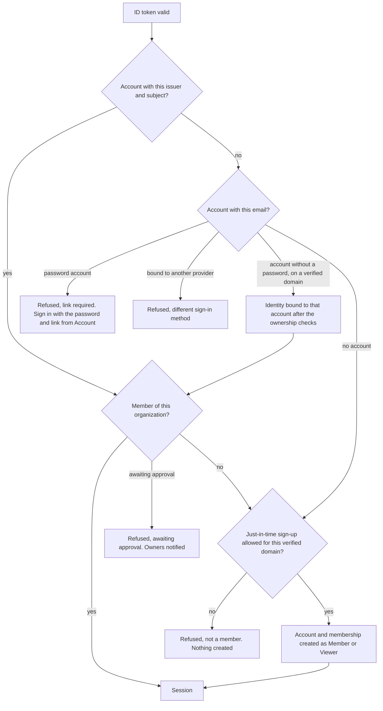

# Single sign-on with OIDC
{: .no_toc }

A person enters their work email on the sign-in page and is sent to the
organization's identity provider. When they come back, the platform checks
the provider's signed answer, finds the account by the provider's stable
user id, checks membership, and opens a session. A platform administrator sets
the provider up for the organization; when the organization has an owner, the
owner approves the change first.

1. TOC
{:toc}

## The flow

1. The console asks the platform where an email signs in. The answer has the
   same shape for every email, so it does not reveal who has an account.
2. The platform builds the provider address with a random nonce and a PKCE
   challenge. What it needs to finish is kept on the server for 10 minutes;
   the browser holds only a signed handle and a binding value in HttpOnly
   cookies.
3. After the provider sign-in, the state is used once. It must come back in
   the same browser that started it.
4. The platform exchanges the code and checks the ID token: the signature
   with the provider's keys (RSA or ECDSA only), the audience, the issuer,
   the nonce, the times (2 minutes of clock skew), and for Microsoft Entra ID
   the directory (tenant) id configured for the organization.
5. The account is found by the provider's issuer and subject. An email match
   alone never signs anyone in to an existing account.
6. A person who is already a member gets a session. A new person joins only
   when just-in-time sign-up is on for the provider, their email domain is a
   verified domain of the organization, and it is allowed for that domain.
   They join as **Member** or **Viewer**, never higher.

### Who gets in

## When something fails

| What happens | What you see | What to do |
|---|---|---|
| The state is used twice, expired or from another browser | The sign-in page shows an error | Start the sign-in again from the same browser. |
| The provider's token fails a check | Sign-in refused | An administrator checks the client id, the directory id and the clock. |
| You are not a member and just-in-time sign-up does not apply | "You do not have access to this organization. Contact your administrator." | Ask an administrator to invite you. |
| A password account exists with your email | Link required | Sign in with your password, then link the provider under **Account**. |
| Your email domain is not allowed | Domain not allowed | An administrator adds and verifies the domain. |
| Microsoft has not verified the email | Email not verified by the provider | Fix the email in the directory. |
| The organization has no free seat | No seat | An owner frees a seat or raises the limit. |

## Security

- **Trust boundary.** The identity provider is outside the platform. Only its
  signed ID token is trusted, after the checks above. Email is never the key.
- **What is protected.** The provider's client secret is encrypted with
  AES-256-GCM. The state handle is signed and single use, PKCE protects the
  code, and the nonce ties the token to this sign-in.
- **Organization isolation.** A provider belongs to one organization. For
  Microsoft Entra ID the directory id is pinned: a token from another
  directory is refused.
- **Roles.** Roles are not read from the provider's claims. Use SCIM groups
  or the console to give more.
- **Sign-out.** The provider can end sessions with back-channel logout.
  Disabling a person at the provider alone does not end an open session; use
  SCIM or suspend the member.

## Related

- [OIDC single sign-on](../../identity/sso-oidc.md)
- [Microsoft Entra ID](../../identity/sso-entra-id.md)
- [Google Workspace](../../identity/sso-google.md)
- [Sign-in methods](../../identity/sign-in-methods.md)
- [Single sign-on with SAML](sso-saml.md)
