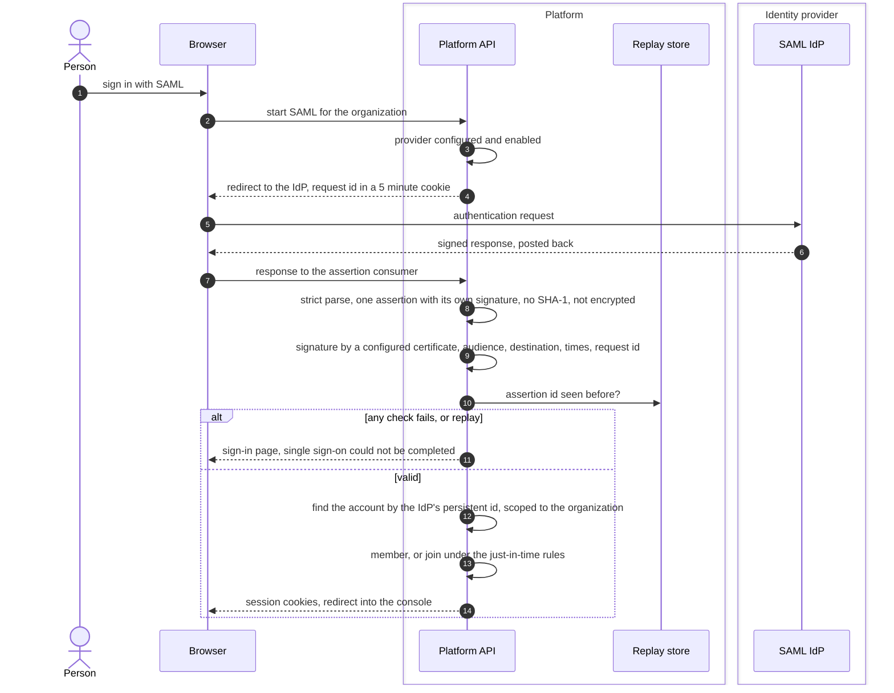

# Single sign-on with SAML
{: .no_toc }

An organization can sign its people in with a SAML identity provider. The
platform sends a request to the provider, receives a signed assertion back,
checks it strictly, and opens a session for a member. A platform administrator
sets up the provider's certificates; the organization's owner approves the
change when the organization has one.

1. TOC
{:toc}

## The flow

1. The platform sends the request by redirect and remembers its id in a
   cookie for 5 minutes.
2. The response must hold exactly one assertion, signed on its own by one of
   the organization's configured certificates (up to five). SHA-1, encrypted
   assertions and artifact responses are refused.
3. The audience, the destination, the validity times (3 minutes of clock
   skew) and the request id must match. Each assertion id is accepted once.
4. The account is found by the provider's persistent id, scoped to the
   organization. For Microsoft Entra ID, the directory id in the assertion
   must match the issuer.
5. Membership and just-in-time sign-up follow the same rules as OIDC: a
   verified email domain, just-in-time on, and the role **Member** or
   **Viewer**.

## When something fails

| What happens | What you see | What to do |
|---|---|---|
| The assertion fails a check, is replayed or too old | "Single sign-on could not be completed. Try again, or contact your administrator." | An administrator checks the certificates and the clock. |
| The provider is disabled | The same message | Enable it in the organization's SSO settings. |
| A certificate is close to expiry | Owners are alerted 30, 7 and 1 days before | Add the new certificate before the old one expires. |
| You are not a member | Not a member | Ask an administrator to invite you. |
| A password account exists with your email | Link required | Sign in with your password and link from **Account**. |

## Security

- **Trust boundary.** Only an assertion signed by a configured certificate
  is trusted. The platform holds no secret of the provider, only public
  certificates.
- **Replay.** Every assertion id is stored until it can no longer be valid,
  and the store fails closed.
- **Organization isolation.** The provider, its certificates and the
  identities it creates belong to one organization.

## Related

- [SAML single sign-on](../../identity/sso-saml.md)
- [Sign-in methods](../../identity/sign-in-methods.md)
- [Single sign-on with OIDC](sso-oidc.md)
