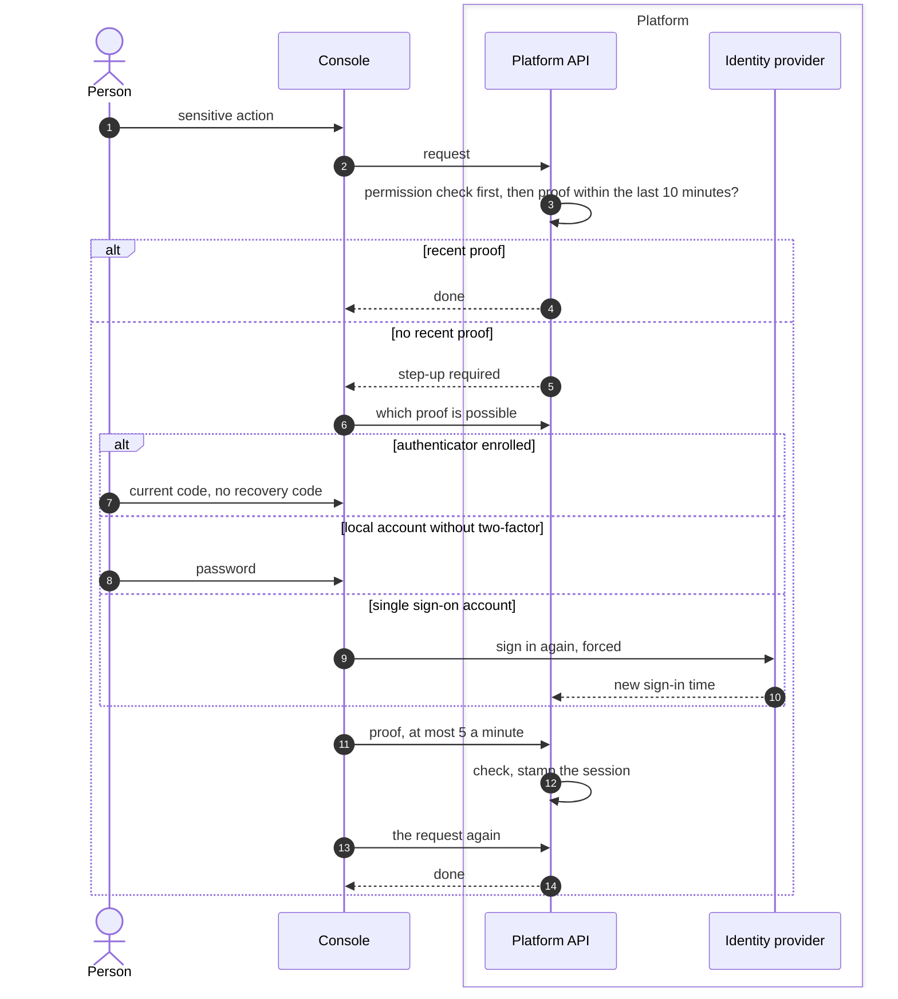

# Step-up re-authentication
{: .no_toc }

Some actions, such as creating an API key, deleting an organization or
accepting ownership, need a recent proof of identity even when the person is
signed in. The console shows **Confirm it is you**, the person proves
themselves once, and for the next 10 minutes the session may do such actions.
Each organization can change how often each tier of action asks (every
time, a longer window, or never for sensitive and routine actions; critical
actions always ask): see the
[re-verification policy](../../identity/two-factor.md#re-verification-policy).

1. TOC
{:toc}

## The flow

1. The proof is stored on the session on the server. No extra token
   travels with requests.
2. The 10-minute window starts at the proof and is not extended by use.
3. With an authenticator, only a current code is accepted: not the
   password, not a recovery code, and not a code already used.
4. For single sign-on accounts, the platform asks the provider for a fresh
   sign-in and uses the provider's sign-in time.
5. Linking or unlinking a sign-in method asks for the proof in the same
   request instead.

## When something fails

| What happens | What you see | What to do |
|---|---|---|
| Wrong code or password | Refused, the failure counts towards the account lock | Try again with a current code. |
| The code was already used | Code used | Wait for the next code. |
| API key request to a step-up action | Step-up not available | Do it in the console. API keys cannot do these actions. |
| Single sign-on account | Sign in again | Sign in at your provider when asked. |

## Security

- **Bound to the session.** A proof made in one session does not help
  another.
- **Audit.** Every proof and every failed proof is audited.
- **Policy floor.** Critical actions (credentials, roles, sign-in, secrets,
  deletion, approving active scanning, exports) ask every time or once per
  10 minutes in every organization. API keys never pass critical or
  sensitive actions.

## Related

- [Two-factor authentication and step-up](../../identity/two-factor.md)
- [Two-factor and the two-factor floor](two-factor.md)
