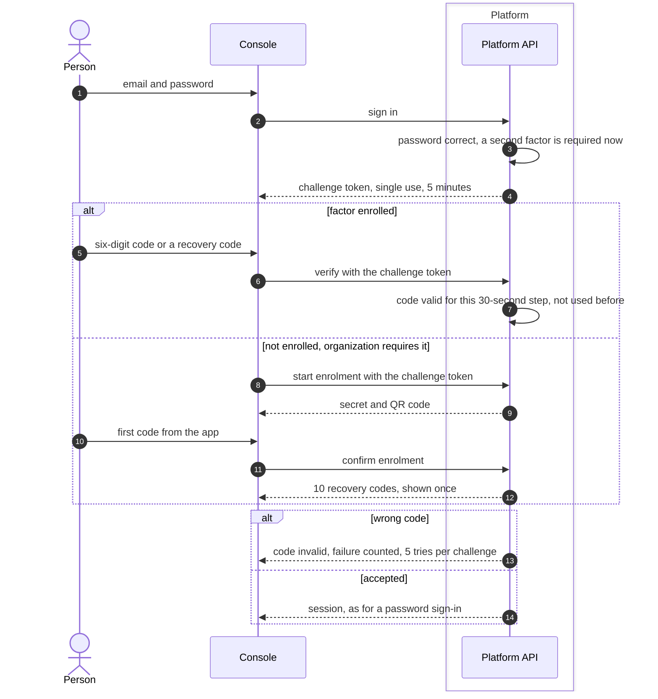
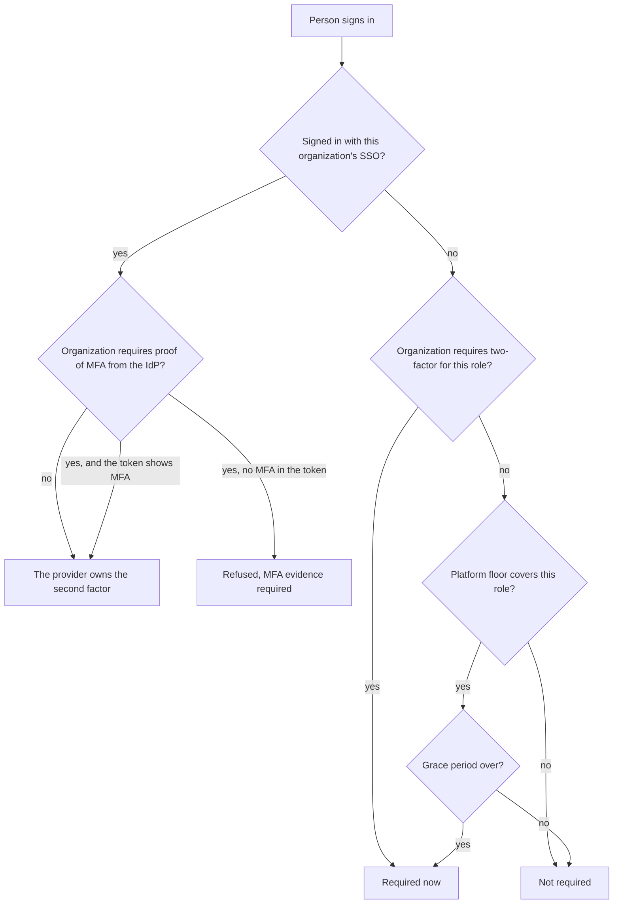

# Two-factor and the two-factor floor
{: .no_toc }

Local accounts protect their sign-in with a time-based one-time password
(TOTP) from an authenticator app. An organization can require it, and the
platform administrator can set a floor that applies to every organization.
People who sign in through their organization's single sign-on prove the
second factor at their provider.

1. TOC
{:toc}

## The flow

### Sign-in with a second factor

1. The challenge token is not a session. It is stored hashed, works once
   and only for 5 minutes, and is burned after 5 wrong codes.
2. Codes are six digits, change every 30 seconds, and one step either side
   is accepted. A code that was already used is refused.
3. A recovery code works once. Using one is audited and the person is
   emailed.
4. Turning two-factor on ends every other session of the person.

### Who must use two-factor

- The floor is set under **Settings > Organizations > Two-factor**: No
  floor, Owners and administrators, or Everyone. Existing members get 14
  days of grace and new accounts 7 days, each adjustable from 0 to 90.
- An organization can only be stricter than the floor.
- Creating an API key or another credential needs two-factor even during
  the grace period.
- If the policy cannot be read, two-factor is treated as required.

## When something fails

| What happens | What you see | What to do |
|---|---|---|
| The code is wrong | Code invalid | Check the time on your phone and try the next code. |
| The challenge expired or was used | Challenge invalid | Sign in again. |
| Too many wrong codes | The account is locked like after wrong passwords | Wait and try again. |
| You lost your phone | | Use a recovery code, then replace the device under **Account > Security**. An owner or administrator can reset your two-factor. |
| You try to turn it off while it is required | Required by policy | It stays on while any of your organizations, or the floor, requires it. |
| Your SSO token carries no MFA proof | MFA evidence required | Ask your identity provider administrator to require MFA. |

## Security

- **At rest.** The TOTP secret is encrypted with AES-256-GCM. Recovery codes
  and challenge tokens are stored hashed.
- **Replay.** Each 30-second step is accepted once per account.
- **Organization isolation.** One organization's requirement never weakens
  another's. The strictest rule that applies wins.
- **Audit.** Enrolling, disabling, resets, recovery code use and failed codes
  are audited.

## Related

- [Two-factor authentication](../../identity/two-factor.md)
- [Two-factor requirements](../../identity/access/two-factor-requirements.md)
- [Step-up re-authentication](step-up.md)
- [Password sign-in](sign-in.md)
