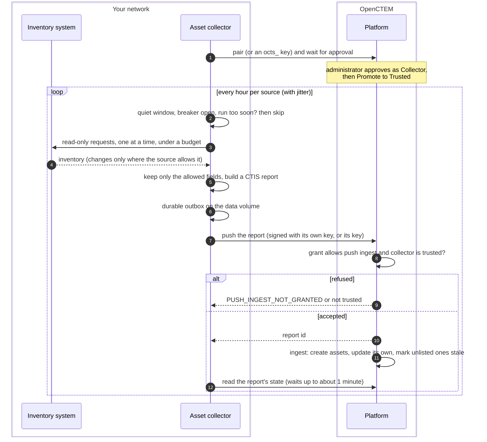
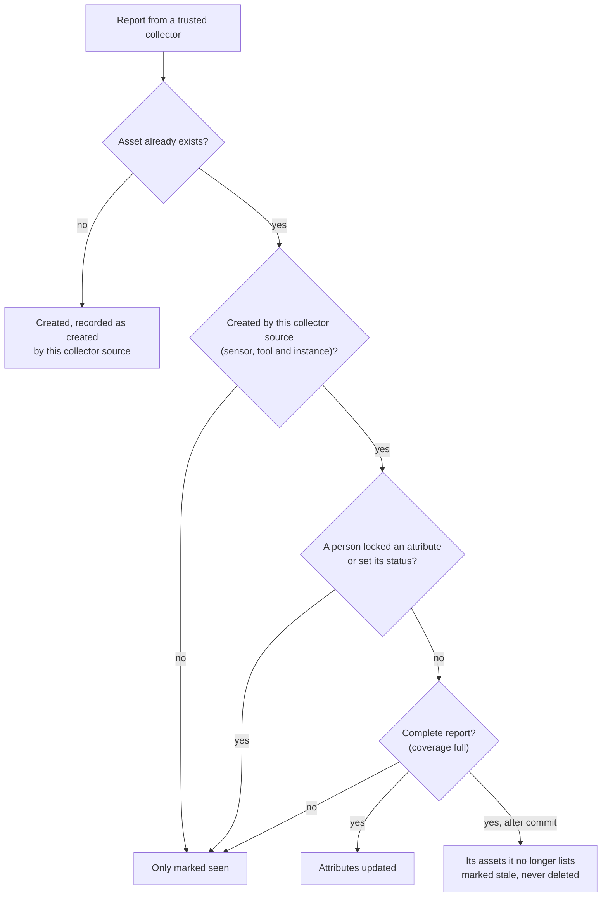

# Asset collector flow
{: .no_toc }

The asset collector reads the inventory of systems you already run (VMware
vCenter, Active Directory or LDAP, Google Cloud DNS, Splunk, PRTG) and sends
it to OpenCTEM as assets. It is a sensor of type Collector that runs in your
network, connects out to the platform and takes no scan jobs. Operators
install it once; an administrator pairs and trusts it; after that it reports
every hour.

1. TOC
{:toc}

## The flow

1. **Pairing.** On its first start without a key, the collector makes its
   own key on its data volume and prints a code and a fingerprint. An
   administrator enters the code under **Discovery > Sensors > Add sensor**,
   checks the fingerprint and approves it as a Collector. Organizations that
   allow key-based sensors can install it with an `octs_` key instead.
2. **Trust.** A new collector gets the `collector` grant profile, with push
   ingest on, but its reports are refused until an administrator chooses
   **Promote to Trusted**.
3. **Schedule.** Each configured source runs once at start, then every hour
   by default, with jitter. A run is skipped in a quiet window, while the
   source's circuit breaker is open, or when the last run was too recent.
4. **Safe collection.** The collector sends one request at a time at an
   adaptive rate, slows down when the source answers slowly or says it is
   busy, stops a run that uses up its request budget or its 5 minutes, and
   never retries refused credentials. vCenter and Active Directory can read
   only what changed since the last run.
5. **Data minimisation.** Each source has an allow-list of fields in the
   collector's code; its configuration can narrow it, never widen it.
6. **Delivery.** Reports go through a durable outbox on the data volume,
   so a platform outage does not lose them.
7. **Accept.** The platform accepts a report without a command only from a
   sensor whose grant allows push ingest, and only while it is trusted.
   Collectors are the one sensor role whose unsolicited reports are applied.
8. **Apply.** The common ingest pipeline stores the assets
   ([From sensor result to findings](../results/result-ingest.md)). The
   collector rules are on top of it, below.

### What a collector may change

- A partial or incremental report never marks anything stale.
- Nothing is marked stale when another source saw the asset after the
  report, when the report lost assets on the way, or when the share of
  missing assets is so large that it would blind the inventory.
- Scope exclusions still apply to what a collector adds.

## When something fails

| What happens | What you see | What to do |
|---|---|---|
| The collector is not trusted yet | The collector logs every report as refused, with the fix | **Promote to Trusted** on the sensor |
| Push ingest is off in its grant | `PUSH_INGEST_NOT_GRANTED` in the collector's log | Set the grant profile to `collector` |
| A source refuses the credentials | That source's run fails and is not retried | Fix the account; `doctor` checks it read-only |
| A source keeps failing | The breaker opens (15 minutes, growing to 6 hours) and runs are skipped | Check the source; `/readyz` shows each collector's last run |
| A run hits its budget or 5 minutes | The run stops; at most a partial report is sent, which marks nothing stale | Narrow the source or raise its budget |
| The platform cannot be reached | Reports wait in the outbox | Nothing; they are sent when it is back |
| The data volume is lost | The collector has no identity | Pair or install it again |

## Security

- The collector connects out to the platform and to the sources. It needs
  no inbound port and takes no platform jobs: its local policy admits no
  target and no tool.
- Source credentials stay on the collector's host (environment or files);
  the platform never receives them.
- A paired collector signs its requests with a key that never leaves its
  data volume. A key-installed one renews its key there.
- A report is accepted only from a trusted collector of your organization;
  a shared platform sensor is never a trusted collector.
- A collector changes only assets it created itself, and never an asset a
  person decided on.

## Related

- [Asset collector](../../sensors/asset-collector.md)
- [Sensor pairing](../sensors/pairing.md)
- [Sensor and platform trust](../sensors/trust.md)
- [From sensor result to findings](../results/result-ingest.md)
- [Connector sync](connectors.md)
