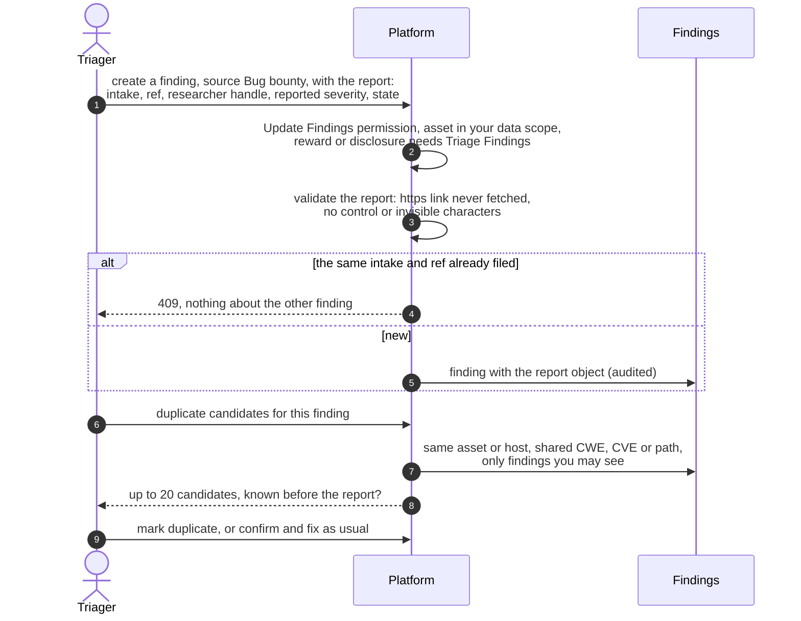
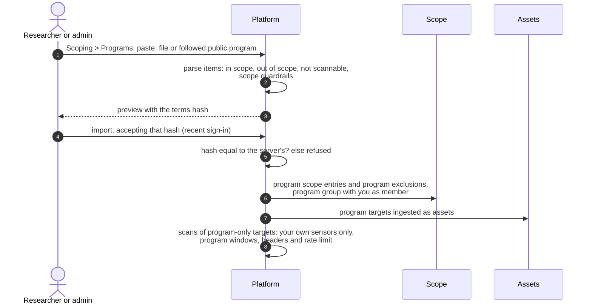

# Bug bounty reports
{: .no_toc }

Bug bounty touches the platform in two directions. Reports that researchers
send to **your** bug bounty or disclosure program are filed as findings with
the source **Bug bounty**, so they follow the normal finding lifecycle. And
programs **your team tests on** (Scoping > Programs) bring their published
scope in as scope entries and assets. The platform pays no rewards, holds no
researcher accounts and sends no messages to researchers.

1. TOC
{:toc}

## The flow

### A report your program received

1. A triager files the report as a finding with the source **Bug bounty**
   (**Create finding** in the console; the report fields `intake`, `ref`,
   researcher handle, reward and disclosure are set through the API). It needs
   the **Update Findings** permission (`findings:write`); reward and
   disclosure also need **Triage Findings** (`findings:triage`).
2. The pair (intake, ref) is unique in your organization, so the same report
   is never filed twice. A changed report replaces the object on the same
   finding (`PUT /api/v1/findings/{id}/bounty-report`), audited with the old
   and new values.
3. **Duplicate candidates** (`GET /api/v1/findings/{id}/duplicate-candidates`,
   Triage Findings) lists up to 20 findings on the same asset or host that
   share a CWE, a CVE or a path, and says whether you knew about it before the
   report arrived. A person decides.
4. The report's own state never moves the finding. The finding's severity is
   the triager's; the reporter's severity is kept as a claim.
5. AI triage reads a bug bounty finding only when a person asks: automatic
   triage and automations skip it, and its result proposes nothing.

### Importing a file of reports

The import route reads the generic `bounty_report` file (JSON
`{"bounty_reports": [...]}`, or CSV with the format chosen). Today those
records are filed as ordinary imported findings with the source
**External**: the report object, the (intake, ref) check and the bug bounty
protections above do not apply to them. File reports one by one as findings
with the source Bug bounty until this is joined up.

### A program your team tests on

1. Importing or re-importing a program needs the program write permission
   (`attack_surface:programs:write`) and a recent sign-in. Your acceptance of
   the program's terms (link, rules, scope) takes the place of a second
   approver; changed terms need a new acceptance.
2. A followed public program comes from a signed feed. Narrowing applies at
   once; widening waits until a member accepts the new terms.
3. Program targets become assets, seen by the program's members and the
   organization's owners. A scan of a target only a program covers runs on
   your own sensors, never on platform sensors, and carries the program's
   testing windows, headers and rate limit.
4. Findings from those scans are ordinary scan findings: see
   [From sensor result to findings](../results/result-ingest.md).

## When something fails

| What happens | What you see | What to do |
|---|---|---|
| The same intake and ref are already filed | 409 | Open the existing finding; a re-filed report updates it |
| Reward or disclosure without Triage Findings | 403 `TRIAGE_PERMISSION_REQUIRED` | Ask a triager |
| The report link is not https or has odd characters | 400 naming the field | Fix the link |
| AI triage from an automation on a report | 403 `AI_POLICY_RESTRICTED` | A person asks for triage |
| A program import with a stale terms hash | Refused | Preview again and accept the current terms |
| Two programs set different headers for one target | `PROGRAM_RULES_CONFLICT` | Narrow the scan to one program's targets |

## Security

- Reporter text is untrusted: it is stored as data, rendered through the
  Markdown sanitizer, and never sent to AI unless a person asks.
- The report keeps a researcher handle only, no e-mail or name. Its link is
  never fetched by the platform.
- Report findings and duplicate candidates are limited to your organization
  and your data scope. The 409 for a repeated report reveals only that the
  report id is filed.
- Program entries authorize scans only while the program is active, and only
  on your own sensors. Private programs' assets and findings are hidden from
  everyone but their members and the owners.

## Related

- [Programs and letters](../../user-guide/03-scoping.md#programs-and-letters)
- [Bug-bounty programs permissions](../../identity/authorization/features/programs.md)
- [Finding import](finding-import.md)
- [AI triage of findings](../remediation/ai-triage.md)
