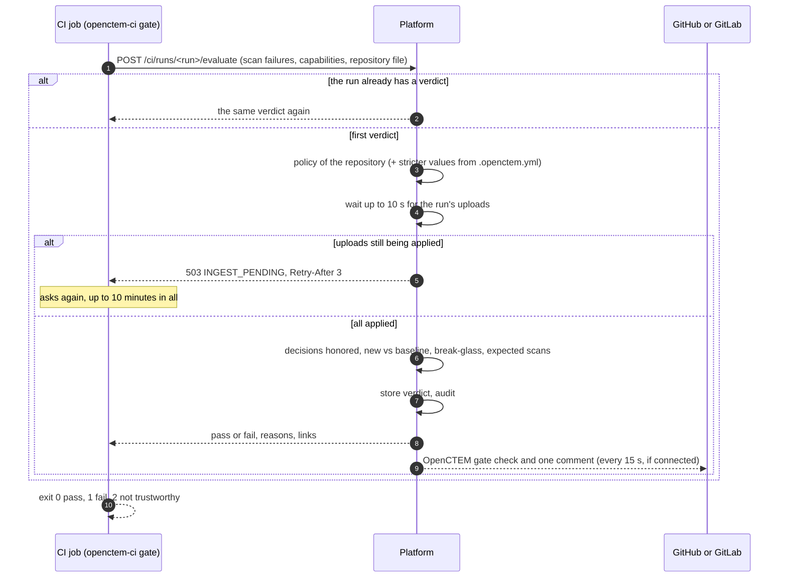
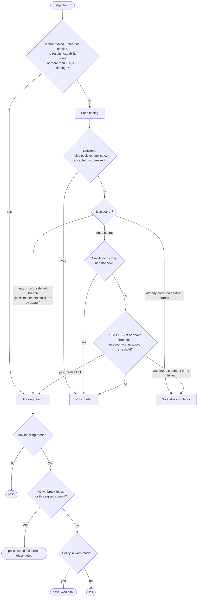
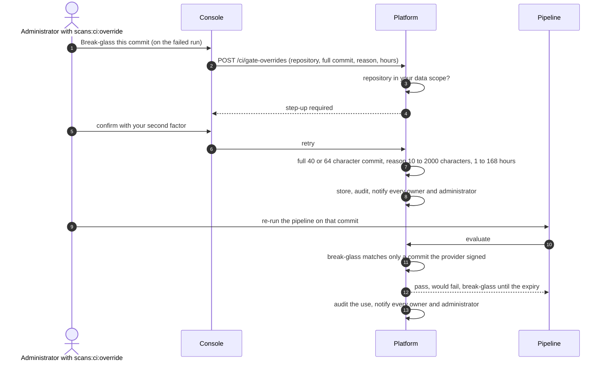

# CI policy gate and break-glass
{: .no_toc }

When a pipeline's scans have uploaded, its last step asks the platform for a
verdict. The platform judges every finding the run reported against the gate
policy that applies to the repository and answers pass or fail with each
blocking reason. The job exits with that verdict, and the pull request shows
one **OpenCTEM gate** check. For an urgent release, an administrator can
break-glass one commit for a limited time.

1. TOC
{:toc}

## The flow

1. The first verdict of a run is final. Asking again returns it unchanged,
   so a job cannot turn a stored failure into a pass.
2. The policy is the repository's own, or the strictest of its business
   units, or the organization's, or the built-in default (enforce, high and
   above, new findings only, known exploited fails). A business unit or the
   organization can lock a setting so no layer below loosens it.
3. If the policy allows it, the repository's `.openctem.yml` can only make
   the policy stricter. Its exceptions become pending suppression requests
   from verified default-branch runs only.
4. The verdict waits for the run's uploads, so it is never computed over
   part of the results. An upload that failed for good fails the run.
5. Findings marked false positive or duplicate, accepted risks that have not
   ended, and approved suppression rules do not count.
6. **New or existing.** A default-branch run is compared with the
   repository's gate baseline. A pull request is compared with its base
   branch when the base is verified (GitHub signs it, GitLab is asked through
   your connection) and is the default or a protected branch. Otherwise it is
   compared with the default branch. A branch never scanned means every
   finding counts as new.
7. The gate then applies the rules below and writes the verdict, which the
   audit log records.

### Break-glass

- A break-glass covers one full commit of one repository, for 24 hours by
  default and at most 168. It does not change a verdict already given: the
  pipeline must run again on that commit.
- It matches only a commit the CI provider signed. A commit the job
  reported itself (CircleCI, or Jenkins without a commit claim) never
  matches.
- **Revoke** on **CI/CD > Settings > Break-glass** ends it early. The next
  run of the commit is judged normally.

## When something fails

| What happens | What you see | What to do |
|---|---|---|
| Uploads are still being applied | `503 INGEST_PENDING`; the job asks again for up to 10 minutes (`OPENCTEM_GATE_WAIT`) | Nothing, or raise the wait for very large reports |
| An upload could not be applied | Fail: upload not applied | Fix the report and re-run |
| A scanner failed, or a capability failed in an earlier attempt of the pipeline run | Fail: scan failure; the check asks for action | Re-run the job; see its log |
| An expected capability did not report | Fail: expected scan missing | Restore the scan in the pipeline |
| The baseline branch was never scanned | Note: every finding counts as new | Run the pipeline once on the base branch |
| The verdict is asked again | The first verdict, unchanged | Start a new pipeline run |
| Break-glass created but the check stays red | The old verdict stands | Re-run the pipeline on that commit |
| Break-glass on an abbreviated commit id | `400` | Use the full commit id |
| The platform cannot be reached | The local `--fail-on` threshold applies; without one, or with a failed scan, the job exits 2 | Check connectivity |

## Security

- The verdict is computed on the platform from the stored findings, not
  from what the job says. The job's own claims (inline ignore comments,
  `suppressed` flags, `.openctem.yml`) never make a finding pass.
- The check on the pull request is posted by the platform with your GitHub
  App installation or GitLab connection, never by the job. It takes the
  strictest latest verdict of every pipeline on the commit, so a second
  workflow cannot turn it green.
- Loosening a policy needs `scans:ci:policy` and a recent sign-in, and is
  announced to every administrator. A break-glass needs
  `scans:ci:override`, a recent sign-in and a repository in your data scope.
- The verdict names no person, because CI logs may be public. The console
  and the audit log show who created a break-glass.
- Every verdict, break-glass creation, revocation and use is audited.
  Creation and use also notify every owner and administrator in-app and on
  channels subscribed to `ci.break_glass`.

## Related

- [Gate policies](../../scanning/ci-policies.md)
- [Understand a blocked pull request](../../scanning/ci-blocked-pr.md)
- [Break-glass](../../scanning/ci-break-glass.md)
- [CI runner identity and upload](ci-runner.md)
- [Step-up re-authentication](../identity/step-up.md)
