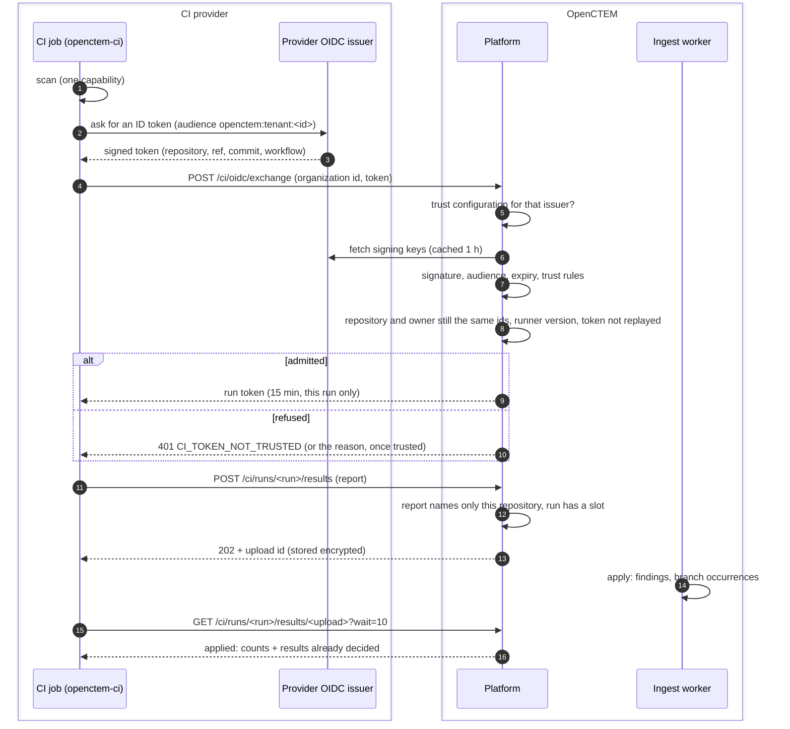
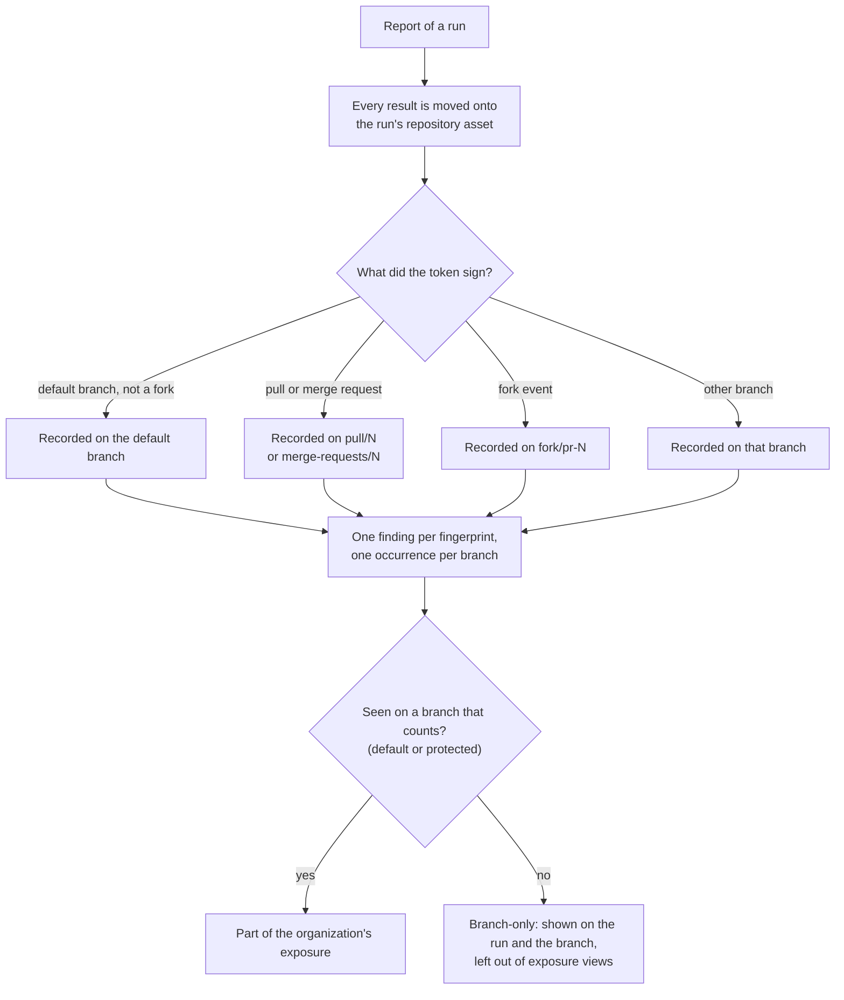

# CI runner identity and upload
{: .no_toc }

A pipeline job that runs `openctem-ci` reports to OpenCTEM without any stored
secret. It trades the OIDC token its CI provider issues for a short-lived run
token, uploads its results with that token, and the platform turns them into
findings on the repository's asset. AppSec administrators set up the trust
that admits a pipeline; developers see the results on the run and the pull
request.

1. TOC
{:toc}

## The flow

1. The job scans first and exchanges its token at its first upload, so a
   long scan does not use up the run token's 15 minutes.
2. `openctem-ci` asks the CI provider for an ID token whose audience names
   your organization (`openctem:tenant:<organization id>` by default).
   GitHub Actions, GitLab CI, Azure Pipelines, Bitbucket, CircleCI and
   Jenkins are supported.
3. The platform looks for an enabled trust configuration with the token's
   issuer. If there is none, it refuses without writing anything to your
   audit log.
4. It verifies the token with the issuer's published keys: signature,
   issuer, audience, expiry (one minute of clock skew), and a token life of
   at most 24 hours.
5. The trust rules decide whether this pipeline may report: owners,
   repositories, branches or tags, environments, events, the pipeline
   definition, fork pull requests (off by default) and protected refs.
6. A repository name stays bound to the repository id that first reported
   under it, and a GitHub organization or GitLab group name to its first
   id. A different repository or owner under a known name is refused until
   an administrator acts.
7. A runner older than the minimum CI runner release is refused with
   `RUNNER_OUTDATED`.
8. Each provider token is used once. Presenting the same still-valid token
   again (at most 5 times in all) gives a fresh run token for the same run
   only. GitHub and Azure jobs can ask their provider for a new token and
   renew the run token 2 minutes before it expires.
9. The platform finds the repository asset by the code host's repository
   id first, then by name, and creates it when it is new. It registers the
   pipeline (one per repository and workflow file) and opens the run. A
   pipeline may start at most 300 runs an hour.
10. The upload is a CTIS 2.0 report, or a file a tool wrote (SARIF, an
    SBOM, ...) which the platform converts. A CTIS report that names any
    other asset than the run's repository is refused at once.
11. The upload is stored encrypted and answered `202`. The ingest worker
    applies it. Uploads of one repository are applied one at a time.
12. The job reads the upload's state. Once applied, the answer lists the
    results of that report that already carry a decision (false positive,
    duplicate, accepted risk, approved suppression), so the job leaves them
    out of its log and its SARIF.

### From results to findings

- The branch, commit and pull request come from the verified token, never
  from the report.
- A finding is one row per fingerprint in your organization. Each branch
  that sees it adds an occurrence, so a finding on `main` and on a pull
  request is one finding with two occurrences.
- A CI run never closes a finding. Closing by absence needs a full scan of
  the default branch bound to a platform command.

### Older pipelines with a sensor key

Before OIDC, a CI job could report with a one-shot sensor key. With
**Require OIDC for CI** on (**CI/CD > Settings**, the default for every
organization created since the setting existed), such a key is refused on
every sensor route and the refusal is audited. `openctem-ci` itself never
uses a key: a job that names an organization but has no OIDC token fails
with the fix for its CI system.

## When something fails

| What happens | What you see | What to do |
|---|---|---|
| No trust configuration admits the token | `401 CI_TOKEN_NOT_TRUSTED` in the job log, and the pipeline under **Recent refused pipelines** | Add or widen a trust configuration on **CI/CD > Settings** |
| The repository was renamed and the trust names it by its old name | Uploads refused; administrators get an in-app notice and an e-mail, at most once a day per new name | Edit the trust configuration's repository patterns |
| Another repository now uses a known name | `401 CI_TOKEN_REPOSITORY_BINDING` | Retire the old pipeline if the change is expected |
| The issuer's keys cannot be fetched | `503 CI_ISSUER_UNAVAILABLE`, retry after 30 s | Keys fetched earlier keep working for 6 hours; after that, wait until the issuer is reachable |
| The runner release is too old | `403 RUNNER_OUTDATED` | Pin a newer `openctem-ci` release |
| The report names another asset | `400 REPORT_OUT_OF_SCOPE` | Upload only the job's own repository |
| The run already has a verdict, or 200 reports | `409` | Start a new pipeline run |
| An upload cannot be applied | Upload state `failed` with a code (`unreadable`, `too_large`, ...), and the run's verdict fails | Fix the report and re-run the job |
| The platform is busy | `429` or `503` with `Retry-After` | The job retries 3 times with backoff by itself |

## Security

- No secret is stored in CI. The provider's token is verified, used once,
  and neither it nor the run token is logged. Only the run token's SHA-256
  is stored.
- The audience names your organization, so a token made for one
  organization is refused by every other.
- The run token works only on its own run's upload, state and verdict
  routes. Every console, API key and MCP route refuses it, and another run's
  id answers 404.
- Refusals before a trust configuration admitted the token look the same
  to the caller, so nobody learns which repositories you trust.
- A run changes only its own repository asset. The platform decides which
  branch is the default branch, not the job.
- Uploads are stored encrypted with a key derived for your organization and
  deleted once applied.
- Creating or changing a trust configuration, and changing the CI settings,
  need `scans:ci:write` and a recent sign-in. Every exchange, refusal,
  upload and verdict is in the audit log under the CI identity
  `ci:<provider>:<login>`.

## Related

- [CI/CD integration](../../scanning/ci-integration.md)
- [Quickstart](../../scanning/ci-quickstart.md)
- [Upload existing reports](../../scanning/ci-upload.md)
- [Troubleshooting](../../scanning/ci-troubleshooting.md)
- [CI policy gate and break-glass](ci-policy-gate.md)
- [Finding deduplication](../results/deduplication.md)
