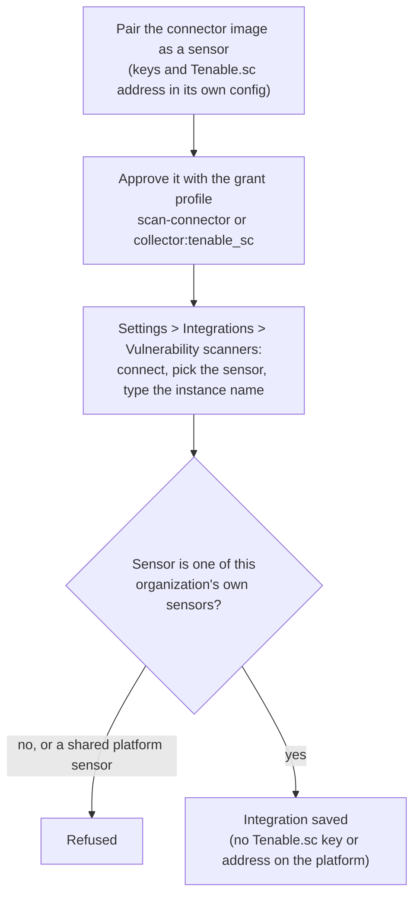
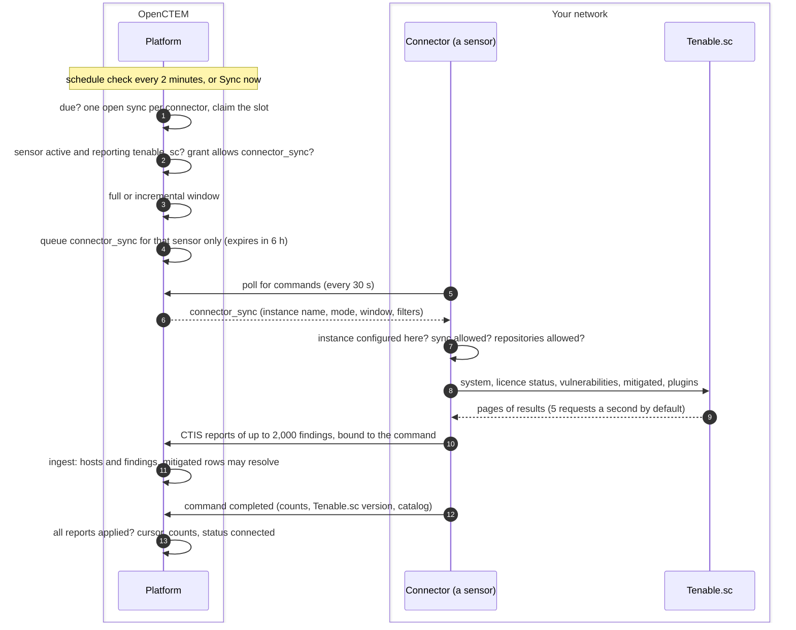

# Connector sync
{: .no_toc }

A connector reads a security product you already run and reports what it
finds to OpenCTEM. Connectors that pull from a system inside your network
run there, as a sensor of their own: the product's keys and address stay on
that host, and the platform only sends it commands. The Tenable.sc connector
works this way. Administrators register it once; after that the platform
syncs it on a schedule or when someone clicks **Sync now**.

1. TOC
{:toc}

## How integrations run

| Mode | Direction | Where the credentials live | Examples |
|---|---|---|---|
| Sensor-run pull | From a product inside your network | On the connector's host only | Tenable.sc connector, [asset collector](asset-collector.md) |
| Platform request | From the platform to a tracker or channel | On the platform, encrypted | Jira, GitHub Issues, notification channels |
| Push in | Into the platform | The caller's own token | CTIS uploads, imports, [CI runs](ci-runner.md) |

No connector that pulls from your network runs in the platform.

## The flow

### Register the connector

### One sync

1. **Schedule.** Every 2 minutes the platform checks each Tenable.sc
   connector. A connector is due after its sync interval (6 hours by
   default, never under 1 hour). Only one platform replica takes a due
   sync, and a connector has at most one open sync. **Sync now** queues one
   at once and needs the Manage integrations permission
   (`integrations:manage`).
2. **Checks before queuing.** The connector's sensor must be one of your
   organization's own sensors, active and reporting the `tenable_sc` tool,
   and its grant must allow `connector_sync`. Otherwise nothing is queued.
3. **Window.** The first sync, and one every 7 days by default (1 to 90),
   is full. In between, a sync reads the days since the last successful one
   plus one day of overlap. A gap of more than 365 days becomes a full
   sync.
4. **Command.** The command names only the instance label, the mode, the
   window, the minimum severity and the Tenable.sc repositories. It is
   assigned to that one sensor and expires after 6 hours.
5. **On the connector.** The connector refuses a command for an instance
   it does not have, an operation its owner did not allow, or repositories
   outside its own allow-list. These limits are set on the connector's host
   and the platform cannot change them.
6. **Pull and push.** The connector reads Tenable.sc page by page, paced
   and retried (up to 5 attempts, 1 to 30 s backoff, honoring
   `Retry-After`), and pushes CTIS reports bound to the command. A report
   that the platform does not accept fails the sync.
7. **Settle.** When the command completed and every report it sent was
   applied, the platform moves the cursor, records the counts and the
   Tenable.sc version, and marks the integration connected. A failed sync is
   tried again after 30 minutes.

After a successful sync, the public names and addresses the reports wrote
are added to scope (the connector's **assets in scope** switch, on by
default). The first successful sync only announces this to administrators;
later syncs add them, with origin `connector`.

Connectors can also run scans. A Tenable.sc scan in OpenCTEM is an ordinary
scan whose step is one `connector_scan` command for the connector's sensor.
Its targets pass the same scope and active-probe checks as any scan
([From scan to results](../scans/scan-to-results.md)).

## When something fails

| What happens | What you see | What to do |
|---|---|---|
| The connector's sensor is offline or does not report `tenable_sc` | **Sync now** answers `409 CONNECTOR_SENSOR_UNAVAILABLE`; a scheduled sync records the reason on the integration | Start the connector and check its config |
| The grant does not allow the sync | `409 CONNECTOR_GRANT_REFUSES` | Set the grant profile to `scan-connector` or `collector:tenable_sc` |
| The integration is disabled | `409` | Enable it |
| The connector refuses the command (unknown instance, sync not allowed) | Sync failed with the connector's reason | Match the instance name to the connector's config |
| Tenable.sc rejects the keys | Sync failed | Fix the key files on the connector host |
| A report of the sync was not applied | Sync failed: a report was not ingested | See the ingest receipt; the next sync retries |
| The sync is still running after 6 hours | The command expires and the sync fails | Narrow the repositories or the window |

## Security

- The platform never stores or sends Tenable.sc credentials or its
  address. The command names an instance label only.
- The connector opens every connection, to the platform and to Tenable.sc.
  The platform needs no route into your network.
- Each command is assigned to one sensor of your organization. Another
  organization's integration or sensor is not found, and shared platform
  sensors are refused.
- The grant is checked when the command is queued and again when the
  connector takes it, and fails closed.
- Reports are bound to the command and its tool. A sync never changes
  existing assets' settings and never reopens a finding a person resolved.
- A mitigated row resolves an open finding only when the same tool reported
  it on the same asset, it was last seen no later than the mitigation, and
  no person decided on it. By default this runs as a dry run that only
  logs and audits.
- A sync never closes a finding because Tenable.sc stopped reporting it.

## Related

- [Tenable.sc connector](../../sensors/connector-tenable.md)
- [Sensor pairing](../sensors/pairing.md)
- [Sensor and platform trust](../sensors/trust.md)
- [From sensor result to findings](../results/result-ingest.md)
- [Asset collector flow](asset-collector.md)
