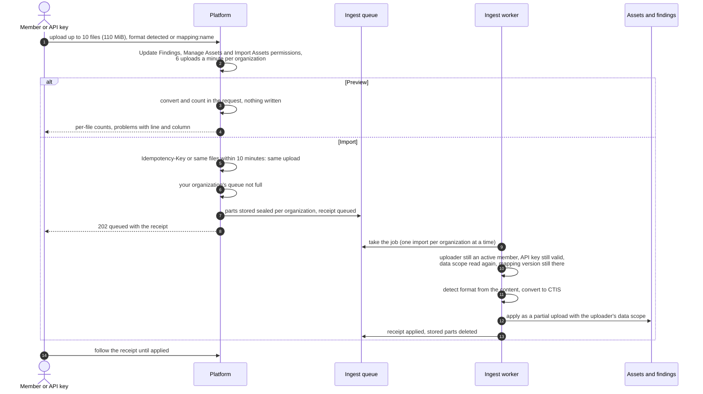
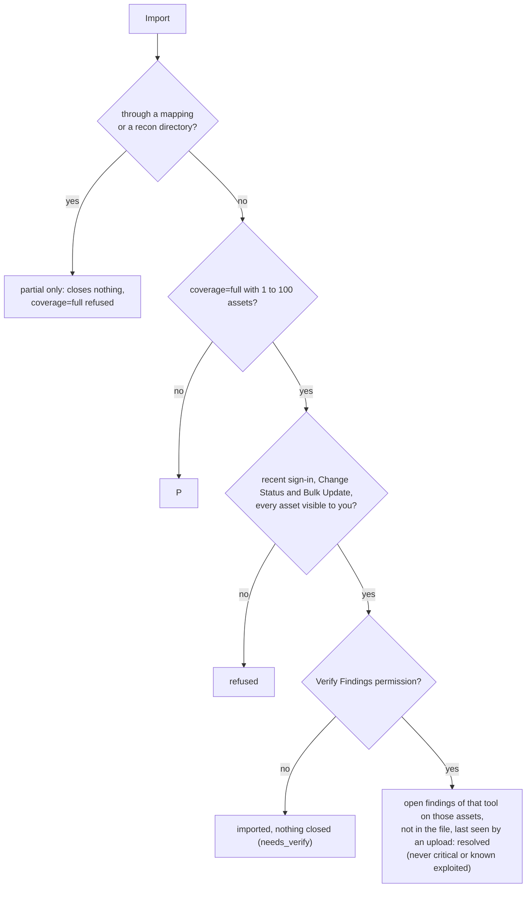

# Finding import
{: .no_toc }

**Import results** on the findings list loads a file another tool exported:
Nessus, Qualys, SARIF, trivy, grype, semgrep, gitleaks, nuclei, ZAP, vuls,
CycloneDX, SPDX, OSV, CSAF, OpenVEX, DefectDojo, a recon results directory, or
a ZIP of these, or a CTIS report. The `openctem import` CLI converts the output
of tools you run yourself (nmap, testssl.sh, line lists) on your machine and
uploads the CTIS report
([Import results from your own tools](../../user-guide/import-your-own-tools.md)).
A file in any other CSV, JSON or XML shape is read through an
**import mapping** your organization saved. The platform converts the file
to a CTIS report, queues it, and applies it with the rights of the person who
uploaded it.

1. TOC
{:toc}

## The flow

1. The upload needs the **Update Findings** (`findings:write`), **Manage
   Assets** (`assets:write`) and **Import Assets** (`assets:import`)
   permissions. Your organization may start 6 uploads a minute.
2. The format is read from the content, never from the file name. A ZIP is
   unpacked in a private place with limits: 50 files, 100 MiB each, 400 MiB
   in all, no links, nested archives or paths that leave the archive.
3. **Preview** converts and counts in the request and writes nothing. It has
   no receipt.
4. **Import** stores the files sealed for your organization and answers at
   once with a receipt. Sending the same files again within 10 minutes, or
   with the same `Idempotency-Key`, returns the same receipt.
5. The worker checks the uploader again before it imports: a person who left
   the organization, or a revoked API key, stops the upload. Rights only ever
   get narrower than they were at upload.
6. What happens to each finding after conversion (dedup, priority, the
   receipt counts) is the common ingest path:
   [From sensor result to findings](../results/result-ingest.md).

### Coverage: what an import may close

- An import from the console is always partial: it never resolves other
  findings.
- Hosts in a recon directory that your scope does not cover become
  candidates: they wait for review, are never scanned, and their findings
  are tagged `candidate`.

### Import mappings

1. A person with the **Manage Integrations** permission
   (`integrations:manage`) builds a mapping in **Settings > Integrations >
   Import mappings**, previewing a sample of up to 5 MiB. A preview stores
   nothing; up to 20 previews a minute per organization.
2. Saving stores a new numbered version. A version that changes how findings
   are identified must be confirmed, because the same records would then
   create new findings.
3. An upload with **Import mapping** pins that exact version. The worker reads
   that version again in your organization; a mapping deleted or changed
   since fails the upload with `mapping_unavailable`.
4. A mapped import is always partial coverage and records the source
   `mapped:<name>`.

### VEX documents

A VEX statement (CycloneDX VEX, CSAF, OpenVEX) is matched to your findings by
vulnerability and package. A `not_affected` statement never closes a finding
by itself: when the platform runs VEX in enforce mode and the uploader holds
the **Approve Findings** permission (`findings:approve`), it opens a pending false-positive
request for another person.

## When something fails

| What happens | What you see | What to do |
|---|---|---|
| The file is not a known format | 400 with the list of formats | Pick the format, or build an import mapping |
| A file is too large or has too many records | 413 or the file's error | Split the export |
| Too many uploads in a minute | 429 | Wait a minute |
| Too many imports of your organization are waiting | Refused, try again shortly | Wait for the queue to drain |
| The uploader left, or the API key was revoked, before the import ran | Failed: `uploader_not_permitted` | Upload again as a current member |
| The mapping version was deleted or changed | Failed: `mapping_unavailable` | Upload again with the current mapping |
| A restricted member imports onto assets outside their scope | Those items are skipped | Ask someone whose scope covers the assets |

## Security

- The organization comes from your sign-in or API key, never from the file.
  Every write and every VEX match is limited to your data scope.
- Uploaded files are stored sealed with a key derived per organization and
  are deleted when the import is applied.
- XML is read without external entities, archives are checked before they
  are read, and the parser stops at fixed limits.
- Every import and preview is in the audit log with file names (as labels),
  formats and counts, never the file content.

## Related

- [Import results](../../user-guide/05-exposures-and-findings.md#import-results)
- [Import any CSV, JSON or XML with a mapping](../../user-guide/import-mappings.md)
- [Upload a report another tool exported](../../api/ingest.md#upload-a-report-another-tool-exported)
- [From sensor result to findings](../results/result-ingest.md)
- [Bug bounty reports](bug-bounty.md)
