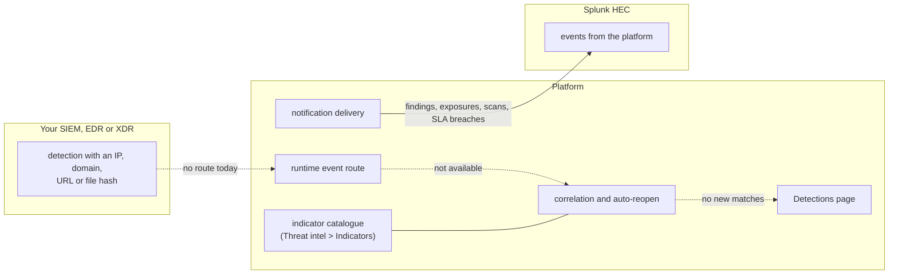

# SIEM ingest
{: .no_toc }

A SIEM, EDR or XDR could tell the platform that a known indicator was seen at
runtime, so the finding it came from reopens. That inbound path ran over the
first sensor protocol and was removed with it. The current sensor protocol
has no route for runtime events yet, so **no detection reaches the platform
today**. The indicator catalogue and the Detections page are kept, and the
outbound direction (findings to Splunk) works.

1. TOC
{:toc}

## The flow

1. **Inbound (not available).** There is no route a SIEM can send runtime
   events to. A forwarder that used the old sensor protocol route gets 404.
2. **Indicator catalogue.** **Threat intel > Indicators (IOCs)** still
   stores your indicators (IP, domain, URL, file hash), each optionally tied
   to the finding it came from. Adding and deleting needs the **Manage Threat
   Intel** permission (`threat_intel:write`).
3. **Detections.** **Threat intel > Detections** lists matches that were
   stored before the route was removed. No new match is made, so no finding
   is reopened by a runtime detection.
4. **Outbound (works).** **Settings > Integrations > SIEM** forwards
   findings, exposures, scans and SLA breaches to Splunk through the HTTP
   Event Collector. Events go through the same delivery queue, filters and
   retries as other notifications: see
   [Notification delivery](../remediation/notifications.md).

## When something fails

| What happens | What you see | What to do |
|---|---|---|
| A SIEM posts detections to the old route | 404 | Nothing reaches the platform; send findings out to Splunk instead |
| The Detections page stays empty | "No detections yet" | Expected: no runtime events are received |
| The Splunk test event fails | The integration shows error | Check the HEC endpoint URL, the token and that the host is reachable |

## Security

- Outbound, the Splunk endpoint is your organization's setting: it is
  checked against private and internal addresses when saved and again at
  every connection, and the HEC token is stored encrypted.
- Indicators and stored detections are your organization's only and need the
  threat intel permissions to read or change.
- With no inbound route there is no SIEM credential to issue or protect.

## Related

- [Indicators and detections](../../user-guide/06-prioritization.md#indicators-and-detections)
- [Settings and integrations: SIEM](../../user-guide/10-settings-and-integrations.md#siem)
- [Notification channels](../../configuration/notifications.md)
- [Notification delivery](../remediation/notifications.md)
