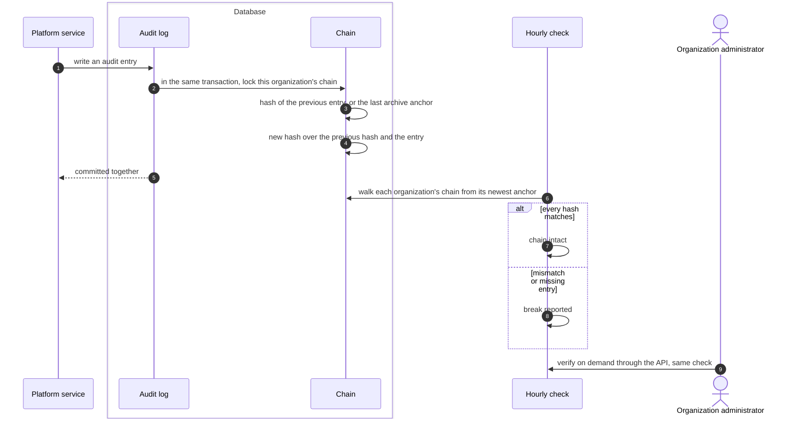

# Audit log integrity
{: .no_toc }

Each organization's audit log is a chain: every entry carries a hash over
its content and the hash of the entry before it. The database builds the
chain itself when the entry is written. Changing or removing an entry in the
middle breaks the chain, and the hourly check reports it.

1. TOC
{:toc}

## The flow

1. The hash covers the entry's id, organization, actor id, action, resource,
   changes, result, severity, message, metadata, request, session and time.
   The actor's email, IP address and browser are left out, so they can be
   erased for privacy without breaking the chain.
2. The database refuses updates to audit entries and to the chain.
3. Retention removes the oldest entries only from the start of a chain. They
   are archived first, and an anchor holding the last removed hash is
   written, so the rest of the chain still checks. Entries are kept at least
   365 days.
4. The platform administrators' own audit log has a separate chain. Its head
   can be checked with `bootstrap-admin verify-audit` and shipped to an
   outside sink.
5. An organization administrator can run the same check at any time with
   `GET /api/v1/audit-logs/verify`. A break answers 409 with the breaks
   found.

## When something fails

| What happens | What you see | What to do |
|---|---|---|
| An entry was changed or deleted in the database | The check reports a break | Treat it as an incident. Compare with backups and the archive. |
| A backup with edited entries was restored | The check reports a break | Restore an earlier backup. |
| Older entries with legacy time precision | Classified as a known benign case | A platform administrator can re-baseline after review. |

## Security

- **Inside the database.** The chain is written by the database, not by the
  application, so a bug in a service cannot skip it.
- **Limit.** Someone who owns the database and recomputes every later hash
  can rewrite the organization chain. Only an outside copy of the chain head
  detects that, and today such a copy exists for the administrators' log
  only.
- **Organization isolation.** One chain per organization.

## Related

- [Audit log](../../security/audit-log.md)
- [Platform console and break-glass](../identity/platform-console.md)
