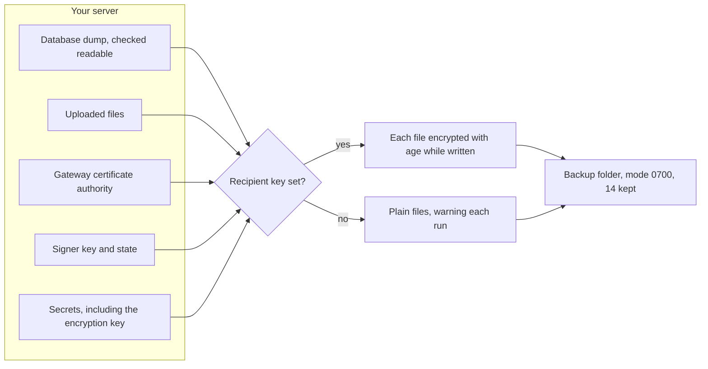
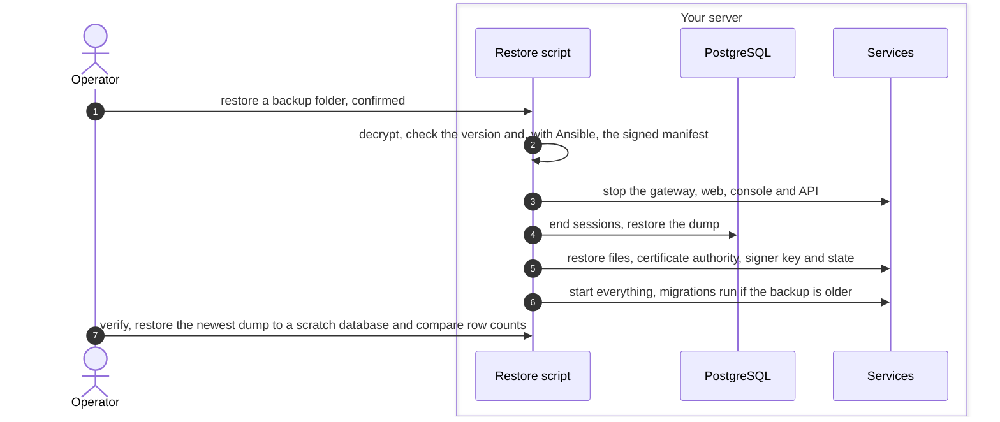

# Backup and restore flow
{: .no_toc }

A complete backup is more than the database. It also holds the uploaded
files, the gateway's internal certificate authority, the job signer's key and
state, and the installation secrets. Without the encryption key, the stored
credentials in the database cannot be read.

1. TOC
{:toc}

## The flow

### Backup

| Path | What it covers |
|---|---|
| Docker Compose `backup.sh` | database, files, certificate authority, signer key and state, `.env` |
| Ansible kit timer | the same, plus the deployment files and the admin audit copy, with a manifest signed by the host key |
| Off-host point-in-time recovery | database only, continuous, encrypted with its own passphrase |
| Helm backup job | database only |

Keep the decryption key, and the point-in-time recovery passphrase, off the
server. Losing them makes the backups unreadable.

### Restore

1. A version mismatch is a warning with Compose and a refusal with Ansible
   unless you allow it.
2. The Ansible restore dumps the current database first, so a wrong restore
   can be undone.
3. With Compose, `.env` is not restored by the script. On a new host, put
   the backed-up `.env` in place before the restore. With Ansible, pass
   `--with-secrets`.
4. Practise with `backup.sh verify` or the Ansible restore drill.

## When something fails

| What happens | What you see | What to do |
|---|---|---|
| The encryption key is lost | Stored credentials do not open after restore | Restore the key from the backup's secrets. |
| The signer state is lost | Sequence numbers of signed jobs can repeat | Restore the signer state together with its key. |
| The certificate authority is lost | Sensors no longer trust the gateway | Restore it, or configure every sensor again. |
| The manifest signature fails | The Ansible restore stops | Check the backup's origin. |

## Security

- **Encryption.** age, per file, streamed, so no plain copy touches the
  disk. Without a recipient the backup is plain and you are warned.
- **Secrets in the backup.** A backup holds the encryption key. Protect it
  like the server itself.

## Related

- [Backup and restore](../../operations/backup-restore.md)
- [Upgrade and migrations](upgrade-migrations.md)
- [Job signer service](job-signer.md)
