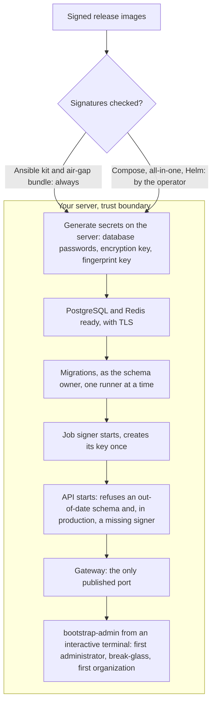

# Install paths
{: .no_toc }

Every install path ends in the same place: secrets generated on the server,
the database migrated before the API starts, the job signer running next to
the API, and a first administrator created from a terminal. The paths differ
in who runs each step.

1. TOC
{:toc}

## The flow

| Path | Secrets | Migrations | Signer | First administrator |
|---|---|---|---|---|
| Docker Compose | `setup.sh` writes `.env` (mode 0600) | `migrate` service, before the API | own container, no network | `docker compose run --rm bootstrap-admin` |
| All-in-one image | given as environment | at container start, one replica at a time | second process in the container | `docker exec -it` the container, `bootstrap-admin` |
| Ansible kit | generated on the server once, files mode 0400 | `migrate` service during `compose up --wait` | own container, key made once | `openctem-bootstrap-admin` on the server |
| Helm chart | kept in a Kubernetes secret; in production you provide them | a Job hook, before an upgrade and after a first install | sidecar in the API pod | optional Job, credentials in its log |
| Air-gap bundle | as the path you install with | as that path | as that path | as that path |

1. **Secrets.** The installer writes them on the server. Back up the
   encryption key: without it, stored credentials cannot be read.
2. **Migrations** run with the schema owner's account. The API itself never
   holds that account and refuses to start while a shipped migration is
   missing.
3. **Signer.** The API reaches the job signer only through a local socket.
   The signer has no network.
4. **First administrator.** `bootstrap-admin` refuses to print one-time
   credentials to anything but a terminal, and its output is not logged.
5. **Air gap.** The bundle holds each image with its signature, provenance
   and SBOM. The import script checks the signed image list, every archive's
   checksum, and the signature of every image copied into your registry.

On a first Helm install the migration Job runs after the API pods are
created, so the pods restart on the schema check until it ends.

## When something fails

| What happens | What you see | What to do |
|---|---|---|
| The API finds unapplied migrations | The API exits at start | Run the migration step, then start the API. |
| A migration failed half-way | The schema is marked dirty, the next run refuses | Fix the cause, then follow the upgrade guide. |
| The signer is missing in production | The API refuses to start | Start the signer, or check its socket. |
| A signature does not verify | Ansible and the air-gap import stop | Do not deploy. Check the release and the mirror. |
| `.env` already exists | `setup.sh` refuses to overwrite it | Keep the existing file. |

## Security

- **Secrets stay on the server.** They are generated there and never in the
  installer's own logs.
- **Separation.** The API runs without the schema owner's rights and without
  the signing key.
- **Signed releases.** See [Release signing and verification](release-verification.md).

## Related

- [Install](../../install/index.md)
- [Docker Compose](../../install/docker-compose.md)
- [All-in-one image](../../install/all-in-one.md)
- [Install with Ansible](../../install/ansible.md)
- [Kubernetes (Helm)](../../install/kubernetes.md)
- [Air-gapped and controlled supply chain](../../install/air-gapped.md)
- [First administrator](../../install/first-admin.md)
