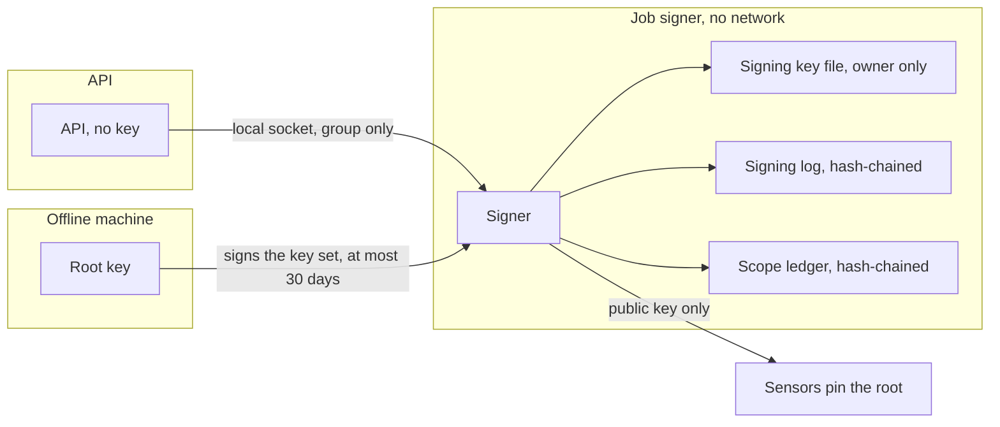

# Job signer service
{: .no_toc }

Every job a sensor runs is signed, so a sensor can tell a real job from a
forged one. The signing key is held by a separate service, the job signer,
not by the API. The API can only ask the signer to sign; it can never read
the key.

1. TOC
{:toc}

## The flow

1. **Key custody.** The key is a file readable only by the signer. It is
   created once on first start and never replaced. The signer runs without
   network access, read-only, with no capabilities.
2. **Access.** The API reaches the signer only through a local socket that
   only the API's group can open.
3. **Signing log.** Every decision, signed or refused, is appended to a log
   where each line carries the hash of the line before. The signer refuses
   to start when the log is broken. `openctem-signer verify-log` checks it.
4. **Scope ledger.** The approved scan scope of each organization is kept
   in a second chained log. Widening it needs approval by people other than
   the requester.
5. **Root.** An optional root key, kept offline, signs the list of valid
   signing keys. Sensors pin that root, so a new signing key can be
   introduced without re-pairing.

How a job is signed when a sensor claims it is described with the job
dispatch flow.

## When something fails

| What happens | What you see | What to do |
|---|---|---|
| The signer is not running in production | The API refuses to start | Start the signer. |
| The signing log is damaged | The signer refuses to start | Investigate; restore the state from backup. |
| The key set is close to expiry or expired | A warning 7 days before. An expired key set stops the signer from starting | Sign a new key set on the offline machine. |
| The key file is readable by others | The signer refuses the key | Fix the file mode. |

## Security

- **Separation.** A compromised API can ask for signatures, which are all
  logged, but cannot take the key away.
- **Back up** the key and the state together; see
  [Backup and restore flow](backup-restore.md).

## Related

- [Target admission on the sensor](../sensor-execution/admission.md)
- [Sensor and platform trust](../sensors/trust.md)
- [Backup and restore](../../operations/backup-restore.md)
