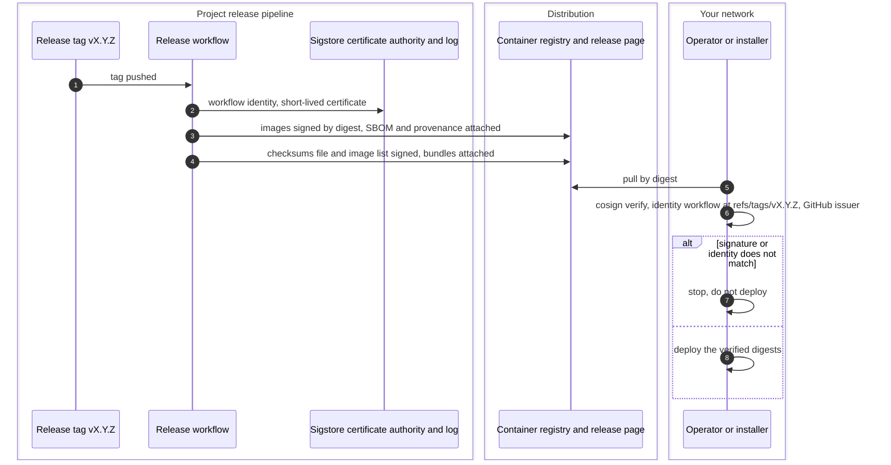

# Release signing and verification
{: .no_toc }

Every release is signed by the project's release workflow with a short-lived
certificate tied to that workflow and that tag (keyless signing). There is no
long-lived signing key to steal. You check a signature by naming the
workflow and the tag you expect.

1. TOC
{:toc}

## The flow

| Artifact | Signed | Checked automatically by |
|---|---|---|
| Container images: api, web, console, all-in-one, gateway, migrations, seed | yes, with SBOM and provenance | Ansible kit before pull (not the seed image), air-gap import |
| Binary archives | through the signed checksums file | air-gap build-from-archives |
| Offline image list | yes | air-gap import |
| Release feed read by the console's update check | yes, renewed every 6 hours | the platform itself |
| Helm chart package | no | |
| Ansible kit and the compose files | no | |

1. The identity to expect is the release workflow of
   `openctemio/openctem` at `refs/tags/vX.Y.Z`, with the GitHub Actions
   issuer. A build from a branch has another identity and does not pass.
2. The release notes list the exact `cosign verify` and
   `cosign verify-attestation` commands.
3. The Ansible kit verifies each image digest before it pulls. The air-gap
   import verifies the image list, each archive's checksum, and each image
   again after it is copied into your registry.
4. Helm does not check signatures. Use an admission policy in the cluster;
   a template is in the air-gap kit.

## When something fails

| What happens | What you see | What to do |
|---|---|---|
| Identity or issuer does not match | `cosign verify` fails | Do not deploy. Check the tag and the source registry. |
| The image came from a mirror without its signature | No signature found | Mirror the signature with the image, or verify at the source. |
| A checksum differs | The air-gap script stops | Download the archive again. |

## Security

- **No long-lived key.** Each signature is tied to the workflow run and is
  written to a public transparency log.
- **By digest.** Verify and deploy digests, never mutable tags.

## Related

- [Versioning](../../operations/versioning.md)
- [Air-gapped and controlled supply chain](../../install/air-gapped.md)
- [Install paths](install.md)
