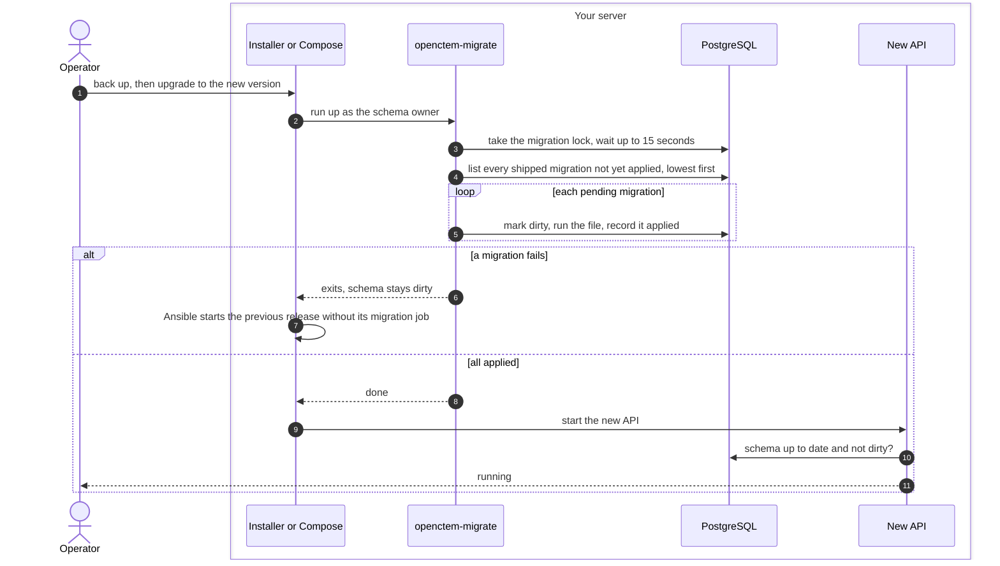
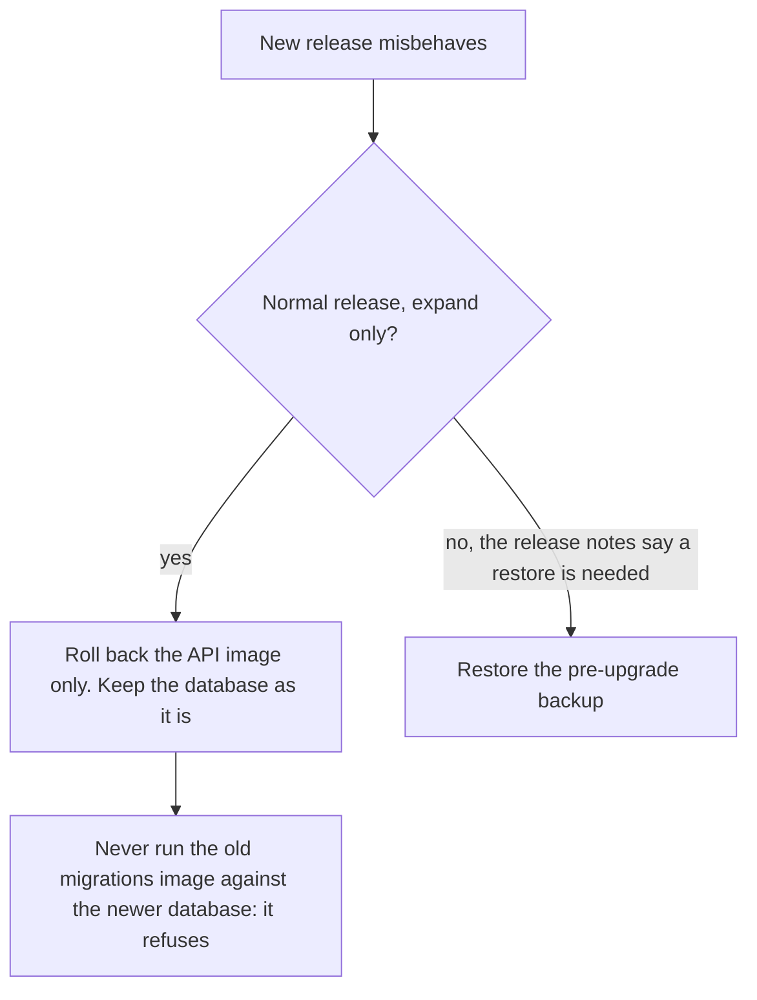

# Upgrade and migrations
{: .no_toc }

An upgrade replaces the images and applies the new release's database
migrations before the new API starts. Migrations only add to the schema in a
normal release (expand), and old structures are removed in a later release
(contract), so the previous API keeps working on the newer schema and a
rollback does not need the database to go back.

1. TOC
{:toc}

## The flow

1. Back up first. The Ansible kit refuses to upgrade when its pre-upgrade
   backup fails.
2. One runner at a time: the others wait for the lock. With the all-in-one
   image several replicas can start at once, and only one migrates.
3. Every shipped migration that the database has not applied runs, even
   one with a lower number than the newest applied.
4. A failure leaves the schema marked dirty. The next run refuses until an
   operator clears it with `openctem-migrate force`, after fixing the cause.
5. The API checks the schema at start and refuses a missing migration or a
   dirty schema. A newer schema than the API knows is fine.

### Rolling back

Removing or renaming a column, or making it required, needs an explicit
override in the change. The project's CI refuses such a migration otherwise,
and also checks that a fresh install and an upgrade give the same schema.

## When something fails

| What happens | What you see | What to do |
|---|---|---|
| Another runner holds the lock | `openctem-migrate` waits, then times out | Wait for the other runner, then retry. |
| A migration failed | Dirty schema, the API does not start | Read the migration's error, fix the cause, clear with `force`, run `up` again. |
| The database is older than the supported baseline | The runner refuses | Upgrade through an older release first. |
| Helm first install | API pods restart until the migration Job ends | Nothing. They settle by themselves. |

## Security

- **Least privilege.** Only the migration step has the schema owner's
  password. The API cannot change the schema.
- **Integrity.** Applied migrations are recorded in a table that only the
  owner can change.

## Related

- [Upgrading](../../operations/upgrade.md)
- [Versioning](../../operations/versioning.md)
- [Backup and restore flow](backup-restore.md)
