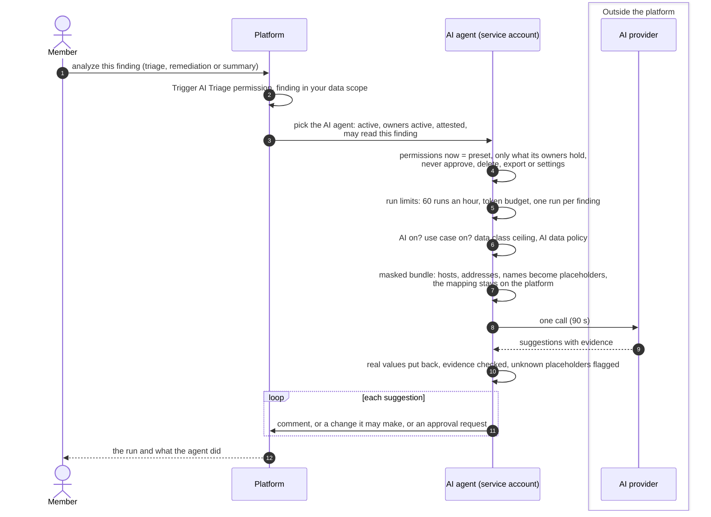
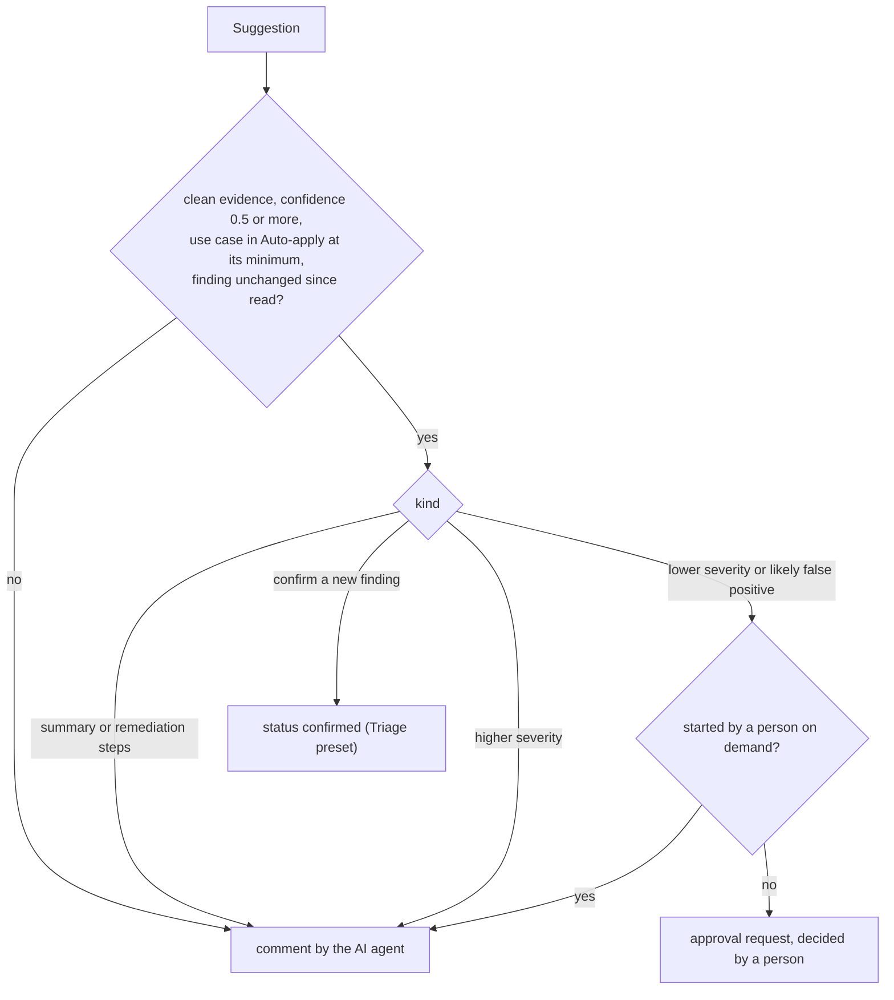

# AI agents and approvals
{: .no_toc }

An **AI agent** is a service account that takes part in triage like a
person, with people or teams who are accountable for it. Asked to analyze a
finding, it calls the model and turns each part of the answer into an action
under its own name: a comment, a change its preset allows, or an approval
request that a person decides. Today an analysis starts through the API
(`POST /api/v1/findings/{id}/ai/analyze`); the console lists and manages AI
agents in **Settings > AI**.

1. TOC
{:toc}

## The flow

1. Asking for an analysis needs the **Trigger AI Triage** permission and a
   finding you can see. The AI agent must also be able to see it.
2. An AI agent works only while it has an active accountable owner and its
   attestation is current (90 days). Otherwise it pauses itself and the run is
   refused.
3. Its permissions are worked out at every run: its preset (**Suggest** or
   **Triage**), cut down to what its accountable people hold, minus a fixed
   deny list. An AI agent can never approve, delete, export, reveal, verify a
   fix or change settings.
4. The data sent is masked: host names, addresses, e-mail addresses, people
   and ticket ids become placeholders, and secrets are removed for good. The
   platform keeps the mapping and puts real values back in the answer.
5. Each suggestion becomes an action:

6. A risk-lowering result (lower severity, false positive) is always a
   request a person decides. When a person started the run, it stays a
   comment, so that person cannot approve the agent's request as the second
   person.
7. Before each change the agent reads the finding again. If someone changed
   it since, the agent writes a comment instead and never overwrites a later
   decision.

## When something fails

| What happens | What you see | What to do |
|---|---|---|
| No active AI agent may read the finding | 409: no active AI agent | Create one in Settings > AI, or widen its owners' scope |
| The agent's owners left or its attestation expired | The agent shows Paused | An accountable owner attests, or an administrator resumes it |
| The agent already ran 60 times this hour | Refused: the AI agent reached its limit | Wait an hour |
| An analysis of the finding is running | 409 | Wait for it to finish |
| AI is off, the use case is off, or the data policy keeps the finding back | The run is refused with its code | Settings > AI, or the campaign's TLP |
| The provider fails | The run failed: provider error | Try again later |
| The answer has no valid shape | The run failed: invalid output | Try again; nothing was changed |

## Security

- Every run is limited to your organization. The AI agent sees only what it
  and at least one accountable person may see.
- The AI agent holds no password, no API key and no role of its own; it acts
  only through the platform, which works out its rights at each run.
- What was sent and withheld, the provider, the model, the prompt template
  and the tokens are stored with the run. Creating, deleting, resuming and
  changing an agent's owners or preset need a recent sign-in and are audited.
- Every action shows on the finding's timeline with the AI agent as the
  actor.

## Related

- [Settings > AI: AI agents](../../user-guide/ai-agents.md)
- [AI suggestions and approval](../../user-guide/ai-suggestions-and-approval.md)
- [Settings > AI: use cases](../../user-guide/ai-use-cases.md)
- [Settings > AI: data masking](../../user-guide/ai-data-masking.md)
- [AI analyze contract](../../api/ai-analyze-contract.md)
- [AI triage of findings](ai-triage.md)
