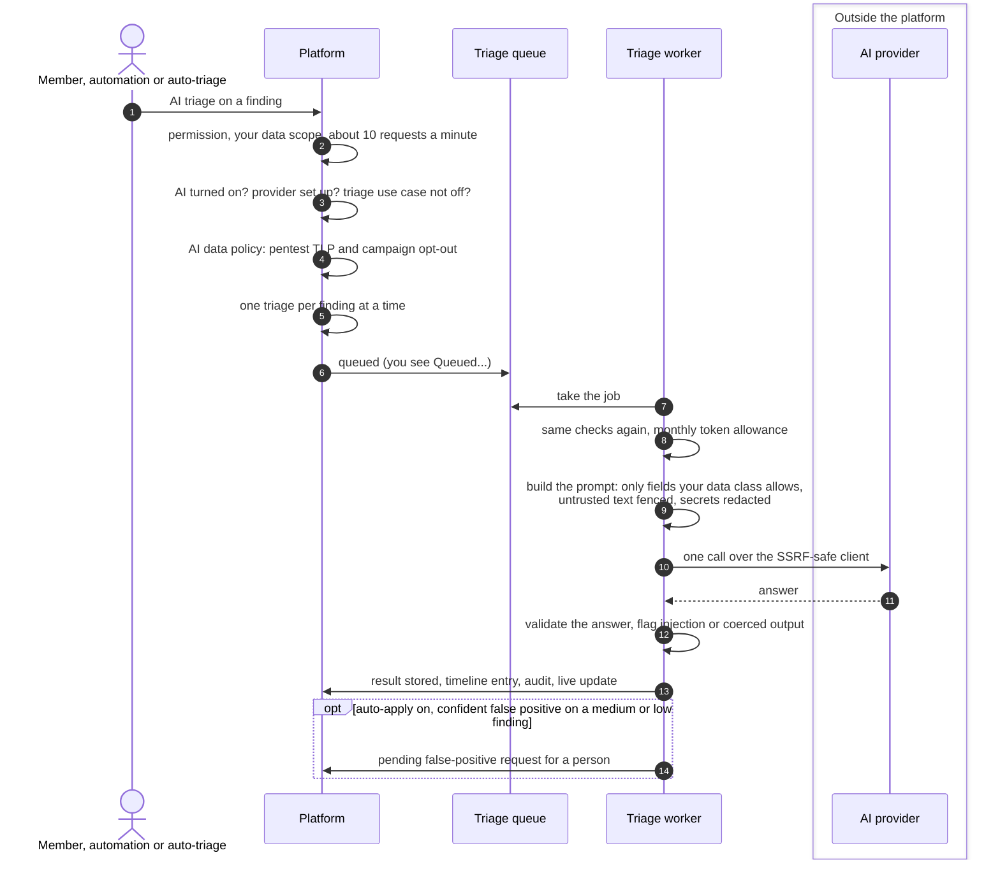

# AI triage of findings
{: .no_toc }

**AI triage** asks a language model for an assessment of one finding:
severity, exploitability, business impact, how likely it is a false positive,
and remediation steps. A person clicks the button, an automation asks for it,
or new findings are queued automatically when your organization turned that
on. The answer is shown on the finding as a suggestion. It never changes the
finding's severity, priority or status by itself.

1. TOC
{:toc}

## The flow

1. The button needs the **Trigger AI Triage** permission
   (`ai_triage:trigger`) and the **Update Findings** permission
   (`findings:write`). The finding must be in your data scope. An
   organization may send about 10 triage requests a minute to each server.
2. Nothing is sent until an organization owner or administrator turns AI on
   in **Settings > AI** (**Provider** tab). The source is **Platform AI**
   (the provider the platform administrator set up) or **Own provider** (your
   organization's key and model). The **Use cases** tab can turn triage off.
3. The AI data policy keeps a pentest finding on the platform when its
   campaign's TLP is above your organization's limit for AI, or the campaign
   lead turned AI assistants off. A bug bounty report is sent only when a
   person asks.
4. The worker checks everything again right before the call, so turning AI
   off or raising a campaign's TLP stops jobs that are already queued.
5. Only the finding fields within the triage use case's data class are sent
   (by default no code snippet). A leaked secret's code line is never sent,
   and secrets in its description are redacted. Finding text is wrapped as
   untrusted data the model is told not to follow.
6. The answer is checked against a fixed shape. Output that had to be
   corrected, or a finding whose text tries to steer the model, marks the
   result **needs review**: it is audited and starts nothing else.
7. In **Suggest** mode (the default) the result card is all that happens. In
   **Auto-apply** mode, a confident false-positive verdict (at least 0.9) on a
   medium or low finding opens a pending false-positive request. A person
   approves or rejects it; it is never made for critical or high findings.

## When something fails

| What happens | What you see | What to do |
|---|---|---|
| AI is off for your organization | The button explains it; 403 `AI_DISABLED` | An owner or administrator turns AI on in Settings > AI |
| No platform provider is set up | 503 `AI_PLATFORM_NOT_CONFIGURED` | The platform administrator sets up a provider in the console |
| Your own provider is not allowed by the platform | 403 `AI_OWN_PROVIDER_NOT_ALLOWED` | Switch to Platform AI, or ask the platform administrator |
| Triage is off in the Use cases tab | 403 `AI_USE_CASE_OFF` | An owner or administrator turns the triage use case on |
| The finding is kept back by the AI data policy | 403 `AI_POLICY_RESTRICTED` | The campaign lead or an administrator changes the TLP or the opt-out |
| A triage is already running for the finding | 409 | Wait for the result |
| The monthly token allowance is used up | Failed: budget exhausted | Wait for next month, or ask the platform administrator for a higher limit |
| The provider is rate limited, slow or down | Retried up to 3 times, then failed | Try again later |
| A job stays queued or running too long | Failed: stuck timeout | Request it again |

## Security

- The finding, the triage result and every check are limited to your
  organization. Results are read only by members who may see the finding.
- The provider key is encrypted, never shown again and never in the audit
  log. Your own provider's base URL must be a public https address; the
  platform connects through its SSRF-safe client and does not follow
  redirects.
- The data class ceiling and the pentest TLP policy decide what leaves the
  platform. Triage sends the finding's own text: it is not passed through
  the placeholder masking that AI agents use, so a host name in a title or
  description reaches the provider as written.
- Requests, completions, failures, needs-review results and spent budgets are
  in the audit log. The timeline shows when triage was asked for and what it
  said.

## Related

- [AI suggestions and approval](../../user-guide/ai-suggestions-and-approval.md)
- [Settings > AI: use cases](../../user-guide/ai-use-cases.md)
- [Settings > AI: data masking](../../user-guide/ai-data-masking.md)
- [Settings and integrations: AI](../../user-guide/10-settings-and-integrations.md#ai)
- [AI triage API](../../api/ai-triage.md)
- [AI agents and approvals](ai-agents.md)
