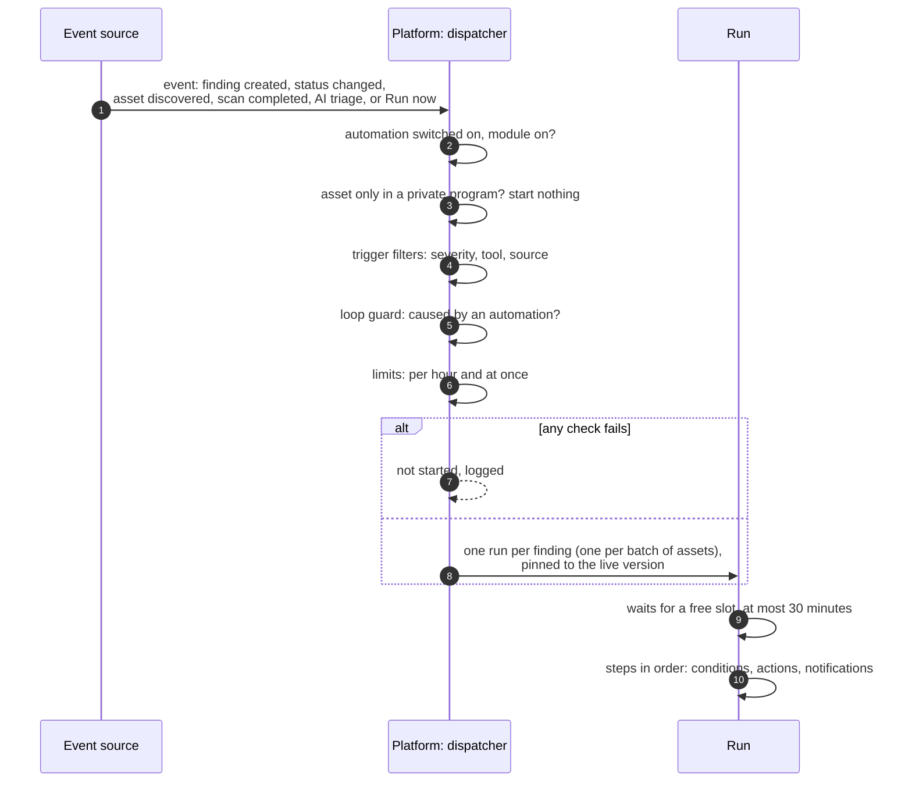
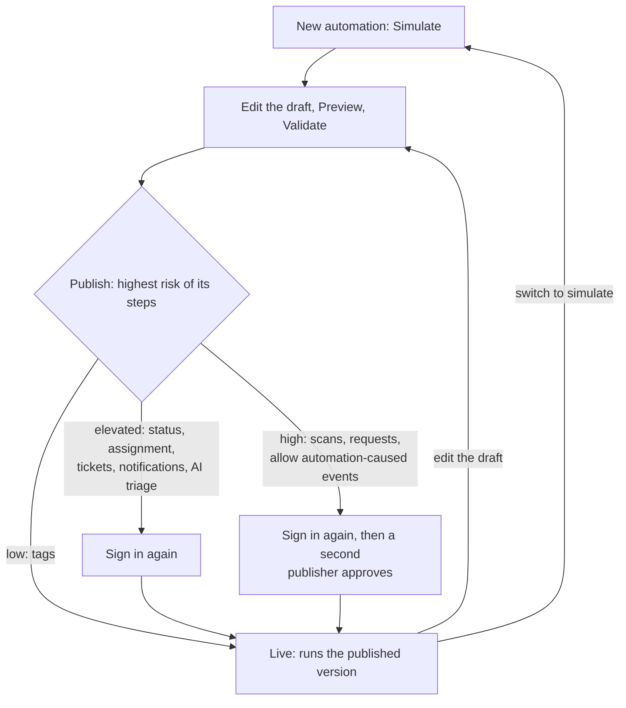

# Automation rules
{: .no_toc }

An automation is a rule: **when** something happens, **if** conditions hold,
**then** do something (assign, tag, open a ticket, start a scan, notify). A new
automation only simulates. Someone with the publish permission makes it live,
and from then on it acts as that person, within limits that stop a rule from
running away.

1. TOC
{:toc}

## The flow

### From an event to a run

1. **Triggers:** a finding is created, a finding's status changes, assets are
   discovered, a scan completes, AI triage completes or fails, or a person
   clicks run.
2. Events about an asset that only private programs list start nothing, so
   they cannot be forwarded outside the program.
3. **One run per finding.** 40 new critical findings start 40 runs of a
   "critical finding, open a ticket" rule; a batch of discovered assets
   starts one run. The same new finding never starts
   the same automation twice.
4. **Conditions** compare a value of the event (for example
   `trigger.finding.severity == critical`) and send the run down the yes or the no
   branch. A step whose branch is not taken is skipped.
5. **Steps act as the automation's owner**: the person who published it (or,
   for a manual run, the person who ran it). Each step needs that person's
   permission and the subject in their data scope; otherwise it is refused
   and recorded.

### Simulate, publish, live

1. A new automation is in **Simulate**: its steps record what they would do
   and never act, send or open anything.
2. **Preview** runs the draft against up to 100 recent subjects you may see;
   **Validate** lists what blocks publishing.
3. **Publish** stores the draft as a version and makes it **Live**. Publishing
   needs Publish Automations (`automations:publish`) and the permission of
   every step. The riskier the steps, the more it needs: signing in again,
   and for high risk a second person with the publish permission who approves
   that exact version.
4. A live automation runs its published version. Editing the draft changes
   nothing until it is published again; a run in progress keeps the version
   it started with.

### What stops a rule

| Guard | Limit |
|---|---|
| Runs of one automation | 200 per hour, 100 waiting or running |
| Runs of one organization | 5,000 per hour, 500 waiting or running |
| Running at once | 10 per organization, 50 in total; others wait up to 30 minutes |
| Changes in one live run | 250 by default (at most 1,000); then the run pauses until a publisher clicks **Continue** |
| One step | 30 seconds; a whole run 5 minutes |
| Status changes | only to confirmed or in progress; false positive and accepted risk become requests a person decides |
| An event an automation caused | never starts the same automation; starts another only if it allows that; nothing beyond 3 levels; once per finding in 10 minutes |
| A rule that keeps failing | switched off after its last 20 finished runs all failed |

- No automation closes a finding. A request it makes for a false positive or
  accepted risk always needs a person to approve it, whatever your approval
  settings.
- Two automations that undo each other stop after at most four levels.

## When something fails

| What happens | What you see | What to do |
|---|---|---|
| Too many runs in an hour | A failed run starting with "THROTTLED:" | Narrow the trigger filters |
| A step the owner may not run | Step refused: not authorized | Publish it again as someone with that permission |
| A step times out | "step timed out"; the steps after it are skipped, other branches go on | Check the integration the step calls |
| The run reaches its change cap | Run paused | **Continue** or **Cancel** after checking it |
| The platform restarts during a run | The run fails after an hour | Run it again if needed |
| The last 20 runs failed | The automation is switched off | Fix it and switch it on again |
| A step uses a removed type | The automation is off: "Removed type" | Replace the step |

## Security

- Automations, runs and their subjects belong to one organization. A run
  about a finding or asset outside your data scope, or a pentest finding of a
  campaign you are not in, is hidden from you.
- Simulate mode cannot act by construction: it only reads findings.
- Deliveries record the channel, target and status, never a message body,
  headers or a secret.
- View Automations (`automations:read`) shows rules and runs; Edit
  Automations (`automations:write`) edits drafts, previews, validates and runs
  by hand; Publish Automations (`automations:publish`) goes live, approves,
  rolls back, switches on or off, deletes and continues a paused run.
- Publishing, approvals, rollbacks and mode changes are in the audit log.

## Related

- [Automations](../../user-guide/08-mobilization.md#automations)
- [Simulate first, then go live](../../user-guide/08-mobilization.md#simulate-first-then-go-live)
- [Runs](../../user-guide/08-mobilization.md#runs)
- [Remediation groups, campaigns and tasks](remediation-work.md)
