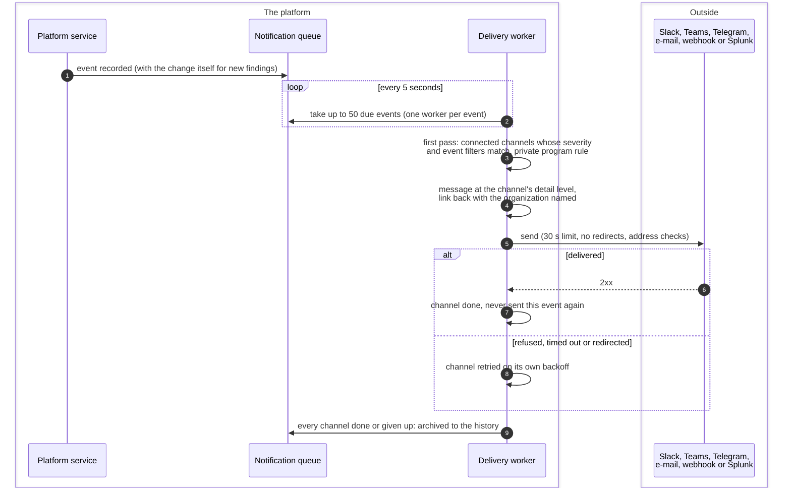
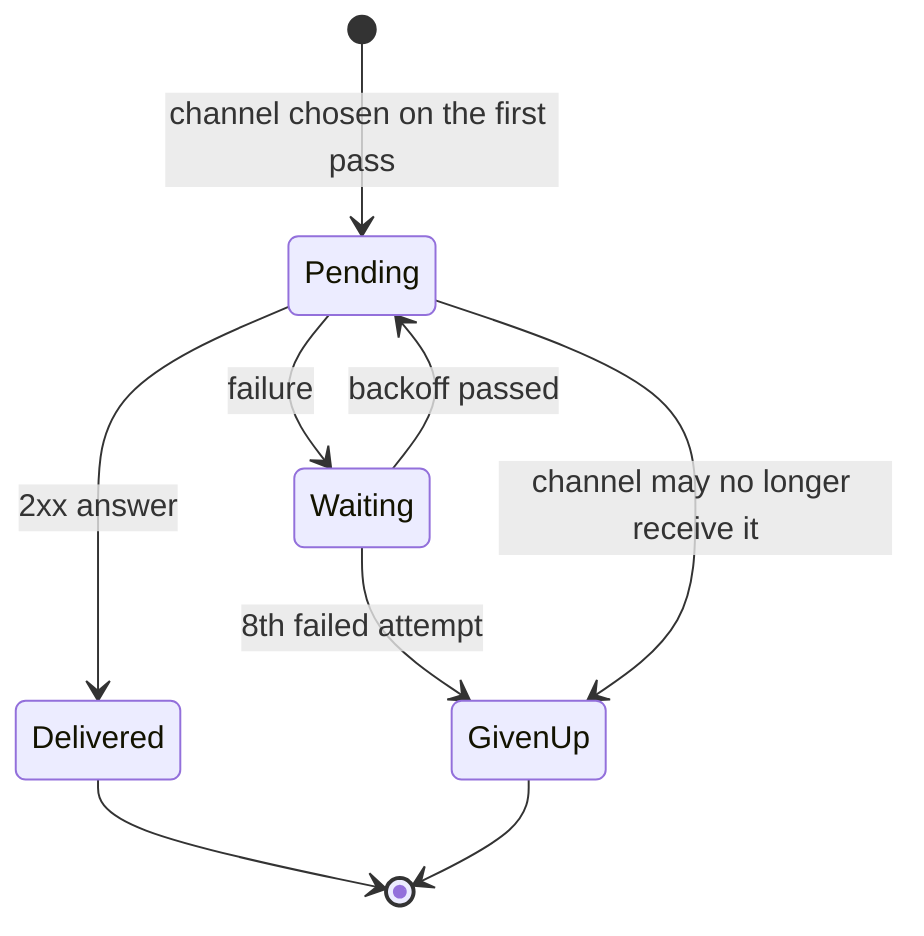
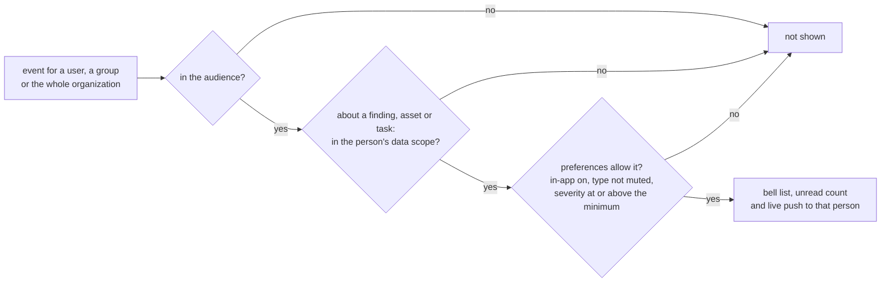

# Notification delivery
{: .no_toc }

When something happens in your organization (a new finding, an SLA breach,
an approval request, a sensor going offline), the platform records an event
and delivers it to every notification channel whose filters match. Each
channel is delivered and retried on its own. Separately, people get in-app
notices in the console, filtered by their own preferences and data scope.
Channel managers set this up; everyone else only sets their own
preferences.

1. TOC
{:toc}

## The flow

### From an event to the channels

1. **Recording.** The service that makes the change records the event in
   the notification queue. A new finding and its event are written in the
   same database transaction, so neither exists without the other. Other
   events are recorded right after their change.
2. **Pickup.** A worker takes up to 50 due events every 5 seconds. Each
   event is locked to one worker; an event locked for more than 10 minutes
   (a worker that stopped) is released for another worker.
3. **Which channels.** On the first pass the event's channels are fixed:
   the organization's connected channels whose **Severity Filters** and
   event types match. Approval, new asset and sensor events ignore the
   severity filter. An event about an asset that only private bug bounty
   programs list goes only to the channels of those programs, and private
   program names are removed for every other channel. A channel added later
   does not get the event.
4. **The message.** The channel's detail level decides what it gets:
   **Minimal** only the headline, severity, organization and a link back;
   **Standard** (the default) also the asset, what it is, why it matters
   and the next step; **Full** also the description
   ([Detail levels](../../configuration/notifications.md#detail-levels)). The channel's message
   template is applied after that, so it can only use what the channel may
   receive. Text from scanned systems is cleaned and each channel escapes
   its own markup.
5. **Sending.** Each channel is sent with a 30-second limit. Any 2xx answer
   is delivered. A non-2xx answer, a transport error or a redirect is a
   failure.
6. **Archive.** When every channel is delivered or given up, the event moves
   to the channel's history (**View events**), with one result and the
   number of attempts per channel.

### One channel's delivery

- **Backoff.** After each failure the channel waits 1 minute, 5 minutes,
  30 minutes, 2 hours, 6 hours, 12 hours, then 24 hours: 8 attempts in about
  45 hours. Other channels of the same event are not affected.
- **A channel that went away.** A channel deleted, disabled or disconnected
  since the event counts a failed attempt, so it still gets the event if it
  comes back in time. A channel the private program rule no longer allows
  is given up at once.
- **Sending again.** An event in the history can be sent again to one of its
  channels with the redelivery API; see
  [Outgoing webhooks](outgoing-webhooks.md#sending-an-event-again).

### In-app notices

- Each person sets **In-app notifications**, the **Minimum severity** and
  the **Notification types** under **My account > Notifications**. With no
  settings saved, everything is shown.
- The same rule decides the list, the unread count and the live push, so
  they never disagree. A notice about a finding or an asset reaches only
  people whose data scope covers it; a notice about a remediation task
  reaches only people who can read one of its findings.
- The live push goes only to the person's own connections, on a channel
  bound to that person and organization. Notices on one finding within 10
  minutes are folded into one.
- In-app notices are not e-mailed. The e-mail digest setting is stored but
  no digest is sent yet.

## When something fails

| What happens | What you see | What to do |
|---|---|---|
| The channel's endpoint is down or refuses | **View events** shows the failure and the attempts; the event is retried for about 45 hours | Fix the endpoint; send the event again from the API if it was given up |
| The endpoint answers with a redirect | A failure, never followed | Use the final URL in the channel |
| The channel's address is private or internal | Refused when saved and on every send | Use a public address, or ask the operator to allow it |
| An e-mail channel breaks the hosted service mail rules | The channel stops with `INTEGRATION_EMAIL_RELAY_POLICY`; owners are told | Edit the channel to an allowed relay and test it |
| Stored credentials cannot be decrypted | Each attempt fails | Enter the credentials again |
| The platform cannot read the channels or the private program rule | The event waits and is retried a few times | Check the database; then retry it from **Queue** |
| No channel matches | The event is archived as skipped | Check the channel filters |

## Security

- **Credentials.** Bot tokens, SMTP passwords and HEC tokens are stored
  encrypted with the install's encryption key and used only for the send.
  Moving an e-mail or Splunk channel to another host needs new credentials.
- **Outbound address checks.** Every channel URL is checked when it is
  saved and on every connection: loopback, private, link-local and cloud
  metadata addresses are refused, also after a DNS change. Redirects are
  never followed.
- **Bounded by the detail level.** A channel sends no description below
  **Full** and no asset or finding facts at **Minimal**; secrets, evidence
  and internal IDs never leave at any level.
- **Organization isolation.** An event is delivered only to its own
  organization's channels. The queue, the history and redelivery need the
  Manage integrations permission (`integrations:manage`), because the queue
  holds events for the whole organization without data scope.
- **Links.** Every link names its organization, so a person who belongs to
  several lands in the right one. The link grants nothing: the page still
  checks the person's access.

## Related

- [Notification channels (operator)](../../configuration/notifications.md)
- [Notification channels (settings)](../../user-guide/10-settings-and-integrations.md#notification-channels)
- [Outbound notification API](../../api/webhooks.md#outbound-notification-channels)
- [Outgoing webhooks](outgoing-webhooks.md)
