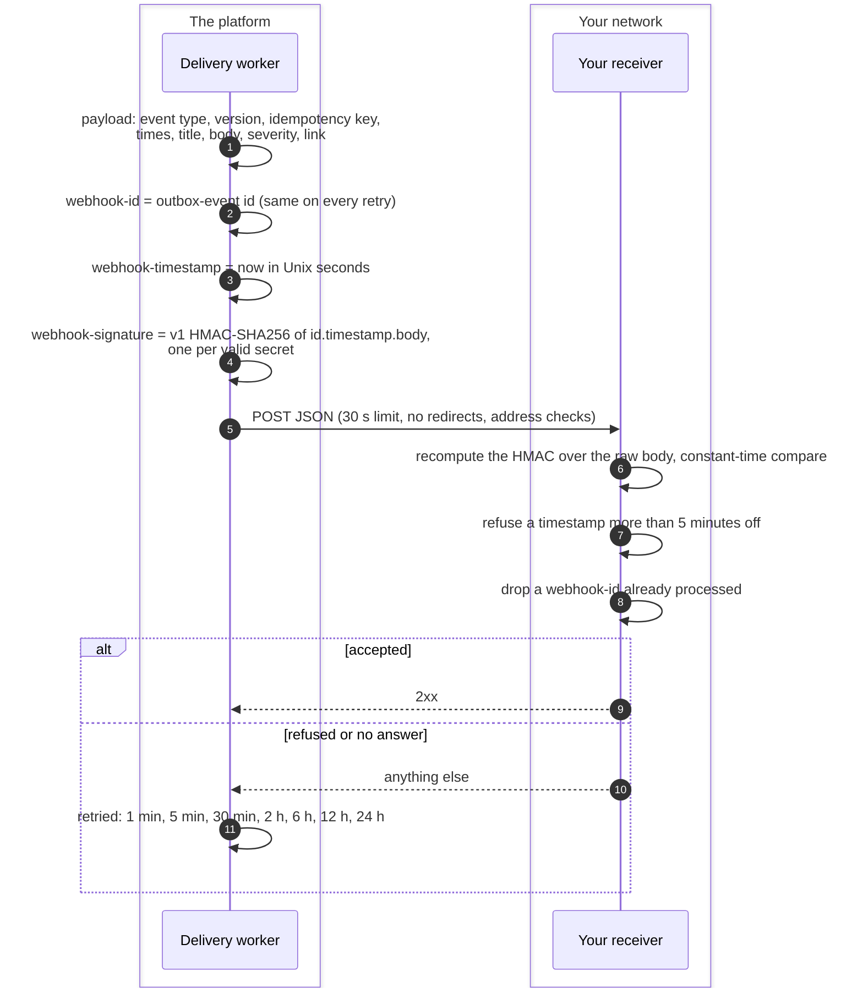
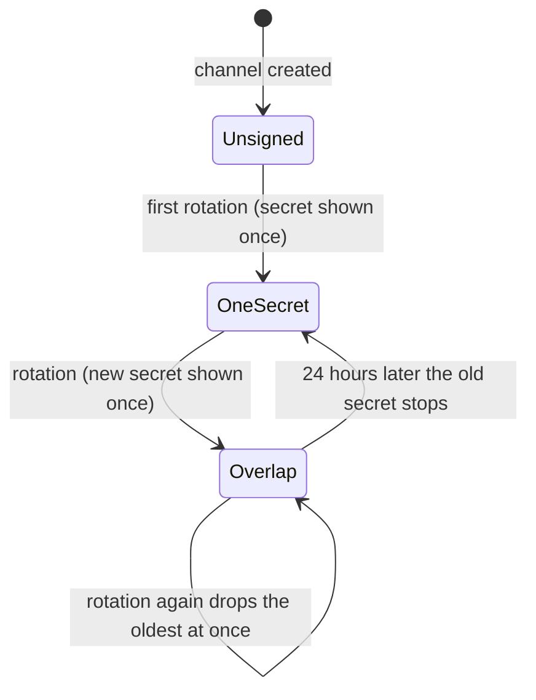
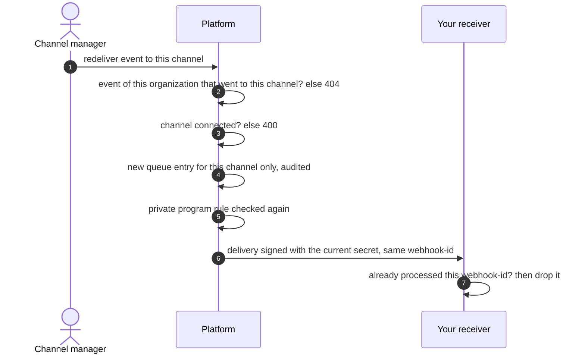

# Outgoing webhooks
{: .no_toc }

A webhook channel sends your organization's events as JSON to an HTTPS
endpoint you run. Each delivery is signed, so your receiver can prove it came
from the platform and was not changed or replayed. Channel managers create
the channel in the console; the signing secret and redelivery are managed
through the API today.

1. TOC
{:toc}

## The flow

### A signed delivery

1. **The event.** A webhook channel receives the events its filters match,
   like any channel; see [Notification delivery](notifications.md). The
   channel's detail level decides the content; the payload also carries a
   `notification` object (schema `openctem.notification/v1`) with the same
   content as the chat message.
2. **Headers.** Each delivery carries `webhook-id`, `webhook-timestamp` and,
   once the channel has a secret, `webhook-signature` in the Standard
   Webhooks format. `Idempotency-Key` and the payload's `idempotency_key`
   equal `webhook-id`.
3. **The signature.** `v1,` and the base64 HMAC-SHA256, keyed with the
   secret after `whsec_` (base64-decoded), over the id, a dot, the
   timestamp, a dot and the raw body.
4. **The answer.** Any 2xx is delivered. Anything else, a transport error,
   no answer within 30 seconds, or a redirect is a failure and is retried
   on the channel's backoff. Only the first 1 MiB of an answer is read.
5. **Giving up.** After the eighth failed attempt (about 45 hours) the
   event is given up for that channel and shows as failed in
   **View events**. The channel stays enabled: it is never turned off
   because deliveries fail.

### The signing secret

- `POST /api/v1/integrations/{id}/signing-secret/rotate` creates or rotates
  the secret. It needs the Manage integrations permission
  (`integrations:manage`) and a recent sign-in, is audited, and answers the
  new secret once. It is stored encrypted and never returned again:
  `GET /api/v1/integrations/{id}/signing-secret` says only whether one is
  set and when it was rotated.
- For 24 hours after a rotation, deliveries carry two signatures, one per
  secret, so the receiver can switch without losing an event. At most two
  secrets ever sign.
- A channel without a secret sends unsigned deliveries, still with
  `webhook-id` and `webhook-timestamp`. Create the secret, then turn
  verification on in the receiver.
- **Send test** in the console is signed the same way, so you can try the
  receiver before real events flow.

### Sending an event again

- `POST /api/v1/integrations/{id}/deliveries/{delivery_id}/redeliver`, where
  `delivery_id` is the event's id in the channel's history. It needs the
  Manage integrations permission and is limited to 30 a minute per
  organization.
- The redelivery is retried and archived like any delivery, and keeps the
  original `webhook-id`, so a receiver that already processed the event
  recognizes it.

## When something fails

| What happens | What you see | What to do |
|---|---|---|
| The receiver rejects the signature | Failures in **View events** | Check the key is the secret without `whsec_`, base64-decoded, and the HMAC covers the raw body as received |
| The receiver's clock is off | Valid deliveries refused as too old | Set the receiver's clock right: each attempt carries a fresh timestamp |
| The receiver was down for longer than the retries | The event shows as failed | Send it again with the redelivery API |
| The stored secret cannot be decrypted | Each attempt fails; nothing is sent unsigned | Rotate the secret |
| The URL is private, internal or redirects | Refused when saved, or a failed attempt | Use the public final URL |
| A redelivery names another channel's or organization's event | 404 | Use an event from this channel's history |

## Security

- **Integrity and origin.** Only a holder of the secret can produce a valid
  signature, and the signature covers the id and timestamp, so a captured
  delivery cannot be changed or replayed beyond your 5-minute window and
  your record of ids.
- **The secret.** `whsec_` and 32 random bytes, generated by the platform,
  never chosen by a caller and never set through the channel's settings.
  It is stored encrypted with the install's encryption key and never read
  back. A secret that does not decrypt fails the delivery instead of
  sending it unsigned.
- **Outbound address checks.** The URL is checked when saved and on every
  connection: loopback, private, link-local and cloud metadata addresses
  are refused, also after a DNS change, and redirects are never followed.
- **Organization isolation.** A channel receives only its own
  organization's events, and redelivery finds an event only in the caller's
  organization and only for a channel it went to.

## Related

- [Verifying generic webhooks](../../api/webhooks.md#verifying-generic-webhooks)
- [Generic webhook payload](../../api/webhooks.md#generic-webhook-payload)
- [Webhook payload settings](../../configuration/notifications.md#webhook-payload)
- [Notification delivery](notifications.md)
- [Step-up sign-in](../identity/step-up.md)
